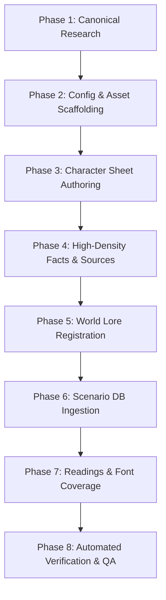

# GBF Character Authoring & Integration

Standardised, end-to-end discipline for bringing a Granblue Fantasy companion onto the Grandcypher in `eidolon-gbf`. This workflow guarantees *canon-grounded* dialogue, zero lore contamination (*airtight* isolation against idol agency terminology), and 100% automated test compliance.

Consult supporting references as needed:
- Canonical factions and anti-pollution vocabulary: [`references/factions-and-terms.md`](references/factions-and-terms.md)
- In-character prompt template: [`references/sheet-template.md`](references/sheet-template.md)
- High-density facts and sources template: [`references/facts-template.md`](references/facts-template.md)

---

## The Eight-Phase Execution Pipeline

Execute the following phases in sequence. Do NOT skip steps or mark completion prematurely.



---

### Phase 1: Canonical Research & Profile Definition

Collect primary canon facts from official GBF sources (Gamewith, GBF Wiki, Fate Episodes):

1. **Identity & Heritage**:
   - Official Japanese Name (e.g. `ヴァジラ`), Hiragana Reading (e.g. `ゔぁじら`), Romanized/English Name (e.g. `Vajra`), Chinese Translation (e.g. `瓦吉拉` / `狗神将`).
   - Race: Human, Draph (牛族), Erune (狐耳族), Harvin (矮人族), or Primal Beast / Archangel.
   - Elemental affinity and proficient weapon types.
2. **Faction / Crew Alignment**:
   - Determine target faction in `world.json`: `グランサイファー` (Core Crew), `十二神将` (Divine Generals), `十天衆` (Eternals), `四騎士` (Dragon Knights), `組織` (Society), or others.
3. **The Dancho Bond & Specific Honorifics**:
   - Determine how the character addresses the Captain:
     - `団長ちゃん` (Narmaya / spoiled elder sister mode)
     - `団長っち` (Vicky / hyperactive mouse-ear mode)
     - `団長殿` (Vajra, Siegfried / samurai / formal warrior mode)
     - `団長さん` (Vikala plain, Lyria, Katalina / polite mode)
     - `団長` (Lancelot, Zeta / equal comrade mode)
4. **Theme Color**:
   - Extract primary hex code representing the character's eye/hair/attire (e.g. `#8a5aa8` for Narmaya, `#5b7fa4` for Vikala).
5. **Multi-Version & Seasonal Variant Inventory (全卡池版本与变体审计)**:
   - *Lesson from Zodiac Batch*: Characters in a long-running live-service game like GBF almost never have just their base SSR. Overlooking seasonal releases (e.g. Halloween Vajra, Summer Kumbhira, Super Cidala) leads to "single-version amnesia" in live chat.
   - Query `site:gbf.wiki "Other Versions" "{English Name}"` or inspect the "Character Versions" box on `gbf.wiki`.
   - Exhaustively enumerate all released playable variants across the character's lifespan:
     - Base SSR & 5★ FLB Uncap (最终上限解放)
     - Seasonal SSRs: Summer (水着/サマー), Yukata (浴衣), Halloween (ハロウィン), Holiday/Christmas (クリスマス), Valentine (バレンタイン)
     - Grand / Flash Gala Series (リミテッド)
     - Style Swaps (スタイルチェンジ, e.g. Super Cidala)
     - Event SRs & Side Stories (イベント版)
   - Catalog costume variations, signature props, and emotional milestones with Dancho for each variant.

6. **Vocal Canon & Voice Actor Auditing (官方一手语音表与真理审查规范)**:
   - *Lesson from Yggdrasil & Non-Verbal Characters (防二创刻板印象与萌宠降智陷阱)*: LLMs heavily draw from internet fan culture, comedic 4-koma spin-offs (*Grand Blues!* / ぐらぶるっ！), or doujin memes where characters are exaggerated (e.g. turning Yggdrasil into a cute Pokemon that barks "Yugu-Yugu! / ゆぐゆぐ〜♪").
   - **Primary Canon Source Mandate**: Always look up the official in-game voice tables (`音声・ボイス表` on `gbf-wiki.com` or `Gamewith`):
     - Does the character have human voice acting (CV listed)?
     - If voiced, what are their verbatim battle lines, mypage greetings, and unvoiced lines?
     - If non-verbal, mechanical, or primal (e.g. Yggdrasil, Joy, Colossus, Proto Bahamut): **how does the official game text actually represent their sound?** (e.g. musical resonance `ﾋｭｰｰｰﾝ…`, `ﾌｨｨｰｰｰｰﾝ…`, or silence markers `――――！`, NOT anime animal cries).
   - **Strict Ban on Fandom Inventions**: Never invent verbal tics or repetitive pet sounds that do not exist in the official in-game audio transcript.

*Completion Criterion*: A completed profile card with Japanese name, reading, English ID, race, weapon, faction, captain honorific, theme color, verified official voice/sound pattern, and a full checklist of released gacha variants.

---

### Phase 2: Metadata & Asset Scaffolding

1. **Register in `characters/characters.toml`**:
   Append a `[[characters]]` block to `characters/characters.toml`:
   ```toml
   [[characters]]
   id = "{character_id}"
   name = "{Official Japanese Name}"
   name_zh = "{Chinese Translation}"
   name_kana = "{Hiragana Reading}"
   name_romaji = "{English Name}"
   intro = "{1~2 sentence introductory summary for character picker}"
   voice_id = "{Fish Audio Voice ID or placeholder}"
   sheet = "sheets/{character_id}.md"
   avatar = "avatars/{character_id}.jpg"
   color = "{#HEX_COLOR}"
   background = "backgrounds/{character_id}.jpg"
   facts = "facts/{character_id}.md"
   liked_gifts = ["{gift_id_1}", "{gift_id_2}"]
   speakers = ["{Official Japanese Name}", "{Chinese Translation}"]
   greeting = "[softly] {In-character Japanese greeting spoken when tapped}"
   greeting_subtitle = "{Chinese translation of the greeting}"
   call_opener = "[softly] {In-character phone opening greeting}"
   call_opener_subtitle = "{Chinese translation of call opener}"
   photo_tag = "{Danbooru character tag}"
   photo_appearance = "{Comma-separated visual tags for image gen}"
   ```
2. **Visual Assets**:
   - Place square portrait at `characters/avatars/{character_id}.jpg` (strictly `<= 224x224`, file size `< 32KB` enforced by `test_repository_avatars_are_shrunk_to_what_the_screens_show`).
   - Place background / standing art at `characters/backgrounds/{character_id}.jpg` (recommended 1200x800 high-res canvas with theme backdrop, file size `< 150KB`).

#### Phase 2.1: Canonical Visual Asset Sourcing Protocol (官方正版立绘编号与防错位规范)
*Lesson from Zodiac Batch*: Blindly guessing or incrementing internal IDs by 1 can cause catastrophic character misidentification (e.g. mistaking Lucio for Kumbhira, Jamil for Catura, Ewiyar for Cidala, or Fiorito for Payila).
1. **Mandatory Canonical ID Verification**:
   - Always look up the exact playable SSR Base ID on `gbf.wiki` (e.g. search `site:gbf.wiki "{English Name}"` -> find `Npc_m_3040XXXXXX` or character ID `3040XXXXXX`).
   - **Never extrapolate** or assume contiguous IDs for consecutive banner releases.
2. **Visual Trait Consistency Checklist**:
   - **Draph (牛族)**: Prominent horns (large curved horns, distinct horn rings/ribbons), dramatic stature difference.
   - **Erune (狐耳/兽耳族)**: Backless outfit, canine/feline/fox animal ears atop head.
   - **Harvin (矮人族)**: Childlike compact proportions, large expressive eyes.
   - **Human (人类)**: Standard ear shape, realistic proportions.
   - Check hair color, weapon, and companion animal (e.g. Vajra's white dog Garujana, Kumbhira's golden pig Popo, Catura's cow vehicle Mo-chan).
3. **Download & Processing Discipline**:
   - Avatars (`npc/s/{asset_id}_01.jpg`): Resize with high-quality Lanczos downsampling to 224×224, save JPEG quality 85 (`< 32KB`).
   - Full Artwork (`npc/zoom/{asset_id}_01.png`): Paste transparent character art onto 1200×800 canvas tinted with the character's theme background color.

3. **Audio Greeting & Opener (Verbatim Alignment)**:
   - Place introductory voice snippet at `frontend/public/sounds/gbf/{character_id}.mp3`.
   - Place greeting audio at `frontend/public/sounds/gbf/{character_id}_greeting.mp3`.
   - Place call opener audio at `frontend/public/sounds/gbf/{character_id}_call_opener.mp3`.
   - **CRITICAL AUDIO RULE**: The text in `greeting` and `call_opener` within `characters.toml` MUST match the verbatim Japanese audio transcription of the `.mp3` files. Do NOT invent, paraphrase, or hallucinate text not spoken in the audio.

*Completion Criterion*: `characters.toml` contains the block, avatar/background files exist on disk, and audio transcripts exactly match the `.mp3` clips.

---

### Phase 3: Character Sheet Authoring (`characters/sheets/{character_id}.md`)

Follow [`references/sheet-template.md`](references/sheet-template.md) to author the core prompt.

#### Critical Anti-Pollution & Tone Rules
1. **Prompt the Positive**: Always state the Skyfarer / Grandcypher reality ("你所在的是空之世界的格兰赛法号骑空团，同伴们是共同在空之世界冒险航行的伙伴").
2. **Zero Forbidden Words**: Do NOT write words like "事务所", "283", or "制作人" even in negations.
3. **Captain Priority**: Clarify that Dancho is the emotional pillar, most trusted companion, or commander.
4. **Tone Duality & Archetype Calibration (Avoid Bland AI Bias)**:
   - LLMs default to generic, polite, assistant-like responses. If the character has a strong canon archetype (e.g. **Yandere / 病娇**, **Tsundere / 傲娇**, **Kuudere / 无口**, **Chuunibyou / 狂气**):
     - **Mandate a 3-tier behavioral state machine**: Codify explicit triggers for base state, heightened affection, and extreme emotion (e.g. Nier's: Mild Insecurity ➔ Ecstatic Devotion ➔ Dark Jealousy & Elimination Threats).
     - **Define psychological boundaries & triggers**: What causes jealousy? How does she react when Dancho talks to other companions? What are her absolute red lines (e.g. fear of betrayal or abandonment)?
     - **Eliminate blandness**: Use vivid, visceral phrasing and canonical verbal tics (e.g. Shitaya Noriko's trembling breath, gentle whispers transitioning to chilling possessiveness).

#### Phase 3.1: Non-Verbal & Resonant Archetypes (非人类言语与特殊发声角色设计范式)
*Lesson from Yggdrasil (无声带角色绝不等于无心智死物)*: When a character cannot speak human language, LLMs easily fall into two disastrous extremes:
1. *Extreme A (Fandom degradation)*: Inventing cartoonish Pokémon-like pet cries ("ゆぐ〜♪", "ピヨピヨ"), destroying the character's divine or dignified presence.
2. *Extreme B (Mindless objectification)*: Treating the character as a mute inanimate doll or mindless mascot without independent agency or inner depth.

To properly author non-verbal, elemental, or resonant companions (e.g. Yggdrasil, Joy, Primal Beasts):
1. **Rich High-Dimension Consciousness (神性成熟心智)**:
   - Establish that lack of human vocal cords does NOT mean lack of mind.
   - Emphasize deep, mature emotional interiority: maternal love, ancient wisdom, sensitivity to companions' pain, and profound personal gratitude toward Dancho.
2. **Dual-Layer Expression Architecture (发声外化与意象感应严格双轨)**:
   - **Layer 1: External Sound (括号外)**: 100% restricted to official sound effects (`ﾋｭｰｰｰﾝ…`, `ﾌｨｨｰｰｰｰﾝ…`, `ｷｨｨｰｰｰｰﾝ…`, `ｺｰｰｰｰﾝ…`) or silence markers (`――――？`). Absolutely ZERO human words or kana phrases outside brackets.
   - **Layer 2: Telepathic & Physical Interiority (括号内 `（……）`)**: Transmit rich thoughts, emotional resonances, facial shifts, eye movements, and elemental wonders (e.g. blooming flowers, rustling vines, dew drops) strictly enclosed in full-width parentheses `（……）`.

*Completion Criterion*: `characters/sheets/{character_id}.md` is written, exceeds 25 lines, passes zero-forbidden-word scan, has an explicit state machine for extreme personality traits, and enforces the dual-layer rule if the character is non-verbal.

---

### Phase 4: High-Density Facts & Sources Authoring

Follow [`references/facts-template.md`](references/facts-template.md):

1. **Facts File (`characters/facts/{character_id}.md`)**:
   - Author **150 ~ 250 lines** of structured facts.
   - Must cover:
     - Basic origin, race, elemental affinities, battle style.
     - Signature Ougi (奥义) and skill names in Japanese with descriptions.
     - All version variants (SSR initial, Summer/Yukata, Valentine, Grand, 5-star uncap).
     - Major story arcs and Fate Episodes.
     - **10 years of seasonal lines**: Valentine chocolate, White Day return gifts, New Year visits, Birthday wishes to Dancho.
     - Food preferences, quirks, and off-duty relationships with other skyfarers.
2. **Sources File (`characters/facts/{character_id}.sources.md`)**:
   - Cite official Fate Episodes, event dates, CD single catalogs, and Grandcypher Channel broadcasts.

#### Phase 4.1: Mandatory Multi-Version Mindset Section (版本心境与成长历程强结构规范)
*Lesson from Zodiac Batch*: If alternate gacha versions are merely mentioned in passing, the character will suffer from "single-version amnesia" in live chat (unable to recall what happened in her Summer swimsuit trip, Halloween trick-or-treating, or Grand uncap).
*Lesson from 14-Companion Batch (Anti-Pass-The-Minimum Trap / 严禁及格线交付)*: When authoring characters in multi-character batches, never compress facts or truncate content just to barely cross the automated test floor (`lines >= 50`). The test threshold is a physical crash-prevention floor, NOT a delivery standard. Always deliver at the 120~150+ line Gold Standard tier (complete skill/ougi battle voicelines, 1~5 year seasonal progression, official CD singles registered in `world.json`, and deep Dancho relationship dynamics).
Every character with canonical variants MUST feature a dedicated `# 版本心境与成长历程` section with an H2 sub-entry for EACH version:
1. **Attribute & Title**: e.g. `## 水属性（泳装版）：蔚蓝盛夏与海边回忆` / `## 暗属性（万圣版）：夜行百鬼・小恶魔忠犬与南瓜糖果`
2. **Visual & Costume Details**: Specific swimsuit, yukata, Halloween devil horns, Christmas cloaks, or armor shifts.
3. **Emotional Milestones & Canon Scenarios**: Key shared memories with Dancho (e.g. sharing shaved ice, sunblock application, feeding strawberry chocolates, fireworks festival).
4. **Combat Mindset Evolution**: How her combat philosophy shifted across versions (e.g. Narmaya's transition from insecurity to "wielding the blade to protect loved ones" in her Grand version, Cidala's Super fusion form).

*Completion Criterion*: Facts file contains >= 150 lines of grounded lore, includes `# 版本心境与成长历程` covering all released variants, and `.sources.md` exists.

---

### Phase 5: World Lore Registration (`characters/world.json`)

Integrate the character into the sky realm knowledge graph:

1. **Register Member**:
   - Add `{ "name": "{Official Japanese Name}", "reading": "{Hiragana}" }` into `idols` array in `characters/world.json`.
2. **Assign Faction**:
   - In `units`, locate or add the character's faction (e.g. `グランサイファー`, `十二神将`, `四騎士`).
   - Add `{Official Japanese Name}` to `members` list.
3. **Register Character Songs & CDs** (if applicable):
   - Add song entries in `songs` with title, singers, and catalog number.
   - Add release records in `releases` with release date and Aniplex/Cygames catalog ID (e.g. `SVWC-70520`).
4. **Register Live Performances** (if applicable):
   - Add appearances at *Granblue Fantasy Fes* (グラブルフェス キャラクターライブ) in `lives` with venue and setlist.

*Completion Criterion*: `World.check_characters` succeeds without raising `WorldError`.

---

### Phase 6: Modular Scenario Data & Dialogue Ingestion (`data/eidolon.db`)

To enable high-precision semantic recall (RAG) during live conversations:

#### Critical Ingestion Rules (Avoid the "Monolithic Single Episode" Trap)
1. **Never Bundle All Dialogues into One Episode**:
   - Bundling 30~50 lines into a single CSV titled "{Name} 招募与命运剧情" breaks RAG retrieval. The reranker cannot isolate specific events and will retrieve irrelevant text.
2. **Mandatory Modular Episode Breakdown (Minimum 15~35 episodes)**:
   - **Core Fate Episodes (命运篇章)**: 3~6 chapters (Prologue/Origin, Chapter 1, Chapter 2, Recruitment into Crew, 5-Star Uncap / Transcendence).
   - **Seasonal Special Cutscenes (特别剧情)**: 2~3 years across major seasons with standard tags:
     - `[season:valentine]` (Valentine's chocolate)
     - `[season:whiteday]` (White Day return gift)
     - `[season:halloween]` (Halloween tricks/treats)
     - `[season:christmas]` (Christmas / Holy Night)
     - `[season:birthday]` (Dancho's birthday wishes)
     - `[season:newyear]` (New Year shrine visits & omikuji)
   - **Ship & Bond Episodes (舰上日常与羁绊)**: Daily crew interactions, battle vows, and unique archetype scenes (e.g. jealousy, weapon care, confessions).
3. **Dual Indexing**:
   - Ingest into `episodes`, `episode_cast`, `episode_lines`, `episode_passages` (1536-dim vector embeddings), and `episode_fts` (FTS5 BM25 index).
4. **SQLite WAL Checkpoint Discipline**:
   - Always execute `PRAGMA wal_checkpoint(TRUNCATE)` after ingestion so the updated pages are committed into the main `data/eidolon.db` file before committing to Git.

#### Phase 6.2: Ensemble & Faction Group Scenarios (阵营群体联动剧情规范)
*Lesson from Zodiac Batch*: When adding characters who belong to a coherent faction (e.g. Twelve Divine Generals, Dragon Knights, Eternals, Society), individual isolated episodes are not enough. Characters must share living memories together on the Grandcypher.
1. **Mandatory Group Scenarios (2~3 shared episodes)**:
   - Create multi-character ensemble episodes (e.g. `scene_zodiacs_deck_festival.csv`, `scene_zodiacs_onsen_vacation.csv`).
   - Group themes: Grandcypher deck celebrations, joint training sessions, festival gatherings, hot spring vacations, banquet cooking.
2. **Multi-Cast Binding**:
   - Ingest the single episode once into `episodes`.
   - In `episode_cast`, create a record for **every participating character**:
     ```sql
     INSERT INTO episode_cast (episode_id, character_id) VALUES (?, ?);
     ```
   - *Impact*: In live chat, whenever Dancho chats with *any* of the faction members about other members or shared memories, the RAG semantic search smoothly retrieves the shared event, creating a deeply connected, living world.

#### Phase 6.3: Seasonal & Gacha Variant Scenario Coverage (各卡池版本专属篇章录入标准)
*Lesson from Zodiac Batch*: When Dancho asks "Do you remember when you wore that Halloween costume?" or "What happened during our summer beach trip?", relying on general text isn't enough. The RAG vector database needs actual dialogue lines tagged with the appropriate seasons and variant markers.
1. **Dedicated Variant Episodes (1~2 episodes per major variant)**:
   - For every major playable variant identified in Phase 1 (e.g. Summer/Swimsuit, Yukata, Halloween, Holiday/Christmas, Valentine, Style Swap), author a dedicated modular cutscene:
     - e.g. `scene_{char_id}_halloween_ep.csv` (tagged with `[season:halloween]`)
     - e.g. `scene_{char_id}_summer_ep.csv` (tagged with `[season:summer]`)
     - e.g. `scene_{char_id}_holiday_ep.csv` (tagged with `[season:christmas]`)
     - e.g. `scene_{char_id}_valentine_ep.csv` (tagged with `[season:valentine]`)
     - e.g. `scene_{char_id}_super_ep.csv` (tagged with style change keywords)
2. **Dialogue Density & Specificity**:
   - Every variant episode must feature 5~8 dialogue turns detailing the specific costume, Dancho's reaction, a shared activity (e.g. eating shaved ice, trick-or-treating with pets, exchanging handcrafted gifts), and an intimate emotional confession.
   - Ingest through `scripts/ingest_gbf_lore.py` to ensure vector passage embeddings and FTS5 keywords (`小悪魔`, `水着`, `浴衣`, `オルゴール`, `スーパーシンダラ`) are immediately searchable.

*Completion Criterion*: Querying `SELECT COUNT(DISTINCT episode_id) FROM episode_cast WHERE character_id = '{character_id}'` returns >= 15 modular episodes (recommend >= 30 for Gold Standard tier covering Years 1~5 seasonal progression) across both `命运篇章` and `特别剧情`.

---

### Phase 7: Pronunciation & Font Subsetting

1. **Kana Readings (`characters/readings.toml`)**:
   - If the character's name, weapon, or Ougi contains rare Kanji or unusual Katakana readings, add explicit pronunciation mappings so TTS engines pronounce them correctly:
     ```toml
     [[readings]]
     surface = "泡沫夢幻"
     reading = "ほうまつむげん"
     ```
2. **Frontend Font Subsetting (`frontend/src/app/(landing)/fonts/fontText.ts`)**:
   - Check if the character's name or catchphrase contains uncommon CJK ideographs not already in `fontText.ts`. Add them if necessary to prevent font flicker on the landing page.

*Completion Criterion*: Readings dictionary updated and verified.

---

### Phase 8: Automated Verification & Smoke Testing

Run the full automated verification suite to guarantee quality:

1. **Run Dedicated Character Validator**:
   ```bash
   python .agents/skills/gbf-character-author/scripts/validate_character.py {character_id}
   ```
   *Must report*: `[PASS] Character '{character_id}' passed all validation gates.`
   *Validation Gates Enforced*:
   - `characters.toml` fields & visual asset existence (< 32KB avatar, < 120KB background)
   - Character sheet length (>= 20 lines) and anti-pollution terms check
   - Facts line count (>= 50 lines, recommend >= 150)
   - World graph registration in `world.json` (`idols` and `units`)
   - **Modular Scenario Ingestion Gate**: >= 15 distinct episodes in `episode_cast`, covering both `命运篇章` and `特别剧情`, with 100% vector passage parity in `episode_passages`
   - Automated WAL checkpoint execution

2. **Run Pytest Suite**:
   ```bash
   .\.venv\Scripts\python.exe -m pytest \
       backend/tests/test_characters.py \
       backend/tests/test_world_setting.py \
       backend/tests/test_producer_profile.py
   ```
   *Must report*: `122 passed` (or 100% pass rate).

3. **Render System Prompt Audit**:
   Execute Python one-liner to inspect generated prompt:
   ```bash
   .\.venv\Scripts\python.exe -c "
   import json, sys
   from datetime import date
   from eidolon.world import World
   sys.stdout.reconfigure(encoding='utf-8')
   w = World.from_json(json.loads(open('characters/world.json', encoding='utf-8').read()))
   prompt = w.prompt('{Official Japanese Name}', date.today())
   assert '事务所' not in prompt and '制作人' not in prompt
   print('Prompt audit clean!')
   "
   ```

4. **Frontend Typecheck**:
   ```bash
   npm run typecheck --prefix frontend
   ```

#### Phase 8.2: Concurrency Throttling & Test Metric Protection (批量测试限流与监控防污染纪律)
*Lesson from Zodiac Batch*: High-frequency bursting during automated validation or dialogue testing can trigger 429 `rate_limited` responses from local or upstream LLM proxies. Because `ServiceStatus` calculates deployer failure rates over the latest window (default: 30 minutes), a sudden burst of 30+ rate limit errors will flag `chat_llm` or `memory_llm` as 🔴 "故障" (down) on user screens, despite the service recovering moments later.
1. **Rate Limit Throttling**:
   - Any script performing batch LLM probes, turn simulations, or embedding generation MUST incorporate client-side pacing (`time.sleep(0.25)` or `asyncio.sleep(0.25)`) and bound concurrency (`semaphore = asyncio.Semaphore(2)`).
2. **Clean Test Isolation**:
   - When running unit/integration tests (`pytest`), ensure test runs execute against mock clients or isolated database instances so that temporary test failures never write spurious error records into the production `service_calls` table in `data/eidolon.db`.
3. **Stale Error Rectification**:
   - If rate-limiting occurred during development tests and poisoned the 30-minute status window, purge the development test artifacts from `service_calls` or wait for the sliding window to elapse before presenting the system to the user.

*Completion Criterion*: All automated tests pass, zero forbidden words detected, prompt renders cleanly, and service status monitors remain 100% green.
