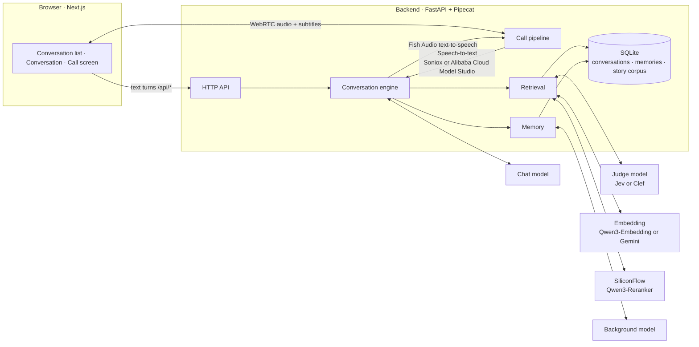
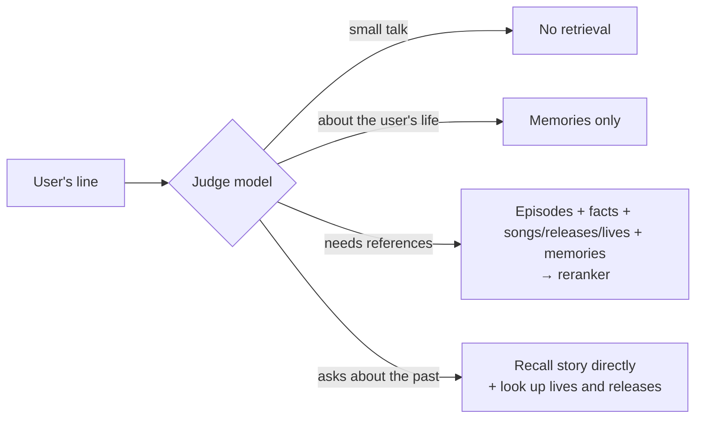

<div align="center">

# Eidolon-SC

**Real-time AI companions of the idols from *THE iDOLM@STER SHINY COLORS***

Voice · Text · Story recall · Memory shared across characters

[简体中文](README.md) · **English** · [日本語](README.ja.md)

[](backend/pyproject.toml)
[](https://fastapi.tiangolo.com/)
[](https://github.com/pipecat-ai/pipecat)
[](frontend/package.json)
[](frontend/package.json)
[](frontend/tsconfig.json)
[](backend/src/eidolon/store.py)
[](docker-compose.yml)
[](LICENSE)
[](docs/adr/0006-open-to-the-public-with-oauth.md)

</div>

---

Eidolon-SC lets you, as **a producer at 283 Production**, text or voice-call the idols from the game. Characters answer in their own Japanese voice with Chinese subtitles, recall the story episodes they actually lived through, and remember what you tell them — which then gets around among the other idols.

The idols you can talk to today are **Sakuragi Mano**, **Kazano Hiori** and **Hachimiya Meguru** of illumination STARS, and **Tsukioka Kogane** of L'Antica; characters are configured in [`characters/characters.toml`](characters/characters.toml), and more can be added.

Deployed publicly, anyone can sign in with Google or GitHub and use it ([ADR-0006](docs/adr/0006-open-to-the-public-with-oauth.md)). The glossary lives in [`GLOSSARY.md`](GLOSSARY.md), design decisions in [`docs/adr/`](docs/adr/), and the visual design system in [`DESIGN.md`](DESIGN.md).

> [!NOTE]
> The product itself is Chinese-first: the UI, subtitles, memories and most docs are in Chinese. Users may speak or type in Chinese or Japanese.

> [!IMPORTANT]
> This is an unofficial fan project, not affiliated with Bandai Namco or the rights holders of *THE iDOLM@STER* series. Story data is **not distributed with this repository**; you must provide it yourself ([ADR-0003](docs/adr/0003-corpus-and-voices-stay-private.md)). The characters pass it on indirectly to signed-in users through their replies; that risk is accepted in [ADR-0006](docs/adr/0006-open-to-the-public-with-oauth.md).

## ✨ Features

| | |
|---|---|
| 🎙️ **Real-time voice calls** | Full-duplex calls over WebRTC. Speak Chinese or Japanese; the character reads her Japanese reply in a Fish Audio voice while subtitles appear in sync. The full-screen call screen can be collapsed at any time, back to the transcript |
| 🎭 **A living stand** | The call screen shows her Spine stand from the game: breathing and blinking while idle, lips moving as she speaks, changing expression and nodding or shaking her head with the emotion of each line. Change her outfit from the conversation page any time; new cards from the game become wearable after the weekly sync ([ADR-0011](docs/adr/0011-stand-assets-fetched-from-shinycolorsdb.md)) |
| 🇯🇵 **Japanese voice + Chinese subtitles** | Characters always answer in Japanese, keeping their sentence-final particles and verbal tics, with a Chinese subtitle for every line ([ADR-0001](docs/adr/0001-japanese-replies-with-chinese-subtitles.md)); delivery cues go to speech synthesis with the lines, so they are read with feeling ([ADR-0007](docs/adr/0007-delivery-cues-kept-in-the-record.md)) |
| 📖 **Story recall** | Once the story corpus is imported, a character recalls only the canon episodes **she appears in**, and can answer "what happened that time…?" |
| 🔄 **Kept in step with the game** | One command syncs the fan translations and the Japanese originals on the mirror, so new cards and events can be recalled within a week; it runs weekly on the server ([ADR-0004](docs/adr/0004-untranslated-episodes-from-shinycolorsdb-mirror.md)) |
| 🧠 **Memory shared across characters** | Tell Mano something and Kogane will know too — but she'll bring it up as "Mano told me…" ([ADR-0002](docs/adr/0002-shared-memory-with-source-character.md)) |
| ⚡ **On-demand retrieval** | A lightweight model first decides whether a line needs any lookup, so small talk adds no latency |
| 🔌 **Bring your own model** | Speaks OpenAI Chat Completions, OpenAI Responses and Anthropic Messages, so any compatible third-party service works too |
| 🧩 **Pick your embedding service** | Choose SiliconFlow's Qwen3-Embedding or Google's Gemini Embedding 2 at deploy time; after switching, one command re-embeds from the text already in the database ([ADR-0005](docs/adr/0005-embedding-provider-chosen-at-deploy.md)) |
| 📝 **Character sheet drafting** | A background model reads through all of a character's episodes and drafts her character sheet for you to proofread |
| 👥 **Open to the public** | Sign in with Google or GitHub; per-user rate limits and fully isolated memories; users can link both sign-in methods and delete all their data for good; the database is backed up daily, encrypted, to a private bucket and kept 30 days ([ADR-0012](docs/adr/0012-encrypted-offsite-backups-with-bounded-retention.md)) |
| 🛠️ **Admin console** | Admins the deployer names get `/admin` on the site: a dashboard (service health, usage, estimated cost), live changes to models and limits (no restart; calls in progress are unaffected), and banning or deleting users — never anyone's conversations or memories ([ADR-0013](docs/adr/0013-admin-console-overrides-env.md)) |
| 🔑 **Bring your own keys** | Users can enter their own LLM, Fish Audio and speech recognition (Soniox or Alibaba Cloud Model Studio) keys to use their own credits, exempt from the limits |
| 🚀 **One-command deployment** | Production config ships with Caddy (automatic HTTPS) and coturn (TURN relay) |

## 🧭 Contents

- [Architecture](#-architecture)
- [Quick start](#-quick-start)
- [Configuration](#-configuration)
  - [Models](#models)
  - [Characters](#characters)
  - [Voice calls](#voice-calls)
  - [Stand](#stand)
  - [Story corpus](#story-corpus)
  - [World setting](#world-setting)
  - [Embedding service](#embedding-service)
  - [Retrieval during conversation](#retrieval-during-conversation)
  - [Memory](#memory)
  - [Sign-in and users](#sign-in-and-users)
  - [Bring your own keys](#bring-your-own-keys)
  - [Admin console](#admin-console)
- [Deploying to a VPS](#-deploying-to-a-vps)
- [Development](#-development)
- [Project layout](#-project-layout)
- [License](#-license)
- [Acknowledgements](#-acknowledgements)

## 🧩 Architecture



- Typed and spoken input go through **the same conversation engine** and land in the same conversation record; a call is just speech recognition and synthesis wrapped around the engine.
- The chat model streams its reply as `<ja>…</ja><zh>…</zh>` segments, and each Japanese segment is sent to speech synthesis as soon as it arrives, without waiting for the whole reply.

## 🚀 Quick start

**Prerequisites**: Docker with Docker Compose, and a chat model that supports streaming and tool calling.

```sh
git clone https://github.com/Sallyn0225/eidolon-sc.git && cd eidolon-sc
cp .env.example .env   # fill in the chat model's base URL, API key and model name; add EIDOLON_DEV_LOGIN=1 to try it locally
# prepare character sheets, see "Characters" below
docker compose up --build
```

Open <http://localhost:3000> to the landing page, click "登录" (sign in) at the top right, follow "开发登录" (dev login) in the sign-in panel (or open `/login` directly) and sign in under any name (offered only with `EIDOLON_DEV_LOGIN=1`), agree to the privacy policy and terms of use, and the conversation list shows the characters: pick one to start a conversation. To sign in with Google or GitHub, first create an OAuth app as described under "Configure OAuth apps" in [`docs/deploy.md`](docs/deploy.md), with the callback URL `http://localhost:3000/api/auth/github/callback` (likewise for Google), or run `scripts/setup-oauth.sh` and follow its prompts.

> [!TIP]
> A chat model alone is enough for text chat. Add the other services' keys as you go to unlock voice, story recall and memory:
>
> | Feature | Required configuration |
> |---|---|
> | Text chat | `CHAT_LLM_*` |
> | Voice calls | `FISH_AUDIO_API_KEY`, plus the speech recognition service's key: `SONIOX_API_KEY` (default), or `STT_PROVIDER=bailian` plus `DASHSCOPE_API_KEY` |
> | Story corpus (sync or import) | The embedding service's key: `SILICONFLOW_API_KEY` (default), or `EMBEDDING_PROVIDER=gemini` plus `GEMINI_API_KEY` |
> | Retrieval and memory | The embedding service's key, `SILICONFLOW_API_KEY` (reranking), and a judge model: `JEV_API_KEY` (default), or `JUDGE_PROVIDER=cloudflare` with `CLOUDFLARE_API_TOKEN` and `CLOUDFLARE_ACCOUNT_ID` |
>
> Every option is documented in [`.env.example`](.env.example) (comments in Chinese).

## 🔧 Configuration

### Models

The **chat model** talks with the user; the **background model** extracts memories and drafts character sheets. Each is configured separately in `.env` and can use any of three protocols (`CHAT_LLM_PROTOCOL`, `BACKGROUND_LLM_PROTOCOL`):

| Value | Protocol | Request URL |
|---|---|---|
| `chat-completions` (default) | OpenAI-compatible Chat Completions | `{base}/chat/completions` |
| `responses` | OpenAI Responses | `{base}/responses` |
| `anthropic` | Anthropic Messages | `{base}/messages` |

You supply the base URL, key and model name, so any third-party service compatible with these protocols works.

- The chat model must support streaming and tool calling. On startup the backend sends one tiny check request (one tool, streamed response). If the model doesn't stream, rejects tools, or the URL/key is wrong, the backend refuses to start and says which requirement failed and what the service returned.
- Reasoning / thinking output emitted before the reply is ignored and never enters the reply.
- The Anthropic protocol requires a per-reply length cap, 16384 tokens by default, adjustable with `CHAT_LLM_MAX_TOKENS` and `BACKGROUND_LLM_MAX_TOKENS` (the other protocols are uncapped when unset). The two are set independently — the background model does not inherit the chat model's cap, so long sheet drafts don't get cut off.
- Any other background-model setting left empty falls back to the chat model's. Setting only `BACKGROUND_LLM_MODEL`, for example, switches to a cheaper model on the same service.

### Characters

Characters are configured in [`characters/characters.toml`](characters/characters.toml): ID, display name, intro, Fish Audio voice ID, image colour, and the paths of the character sheet, avatar and call-screen background. Adding a character or swapping a voice ID only takes an edit to this file and a backend restart.

```toml
[[characters]]
id = "mano"
name = "櫻木真乃"
intro = "illumination STARS 的中心。温柔又有点慢热，喜欢鸟……"
voice_id = "a1150f3d14ac46fb8ea59c7803cd8357"
sheet = "sheets/mano.md"
avatar = "avatars/mano.jpg"
color = "#ffbad6"
facts = "facts/mano.md"
speakers = ["真乃"]
idol_id = 1                          # these two are optional, for the call-screen stand; idol_id also places her in the landing page's spectrum
default_outfit = "stand/1030010010"  # 【ナチュラルモード】
```

Character sheets, character facts, avatars and call-screen backgrounds are committed with the repository (ADR-0003). To add a character, write `characters/sheets/<id>.md` following [`characters/sheets/example.md`](characters/sheets/example.md); optionally add character facts under `characters/facts/` following [`characters/facts/example.md`](characters/facts/example.md), and avatars under `characters/avatars/`. If a sheet is missing, the backend refuses to start and names the missing file. After adding a character or changing a display name, regenerate the landing page's font subsets (run `node scripts/landing-fonts.mts` in `frontend/`, see [`frontend/AGENTS.md`](frontend/AGENTS.md)); otherwise the frontend's font coverage test fails and lists the missing characters.

`color` is the official image colour the original game gives her (`#rrggbb`, required). Everything in the interface that belongs to her (the conversation wallpaper, the call and send buttons, the unread count, the call screen and the call bar) is based on it; the frontend derives light and dark colours from it, keeping text readable in both. If `color` is missing or malformed, the backend refuses to start and names the character. A call-screen background (optional) goes under `characters/backgrounds/`, set with `background = "backgrounds/mano.jpg"`; without one, or if the file is missing, the call screen uses a gradient of her image colour instead. docker compose mounts `characters/` read-only into the backend container. `idol_id` and `default_outfit` are for the call-screen stand; see [Stand](#stand) below.

<details>
<summary><b>Drafting a character sheet with the background model</b></summary>

<br>

You can also have the background model draft a sheet from the story corpus and proofread it afterwards (import the corpus first; see "Models" above for the background model):

```sh
uv run eidolon --db data/eidolon.db character draft-sheet mano   # inside backend/
# under docker compose, characters/ is read-only: write to the data volume, then copy out
docker compose exec backend eidolon character draft-sheet mano --output /data/drafts/mano.md
docker compose cp backend:/data/drafts/mano.md characters/sheets/mano.md
```

- Source material is only the canon episodes the character appears in. The draft has sections for identity, self-reference, how she addresses others, verbal tics, relationships with unit partners and hard rules; sections the model misses are left as “（待补充）” (to be filled in). An episode longer than the limit is read in parts, never truncated.
- The first line of a draft is a draft marker. The sheet works normally while it's there (the marker never enters the prompt), but the backend warns at startup that the sheet hasn't been proofread; delete the line once you're done.
- A proofread sheet (no marker) is never overwritten — pass `--force` to regenerate anyway. An unproofread draft is simply replaced.
- When the material exceeds one request's budget (`--budget`, 40,000 characters by default), the background model first takes notes batch by batch, then drafts from the notes; beyond 20 batches, episodes are sampled evenly from the whole corpus. Mano has about 220 episodes (≈330k characters), which takes roughly ten background-model requests.

</details>

### Voice calls

With `FISH_AUDIO_API_KEY` and the speech recognition service's key (see the table below) set in `.env`, the call button in the conversation header comes alive. Pressing it opens the call screen and starts calling: full screen on a phone, covering the conversation column on a computer.

Speech recognition is chosen at deploy time with `STT_PROVIDER`, and the whole deployment uses that one service ([ADR-0010](docs/adr/0010-speech-recognition-provider-chosen-at-deploy-and-per-own-key.md)); users who bring their own speech recognition key pick their own service, whatever is chosen here.

| `STT_PROVIDER` | Service | Required key | Model |
|---|---|---|---|
| `soniox` (default) | Soniox | `SONIOX_API_KEY` | Pipecat's default Soniox real-time model |
| `bailian` | Alibaba Cloud Model Studio | `DASHSCOPE_API_KEY`; Beijing and Singapore region keys both work, the region is detected automatically | `qwen-audio-3.1-asr-flash-streaming` (`BAILIAN_STT_MODEL`, currently the only option), which must first be activated in the Model Studio console |

> [!WARNING]
> If you choose Alibaba Cloud Model Studio: the backend tries the key once on startup, and refuses to start, saying why, if both regions reject it, the model isn't activated, or the service can't be reached. In a public deployment with a Beijing region key, **strangers' voices are processed in mainland China and kept under Chinese law** (for an undisclosed period); Alibaba Cloud commits to not training on data from pay-as-you-go calls. The privacy notice lists both services and says as much (ADR-0010).

- The call screen shows her avatar, the call status and timer, her current line in Japanese with its subtitle, and what you are saying; the full transcript stays in the conversation. The timer starts when the call is connected, and switches to the time left when less than a minute of the per-call limit remains.
- The collapse button at the top left, or Esc, collapses the call screen back to the transcript while the call carries on; a bar in her colour reading “通话中 mm:ss” (in call) and “回到通话 ›” (back to call) stays below the conversation header, and pressing it brings the call screen back. You cannot type on the call screen: collapse it and type in the conversation.

- Speak Chinese or Japanese. The character reads her Japanese reply in the configured Fish Audio voice, and both the Japanese text and the Chinese subtitle appear in the transcript.
- Where a segment carries clear emotion, the character puts a delivery cue for Fish Audio before the Japanese (e.g. `[shyly] えへへ`), and the synthesis reads it with that feeling; malformed cues are dropped, never read out. Cues are not shown in the interface or sent for memory extraction, but stay in the conversation record as written, so the model keeps seeing that it marked them and doesn't drift into marking fewer and fewer ([ADR-0007](docs/adr/0007-delivery-cues-kept-in-the-record.md)).
- Anything typed during a call joins the same conversation, and the character answers it by voice too.
- Whatever you say or type before the character starts speaking, or before her reply has a complete segment (the Japanese and its subtitle both shown), is a follow-on: it joins the current turn, and she drops the reply she had begun and answers the whole thing afresh. Once the reply has a complete segment, speaking up interrupts her: she stops, the reply is recorded with only its complete segments, and what you just said is answered straight away. Sending typed text interrupts her just the same.
- Three round buttons along the bottom:
  - **Mic mute** (麦克风静音) turns off your microphone in the browser only, so she cannot hear you; typing is unaffected.
  - **Hang up** (挂断) ends the call and the call screen goes away, with no ending page.
  - **Switch microphone** (切换麦克风) lists the available microphones and switches to the one you pick on the spot, without dropping the call and keeping mic mute as it was; that microphone becomes the default for later calls. If the microphone in use is unplugged, the call switches to the system default and says so on the call screen; if no other microphone is available, the call carries on and the call screen says the microphone was disconnected.
- With the **Text only** (只看文字) switch at the top right on, she stays silent and her replies appear only as Japanese text with subtitles; every other rule stays the same. The default microphone and call audio quality are chosen on the settings page.
- Just like a phone call: a ringback tone loops from the moment you press the call button until the call connects, a short tone plays when it connects, and a “beep beep beep” hang-up tone plays when the call ends, whoever hung up and for whatever reason. These are the phone's own sounds, so Text only and collapsing the call screen don't affect them.
- With the **Phone texture** (电话质感) switch on the settings page turned on (it is off by default), her voice sounds as if heard through a handset: only the telephone band is kept, with light compression, instead of studio-clean audio. It takes effect from the next call and is independent of call audio quality.
- When a call ends for a reason (it could not connect, dropped midway, hit the per-call time or turn limit, ran out of quota, an own key failed, or the microphone was refused), the call screen stays on an ending page that gives the reason and whether the call counted towards the quota, with a button to call again or go back to the conversation; when the quota ran out or an own key failed, the main button leads to setting up your own keys instead (去设置自带密钥).
- Leaving the conversation hangs up the call, even while it is still connecting. Leaving from within the page (picking another character in the list, opening settings or memories, the back button on a phone) asks for confirmation first.
- `FISH_AUDIO_MODEL` defaults to `s2.1-pro-free`, which consumes no API credits; switch to a paid model if you have credits.

> [!NOTE]
> Audio flows directly between the browser and the backend over WebRTC (UDP). With local docker compose, a browser on Linux can reach the container directly. Elsewhere (Docker Desktop on macOS, phones), the browser must be able to reach the backend, which usually means configuring a TURN server — see `EIDOLON_ICE_SERVERS` and `EIDOLON_TURN_URLS` in `.env.example`. The public production config ships with coturn; see [`docs/deploy.md`](docs/deploy.md).

### Stand

The call screen can show her Spine stand from the original game (optional). It appears only when all three of these are set; otherwise the call screen shows her background only:

| Setting | Where | What it is |
|---|---|---|
| `idol_id` | `characters.toml` | Her idol number in the game (ShinyColorsDB's idolId), e.g. `1` for Mano |
| `default_outfit` | `characters.toml` | What she wears until the user picks something: `stand/<enzaId>` (that card's everyday clothes) or `stand_costume/<enzaId>` (its stage costume) |
| `EIDOLON_STAND_ASSETS_URL` | `.env` | The public URL of the S3-compatible bucket holding the stands |

- **Alive**: she breathes and blinks while idle, moves her lips while her voice plays, looks at you when you start speaking and nods when you finish; when you interrupt her, her mouth closes the moment her voice stops. The stand keeps following the call while the call screen is collapsed.
- **Emotion**: with a judge model set up (Jev or Cloudflare's Clef; see [Retrieval during conversation](#retrieval-during-conversation)), it judges the emotion of each segment she speaks (calm, happy, shy, surprised, sad, angry, thinking) and whether she nods or shakes her head, and the stand takes on that expression and motion as the segment's audio starts. Emotion only affects the stand and is never stored in the conversation record; tune the judgement's threshold and timeout with `JUDGE_EMOTION_MIN_PROBABILITY` and `JUDGE_EMOTION_TIMEOUT`. These used to be `JEV_EMOTION_MIN_PROBABILITY` and `JEV_EMOTION_TIMEOUT`; with an old name still set, the backend won't start.
- **Outfits**: when she has a stand, the conversation header gains an outfit button (换衣装; a dialog on wide screens, a bottom sheet on narrow ones). Each card is one entry, switchable between everyday clothes and stage costume, and the selected one is previewed full-body and animated; “穿这套” (wear this) remembers it for her on this device, and she wears it in calls.
- **Asset sync**: the stands are neither committed nor covered by the license; they live in object storage. `deploy/stand-sync.sh` fetches new cards from ShinyColorsDB for every character with an `idol_id`, lists her outfits, renders their thumbnails and uploads them to the bucket ([ADR-0011](docs/adr/0011-stand-assets-fetched-from-shinycolorsdb.md)). Run it weekly from cron and new cards from the game show up in the outfit picker; with no new cards it takes almost no time.

> [!NOTE]
> `stand-sync.sh` runs outside docker, on the server or your own computer, and needs uv, Node.js (22.18 or later) and Playwright's Chromium. Choosing a bucket (R2, Tencent COS, Aliyun OSS, MinIO…), CORS, exit codes and previewing locally are covered under “立绘素材” in [`docs/deploy.md`](docs/deploy.md).

### Story corpus

The episodes characters can recall come from two sources, kept up to date by one sync command:

| | Translated episodes | Untranslated episodes |
|---|---|---|
| Source | Story CSVs from [SCTranslationData](https://github.com/ShinyGroup/SCTranslationData) | ShinyColorsDB's decoded mirror ([ADR-0004](docs/adr/0004-untranslated-episodes-from-shinycolorsdb-mirror.md)) |
| Content | Japanese original + fan Chinese translation | Japanese original only |
| Freshness | Waits for fan translators: weeks to months | Within a week of a game update |

They are two states of the same episode: once a translation arrives it replaces the untranslated episode by script ID, under the same card or event in the story catalog. Characters recall both the same way.

Story data is not committed (ADR-0003): clone SCTranslationData into `corpus/` at the repo root (git-ignored, mounted read-only at `/corpus` in the backend container), set the embedding service's key in `.env` (`SILICONFLOW_API_KEY` by default; see [Embedding service](#embedding-service)), then sync:

```sh
git clone --depth 1 https://github.com/ShinyGroup/SCTranslationData.git corpus/SCTranslationData
docker compose exec backend eidolon story sync
```

The first sync fills in everything missing from the mirror and takes an hour or two; you can interrupt it at any time and rerun it to pick up where it stopped. Later syncs take minutes. On a server, cron runs the sync weekly; see [`docs/deploy.md`](docs/deploy.md).

<details>
<summary><b>What the sync does</b></summary>

<br>

`eidolon story sync` imports SCTranslationData's translations, then imports the episodes the corpus still lacks from the mirror as untranslated episodes. Episodes that already have a translation are never downloaded or overwritten.

- **P-card and S-card episodes**: the source is the card name (e.g. `【ほわっとスマイル】櫻木真乃`, matching SCTranslationData's directory names) and the title the in-game episode title.
- **Produce and special episodes**: produce episodes (W.I.N.G., the fan appreciation festival, G.R.A.D., Landing Point, S.T.E.P., and the morning, cheer, audition and TV communications along the way) and special episodes such as birthdays and holidays come from each idol's in-game album (not updated since March 2024). They are filed under the directory name SCTranslationData uses for the same part of the album (e.g. `W.I.N.G.編`, `Morning`), or the album's own name for that part if none of it is translated, and titled as the album titles them. At the end the sync lists the produce episodes it imported whose title contains 「敗」 or 「失敗」 but which the failure-ending rules did not exclude, for you to check by hand.
- **Event episodes**: there is no listing, so they are found by script number (`4001` + a three-digit event number + a two-digit episode): the sync fills in the events and episodes missing within the known range, then tries a few numbers after the latest event, so a sync with no new event costs only a few 404s. Event names come from `deploy/event-names.toml` (write it from [`deploy/event-names.example.toml`](deploy/event-names.example.toml), one line per new event, using the same name as the event's directory in SCTranslationData; it stays out of the repo); edits reach the catalog at the next sync. Events not in the table take the directory name of their episodes SCTranslationData has translated, or else show as 「活动剧情 NNN」 and 「第N話」; the sync lists those numbers at the end. `--events` points at another table.
- **Cache**: downloaded scripts are cached in `EIDOLON_MIRROR_CACHE_PATH` (`/data/mirror` in the data volume in the container, `corpus/mirror` locally by default), outside the repo. Unchanged cards and albums are not requested again, only checked for on disk; changed ones use ETag conditional requests. Delete a script from the cache and the next sync downloads it again. A script the mirror lacks leaves a `.missing` mark: cards and events retry it every sync, albums only once the album changes; delete the mark to retry it right away.
- **Politeness and failures**: requests go out one at a time, about a second apart. If the mirror is unreachable the translations are still imported and the command exits with code 2; rerunning after an interruption picks up where it stopped without downloading scripts again.
- **Options**: `--idol 1` limits the sync to one idol's cards and album and skips events (the mirror API's idol ID, repeatable); the translations directory defaults to `EIDOLON_STORY_PATH`, or pass `--story`.

</details>

<details>
<summary><b>Import rules (shared by translated and untranslated episodes)</b></summary>

<br>

- Each episode is keyed by its raw script ID (for a CSV, the script its trailing `info` row references); re-importing updates it in place. Unchanged episodes are not re-embedded, so you can re-import or sync any time.
- Only canon is kept: failure endings (W.I.N.G. defeat, missed season goals, G.R.A.D. defeat, failed auditions, broken promises) are identified by script ID and excluded; the producer's choices are not recorded, while the character's reaction to every choice is kept.
- The cast is identified from each line's speaker: each character's `speakers` in `characters.toml` lists her name as it appears in scripts (e.g. `真乃`). Re-import after changing `speakers` or adding a character.
- Embeddings use the service chosen at deploy time (see [Embedding service](#embedding-service)); after switching service or model, run `eidolon reembed` — no re-import needed. Only episodes with a non-empty cast are embedded.
- The story catalog (character → card or event → episode) is generated straight from the corpus, so it always matches the latest import; an import ends by listing each character's catalog size.

</details>

<details>
<summary><b>Importing CSVs or raw script JSON by hand</b></summary>

<br>

To skip the mirror, import SCTranslationData's translations alone:

```sh
docker compose exec backend eidolon story import-csv /corpus/SCTranslationData/data/story
```

If you have the game's raw script JSON (each file is one script's array of frames, with fields such as `speaker`, `text` and `select`), you can fill gaps with it too:

```sh
docker compose exec backend eidolon story import-json /corpus/scripts
```

- The script ID is taken from the file path: either the in-game path (`produce_events/100100101.json`) or the translation plugin's naming (`produce_events_100100101.json`). Files whose path has no script ID are skipped with a warning (they couldn't be de-duplicated against the CSV of the same script).
- When files sit under a `source/` directory the way SCTranslationData lays them out, the source is the directory name and the title the file name; with in-game paths, the source is the script ID minus its last two (episode) digits (e.g. `produce_events/2011005`) and the title looks like `produce_events_201100501`.
- If the same script was already imported from CSV, the CSV version with its Chinese translation wins and JSON won't overwrite it; conversely, a later CSV import replaces the JSON version.

</details>

For local development, run `uv run eidolon --db data/eidolon.db story sync` in `backend/` (likewise `import-csv` and `import-json`).

### World setting

Every turn carries a section on the world after the character sheet ([ADR-0008](docs/adr/0008-real-world-releases-and-lives-are-in-character.md)):

- the office's president and clerk, the eight units and their idols;
- the character's own songs: those she sings alone and those her whole unit sings, each with the releases it is on and their dates;
- the lives she stood on or is to stand on: each day's date and venue, the days her CV was absent left out.

The data is `characters/world.json`, beside the character configuration and committed to the repository. Every character's display name must match one of the idols or the backend will not start; without the file, it runs without the world setting.

<details>
<summary><b>Updating the world setting (eidolon world sync)</b></summary>

<br>

Run `uv run eidolon world sync` in `backend/`. It imports from these sources:

| What | Source |
|---|---|
| Idols and units | im@sparql, the official unit pages |
| Releases, tracks and singers | Lantis's Shiny Colors site; ふじわらはじめ's API fills in singers Lantis leaves out |
| Lives | The idolmaster portal (the old official site before September 2020) |
| Each day's performers and absences | wikiwiki |
| Each day's setlist | imas-db: who sang each song, backing dancers not counted; covers of other brands' songs at joint lives are recorded as such, marked with their brand, but are no songs of hers |

- At the end it prints how many of each there are, what changed since the old file, where the sources disagree (including days imas-db and the lives disagree on, such as a day of two shows, which get no setlist) and which singers and performers match none of the idols. Read the `git diff` before committing.
- Corrections checked by hand (who sings a track or that it is no song, who actually stood on a day, which performers are no idols) go in `characters/world-corrections.json` beside it, each with its source and a note, and every import applies them.
- If any source fails, the old file is left as it was.

</details>

### Embedding service

The story corpus, character facts and memories all share one embedding service, chosen at deploy time with `EMBEDDING_PROVIDER` ([ADR-0005](docs/adr/0005-embedding-provider-chosen-at-deploy.md)). Reranking doesn't follow the switch; it always uses SiliconFlow.

| `EMBEDDING_PROVIDER` | Service | Required key | Default model |
|---|---|---|---|
| `siliconflow` (default) | SiliconFlow | `SILICONFLOW_API_KEY` | `Qwen/Qwen3-Embedding-0.6B` |
| `gemini` | Google Gemini API | `GEMINI_API_KEY` (reranking still needs `SILICONFLOW_API_KEY`) | `gemini-embedding-2`, with dimensions set by `EMBEDDING_DIMENSIONS` (default 1536, 128–3072) |

> [!WARNING]
> If you choose Gemini: the Gemini API is **not available in mainland China, Hong Kong or Macao**, so the server must be elsewhere; and **content sent on the free tier is used by Google to improve its products** — what gets embedded includes the story corpus and users' memories. If that matters to you, enable billing (the paid tier is not used for training).

- The database keeps vectors for the current model only. After switching service, model (`EMBEDDING_MODEL`) or dimensions, restart the backend, then run once:

  ```sh
  docker compose exec backend eidolon reembed
  ```

  It re-embeds the story corpus, character facts, the work facts (songs, releases and lives, built from the world setting's data file) and every user's memories from the text already in the database, with no need to download or import episodes again; once everything is done it deletes the old model's vectors. The service stays up meanwhile, though retrieval only finds the parts already done. You can interrupt it any time and rerun it to pick up where it stopped; if it fails, the old vectors are not deleted.
- If the backend finds on startup that some corpus passages lack vectors for the current model, it logs a reminder to run `eidolon reembed`.
- A model's stored ID includes its dimensions (e.g. `gemini-embedding-2@1536`), so changing dimensions counts as switching models. Existing deployments that stay on SiliconFlow need to do nothing.

### Retrieval during conversation

With the embedding service's key and `SILICONFLOW_API_KEY` (reranking) set and a judge model set up, characters can recall episodes and consult their character facts mid-conversation; if any is missing, they answer from their character sheet alone.

The judge model decides, every turn, whether and what to look up, and in calls judges the emotion of each segment of a reply. Choose one with `JUDGE_PROVIDER`; both retrieval and emotion use it, and if it fails the other is never used in its place.

| | Jev (default) | Clef-flash | Clef |
|---|---|---|---|
| Settings | `JEV_API_KEY` | `JUDGE_PROVIDER=cloudflare` | `JUDGE_PROVIDER=cloudflare`, `CLOUDFLARE_JUDGE_MODEL=clef` |
| Price (per million input tokens; output is free) | $0.042 | $0.09 | $0.24 |
| Free allocation per day | none | about 2,000 judgements | about 750 judgements |

- **Clef and Clef-flash** are Cloudflare's judge models, called directly on Workers AI. Clef-flash is faster and cheaper, and the default; Clef judges retrieval more accurately (94% against 87% on the repo's eval set, mostly by skipping fewer lookups and mistaking fewer of them for story recall), but costs nearly 3× as much and is a little slower.
- **Cloudflare credentials**: sign up for a Cloudflare account (free, no domain needed), open Workers AI in the dashboard, choose "Use REST API", click "Create a Workers AI API Token" (it is shown only once; copy it right away), and copy the Account ID from the same page into `CLOUDFLARE_API_TOKEN` and `CLOUDFLARE_ACCOUNT_ID`. If you create the token yourself, give it the account-level Workers AI Read and Edit permissions. The backend tries both once at startup and won't start if either is wrong, saying which.
- **Free allocation**: Workers AI gives 10,000 neurons a day for free; at about 600 input tokens a judgement, that is about 2,000 judgements with Clef-flash, or 750 with Clef. A text turn is judged once; in a call, every segment of a reply is judged for emotion as well. So a public deployment on Cloudflare should be on Workers Paid (from $5/month, with usage beyond the allocation billed). Once the day's allocation is used up, judgements fail for the rest of the day: retrieval runs anyway, the stand keeps its expression, and the log says the allocation ran out.
- **Clef through OpenRouter**: no Cloudflare account needed. Keep `JUDGE_PROVIDER=jev` and set `JEV_MODEL=cloudflare/clef-flash` (or `cloudflare/clef`); it spends your OpenRouter balance, with no free allocation.
- The judgement thresholds are set per model in code, from the eval set in the repo, with `eidolon eval judge` (see "校准判断模型阈值" in [`docs/deploy.md`](docs/deploy.md)).

Jev is reached through [OpenRouter](https://openrouter.ai/typesafe/jev-1.13) by default: `JEV_API_KEY` is an OpenRouter key, and the model is pinned to `typesafe/jev-1.13` (change it with `JEV_MODEL`). Jev speaks TypeSafe's System One API, which Vercel AI Gateway and TypeSafe itself serve too: for Vercel set `JEV_BASE_URL=https://ai-gateway.vercel.sh/typesafe/v1` (Vercel's free tier can't call Jev; buy credits first), for TypeSafe directly `JEV_BASE_URL=https://api.typesafe.ai/v1`, and in either case use that provider's key and model name in `JEV_API_KEY` and `JEV_MODEL` (each writes the model differently: TypeSafe's own is `jev-1.13.0`). The old `AI_GATEWAY_API_KEY` is now `JEV_API_KEY`; with only the old one set, the backend won't start.



- Every line first goes to the judge model to decide what it needs. Small talk: no retrieval, no added latency. Needs references: the search below. A question like "what happened that time…?": the line is used to **recall story** right away and the result goes into the prompt, saving the chat model a tool-call round. If the judge model errors, retrieval runs anyway.
- A search covers the episodes the current character appears in, her character facts, and the index all characters share (one entry per song, release and live day), reranked with SiliconFlow's Qwen3-Reranker (`Qwen/Qwen3-Reranker-0.6B` by default, `RERANK_MODEL` to swap); up to 5 sufficiently relevant results go into the prompt (none if nothing is on-topic). What counts as "sufficiently relevant" is a threshold set per reranker model (both 0.6B's and 4B's are calibrated), which you can also set by hand with `RERANK_MIN_RELEVANCE` and `RERANK_MEMORY_MIN_RELEVANCE`; `eidolon eval rerank` prints the score distribution on the repo's calibration dataset to help pick one (see [`docs/deploy.md`](docs/deploy.md)). If search or reranking fails, the turn proceeds without references.
- The chat model can also call the `recall_story` tool: when the producer asks about a past event, the character searches her own episodes with a one-line summary and gets back the full text of up to 2 best-matching episodes (with the card or event each belongs to in the story catalog and its sibling episodes), then answers from them. The tool searches only the story. At most one tool round per line; turns the judge model already routed to story recall don't offer the tool.
- Character facts are the Markdown file referenced by `facts` in `characters.toml`, one entry per heading. They're embedded on a character's first search, and afterwards only changed entries are re-embedded; just restart the backend after editing.
- The work facts are built from the world setting's data file `characters/world.json`: each song with its singers and releases, each release with its date and tracks, each live day with its date, venue, performing idols and setlist — never a CV's name. Setlists only come up when retrieved; they are not in every turn. Like character facts they're embedded on the first search (about 1,400 entries with the current data, so the first one is slower; run `eidolon reembed` beforehand to have them ready), and afterwards only changed entries are re-embedded; restart the backend after re-importing. Without the data file work facts aren't searched. In the prompt, work facts and character facts go under headings of their own (「作品资料」 and 「角色资料」).
- When the judge model routes a turn to story recall, lives and releases from the work facts are looked up and reranked along with the episodes; if the story has no record of how something went, the character is told that doesn't mean it never happened, so she neither makes it up nor denies it.

### Memory

Characters remember what users tell them about themselves, and all of a user's characters share those memories: tell Mano something and Kogane will know, but she'll bring it up as "Mano told me…" (ADR-0002). Different users' memories are fully isolated. Memory turns on together with retrieval (requires the embedding service's key, `SILICONFLOW_API_KEY` and a judge model).

- **Writing down**: after each turn, the background model reads the exchange and writes whatever the user revealed that's worth keeping as a memory in Chinese (e.g. "the producer has a cat named Xiaobai"), recording its owner and source character. Relative times like "next Saturday" are converted to dates in the user's time zone. Things already remembered aren't duplicated. This runs in the background without holding up the reply; the user's next line waits for it to finish (at most 5 seconds).
- **Recalling**: later, when the judge model decides the user is talking about their own life (news, plans, family, pets…), only memories are searched; when episodes and facts are searched, memories are searched alongside. Up to 3 relevant memories go into the prompt, each labeled with its source character and date.
- **Across conversations**: a new conversation picks up earlier topics only through the memories it finds, never by carrying over the previous conversation.
- **Management**: under **Settings → Manage memories**, users see every memory the characters have kept, each labeled with who it was told to. They can delete memories one at a time or clear them all after confirmation, but can't add or edit them. Deleted memories never reach a prompt again; memories still being extracted when the user clears are discarded and won't reappear afterwards.

### Sign-in and users

Anyone can sign in with Google or GitHub, with no invitation or approval (ADR-0006). The sign-in page offers whichever OAuth apps are configured in `.env` (`GITHUB_CLIENT_ID` and `GITHUB_CLIENT_SECRET`, `GOOGLE_CLIENT_ID` and `GOOGLE_CLIENT_SECRET`); how to create them is in [`docs/deploy.md`](docs/deploy.md). Or run `scripts/setup-oauth.sh` from the repo root: it opens each page you need, says what goes in each field, writes the values into `.env`, generates `EIDOLON_SECRET_KEY`, then restarts the backend and lists what to check with a real account.

- The first sign-in with an identity makes a new user; later sign-ins with it are that user. GitHub accounts must be at least a year old and Google email addresses verified, or sign-in is refused with the reason.
- After their first sign-in, users agree to the privacy policy and terms of use and confirm they are 13 or older before anything else works. Visitors who are not signed in see only the sign-in page, the privacy policy and the terms.
- Users can link their other sign-in method on the settings page, so either one shows the same memories. Two identities with the same email are never merged automatically, an identity that belongs to someone else cannot be linked, and the last sign-in method cannot be unlinked.
- Sessions are kept by the backend and held by the browser in an httpOnly cookie, lasting 30 days from last use. The settings page signs out this device or every device.
- "Delete all my data" on the settings page, after a second confirmation, deletes the user's memories, conversations, producer profile, sign-in methods, sessions and limit counts for good, clears their own keys from this browser, signs them out everywhere, and their activity records no longer say whose they were; signing in again with the same identity makes a brand-new user. Copies in the daily encrypted backups go when those backups expire, within 30 days ([ADR-0012](docs/adr/0012-encrypted-offsite-backups-with-bounded-retention.md)).
- For local development and tests, `EIDOLON_DEV_LOGIN=1` adds a "dev login" by name to the sign-in page. A public deployment (with `EIDOLON_DOMAIN` set) refuses to start with it.

Admins manage users in the admin console (see "Admin console" below), or from the command line on the server, with exactly the same effect:

```sh
docker compose exec backend eidolon user list              # ID, name, sign-in methods (in brackets: the id for EIDOLON_ADMINS), created, banned and the note
docker compose exec backend eidolon user ban <user-id> [--note text]  # signed out everywhere, calls hung up within seconds, cannot sign in; only admins see the note
docker compose exec backend eidolon user unban <user-id>
docker compose exec backend eidolon user usage <user-id>   # text turns and calls per hour over the last 24 hours, and how many were exempt (7 and 30 days: in the admin console)
```

So no single user drains the deployer's API credits, the following limits apply by default (0 means unlimited). They can also be changed in the admin console, which takes precedence over `.env`; turns and calls per hour can also be set for a single user:

| Limit | Default | Environment variable |
|---|---|---|
| Text turns per hour | 60 | `EIDOLON_TURNS_PER_HOUR` |
| Voice calls per hour | 5 | `EIDOLON_CALLS_PER_HOUR` |
| Call duration | 10 minutes | `EIDOLON_CALL_MINUTES` |
| Turns per call | 40 | `EIDOLON_TURNS_PER_CALL` |
| History turns sent per turn | 20 | `EIDOLON_HISTORY_TURNS` |

- Limits are per user, whichever sign-in method or device they use. Speech and typing during a call don't count separately. Turns that fail because a service errs and calls that never connected don't count; a turn the user leaves before the character finishes (say, by closing the page) isn't recorded but still counts. Just moving to another page of the site doesn't leave it: the reply finishes and is recorded.
- Use on the user's own keys is exempt: a text turn on their own LLM doesn't count; a call counts unless its LLM, speech synthesis and speech recognition are all their own. The per-call duration and turn caps are the same for everyone.
- Requests over the limit get a 429 with the time usage resumes, and the frontend tells the user when they can try again.
- When a call hits its limit, the character finishes what she's saying and hangs up, and the frontend explains why.
- The chat model only sees the most recent turns of the conversation; earlier context comes back through memory and retrieval, so long conversations don't grow slower, pricier, or overflow the context window. The conversation record itself is kept in full.

For local development, use `uv run eidolon --db data/eidolon.db ...`.

### Bring your own keys

The deployer pays for everything by default. Users can enter their own API keys on the settings page to share the cost:

| Service | What to enter | Used for |
|---|---|---|
| LLM | Protocol, base_url, key, model | Playing the character (text and calls), writing down memories |
| Speech synthesis (Fish Audio) | Key | The character's voice in calls; the voice ID still comes from the character configuration |
| Speech recognition (Soniox or Alibaba Cloud Model Studio) | Service and key | Hearing the user in calls; independent of the deployer's choice |

- Each key is tried once when it is entered; if the try fails, nothing is kept and the provider's error is shown. The LLM must support streaming and tool calls too; in a public deployment its base_url must be HTTPS on the public internet, checked again on every connection, not only when entered.
- For Alibaba Cloud Model Studio speech recognition, users enter only the key: the region is detected when the key is tried, and the model follows the deployer's `BAILIAN_STT_MODEL` (the default model when the deployment uses Soniox). If the model isn't activated, users are told to activate it in the Model Studio console.
- Keys are kept only in the user's browser (apart for each account), never by the server ([ADR-0017](docs/adr/0017-own-api-keys-stay-in-the-browser.md)): they go to the server with each turn or call and stay in its memory only while it is handled, never written to the database, logs or backups. Only their last 4 characters are ever shown. A new device, another browser or clearing browser data means entering them again; signing out or deleting the account clears them from that browser.
- Activity records say only whether an own key was used: no key, and no host or model of an own LLM. The admin console shows how much of a user's use was on own keys, not whether they have entered any.
- Own keys do not depend on `EIDOLON_SECRET_KEY` and work without it; that variable is only for the keys kept in the admin console and for the ban list.
- When an own key fails (out of credit, revoked, …), the turn or call fails, saying which key it was — it **never falls back to the deployer's key**. Deleting an own key switches back to the deployer's service.
- Embedding, reranking, deciding whether to recall the story and judging the stand's emotion in calls (the judge model) are always on the deployer.

### Admin console

List the admins' sign-in identities in `.env` as `EIDOLON_ADMINS` (like `github:12345`; `eidolon user list` shows them) and recreate the backend: those users then find the way into the admin console on their settings page (ADR-0013). Without it there is no admin console and nothing changes; anyone else gets a 404 at `/admin`. The list can only be changed in `.env`.

| Page | What it does |
|---|---|
| Dashboard (`/admin`) | Calls, error rate and latency per service (own keys counted apart); active users, turns and calls and their trend, usage per character, calls in progress; the deployer's cost estimated from unit prices. Over the last 24 hours, 7, 30 or 90 days |
| Config (`/admin/config`) | Change the LLMs for playing the character and writing down memories, speech synthesis, speech recognition, the judge model, rerank thresholds, limits, per-call caps, history turns, and the unit prices for the cost estimate |
| Users (`/admin/users`) | Search by name, email or user ID; see sign-in methods and recent usage; ban (with a note only admins see), unban, set a user's own limits, delete |

- **What the admin console changes takes precedence over `.env`.** It is kept in the database and needs no restart: new turns and calls use it at once. A call in progress keeps the speech synthesis, speech recognition, emotion judging and per-call caps it connected with, while the judge model for retrieval, rerank thresholds and history turns take effect from its next turn. Each change is tried first and not saved if the try fails. Every item shows `.env`'s value and the one in effect, and can be restored to `.env`'s; keys show only their last 4 characters, and without `EIDOLON_SECRET_KEY` they are read-only.
- The startup log lists the items the admin console overrides. If an override fails its try at startup, the server starts anyway on `.env`'s value for that item, and the admin console marks the override as failed.
- The admin list, `EIDOLON_SECRET_KEY`, OAuth, the domain, WebRTC/TURN, backups, paths and embedding can only be changed in `.env`.
- The dashboard's numbers come from activity records (the outcome, usage and timing of each turn, call and service call within them, with nothing anyone said), kept 90 days and no longer tied to a user once they are deleted. Cost is an estimate from unit prices: the admin's own, else the online catalogs (models.dev, OpenRouter), else the presets in the code.
- Admins cannot be banned or deleted from the admin console. A banned user who is deleted stays on a ban list as hashes of their sign-in identities, and cannot sign in again.
- With `EIDOLON_CONTACT` set, banned users are shown it when they try to sign in, and the privacy policy shows it at the end.

How to turn it on, how overrides relate to `.env`, and what to do when the admin console is out of reach: 「后台」 in [`docs/deploy.md`](docs/deploy.md) (Chinese).

## 🌐 Deploying to a VPS

The production config [`docker-compose.prod.yml`](docker-compose.prod.yml) runs four services:

| Service | Role |
|---|---|
| **caddy** | HTTPS entry point; obtains and renews Let's Encrypt certificates automatically |
| **frontend** / **backend** | Listen on 127.0.0.1 only, never exposed directly |
| **coturn** | STUN/TURN, so phones behind NAT can make voice calls |

```sh
docker compose -f docker-compose.prod.yml pull
docker compose -f docker-compose.prod.yml up -d
```

`deploy/db-backup.sh` backs the database up once a day: compressed, encrypted to an age public key, and uploaded to a private S3-compatible bucket (Cloudflare R2 recommended; never the public stand bucket), kept 30 days. You keep the private key offline.

See [`docs/deploy.md`](docs/deploy.md) (Chinese) for the full walkthrough: domain, firewall ports, the admin console, weekly corpus sync, stand assets, upgrades, backups and restoring, and troubleshooting.

## 💻 Development

**Backend** (Python, `backend/`, using [uv](https://docs.astral.sh/uv/)):

```sh
cd backend
uv sync
uv run pytest        # tests
uv run pyright       # type checking
EIDOLON_DEV_LOGIN=1 CHAT_LLM_BASE_URL=... CHAT_LLM_API_KEY=... CHAT_LLM_MODEL=... uv run eidolon
# serves on :8000 and reads ../characters/characters.toml (override with EIDOLON_CHARACTERS_PATH)
```

**Frontend** (Next.js + [shadcn/ui](https://ui.shadcn.com/) + Tailwind CSS, `frontend/`):

```sh
cd frontend
npm install
BACKEND_URL=http://localhost:8000 npm run dev   # serves on :3000, proxies /api/* to the backend
# to see the stands, also give the frontend the same EIDOLON_STAND_ASSETS_URL as in .env: the page's CSP loads stands from nowhere else
npm run typecheck
npm test
```

The interface is built with shadcn/ui (on Base UI) and Tailwind CSS v4 in a restrained LINE-like style: a neutral grey-and-white frame, with her image colour in the places that belong to her (visual design system in [`DESIGN.md`](DESIGN.md)). Theme variables live in `src/app/globals.css`; component conventions are in [`frontend/AGENTS.md`](frontend/AGENTS.md). Interface copy lives in `src/i18n/`; only Simplified Chinese exists so far.

GitHub Actions ([`.github/workflows/ci.yml`](.github/workflows/ci.yml)) runs the checks above, the frontend style check (`frontend/scripts/check-discipline.sh`) and shellcheck on the shell scripts for every PR and every push to main, then builds both images; on main, the images are published to GHCR only once every check passes. Dependabot opens dependency-update PRs every Monday.

## 📁 Project layout

```text
eidolon-sc/
├── backend/                  # Python backend: FastAPI + Pipecat
│   ├── src/eidolon/
│   │   ├── engine.py         #   conversation engine: a turn in, the character's reply out
│   │   ├── accounts.py       #   users, sign-in methods, deleting users
│   │   ├── identity.py       #   signing in with Google and GitHub (OAuth)
│   │   ├── sessions.py       #   session cookies and the cross-site check
│   │   ├── own_keys.py       #   users' own API keys, and whose keys each turn and call runs on
│   │   ├── usage.py          #   usage limits: each user's turns and calls over the last 24 hours
│   │   ├── live_config.py    #   the config in effect: .env plus the admin console's overrides, tried before saving, restorable to .env
│   │   ├── service_clients.py #  service clients made from the config in effect, swapped while running
│   │   ├── activity.py       #   activity records: each turn, call and service call within them
│   │   ├── dashboard.py      #   the dashboard: activity records summed up, cost estimated from unit prices
│   │   ├── prices.py         #   unit prices: the admin's, else the online catalogs', else the presets
│   │   ├── price_catalog.py  #   the price catalogs fetched from models.dev and OpenRouter
│   │   ├── admin_*.py        #   the admin console's API (dashboard, config, prices, users)
│   │   ├── database.py       #   how every database connection is set up; deleting a user's data by its list
│   │   ├── call.py           #   voice calls: signalling and the Pipecat pipeline
│   │   ├── bailian.py        #   Alibaba Cloud Model Studio real-time speech recognition
│   │   ├── turn_taking.py    #   follow-on and interruption rules during a call
│   │   ├── call_outcome.py   #   whether a call counts towards the limit, and why it ended
│   │   ├── emotion.py        #   the emotion of each segment in a call, for the stand
│   │   ├── judge.py          #   the judge model: Jev or Cloudflare's Clef, and the thresholds of each
│   │   ├── delivery_cues.py  #   delivery cues: which go to synthesis, which are dropped
│   │   ├── retrieval.py      #   retrieval routing, reference sources (story, character facts, work facts), reranking, recall
│   │   ├── memory.py         #   memories shared across conversations and characters
│   │   ├── corpus.py         #   story corpus: storage, vector search and the story catalog
│   │   ├── embedding.py      #   embeddings: SiliconFlow Qwen3-Embedding or Gemini
│   │   ├── reembed.py        #   re-embedding after switching embedding models (eidolon reembed)
│   │   ├── rerank_eval.py    #   reranker threshold calibration (eidolon eval rerank)
│   │   ├── judge_eval.py     #   judge model threshold calibration (eidolon eval judge)
│   │   ├── memory_eval.py    #   memory eval (eidolon eval memory)
│   │   ├── story_import.py   #   story corpus import (CSV / JSON) and the canon rules
│   │   ├── story_sync.py     #   keeping the corpus in step with the game (eidolon story sync)
│   │   ├── mirror.py         #   client for the ShinyColorsDB mirror and API
│   │   ├── world.py          #   world setting: the data file and the section every turn carries
│   │   ├── world_sync.py     #   importing the world setting (eidolon world sync)
│   │   ├── work_facts.py     #   the work facts: songs, releases and lives, shared by all characters
│   │   ├── references.py     #   the reference source interface (story, character facts, work facts)
│   │   ├── release_sync.py   #   importing releases and songs (Lantis; singers it leaves out from ふじわらはじめ)
│   │   ├── live_sync.py      #   importing lives and who stood on each day (the portal, the old site; performers from wikiwiki)
│   │   ├── setlist_sync.py   #   importing each live day's setlist (imas-db)
│   │   ├── roster.py         #   the roster: matching the names the sources give to the idols and units
│   │   ├── sync_tools.py     #   small helpers the imports share
│   │   ├── script_cache.py   #   cache of the raw scripts the sync downloads
│   │   ├── stand_fetch.py    #   fetching the stands from ShinyColorsDB (eidolon stand fetch)
│   │   ├── stand_outfits.py  #   each character's outfit list (eidolon stand outfits)
│   │   ├── stand_upload.py   #   uploading the stands to object storage (eidolon stand upload)
│   │   ├── backup.py         #   daily encrypted database backups to a private bucket (eidolon backup)
│   │   ├── sheet_draft.py    #   character sheet drafting
│   │   └── llm/              #   adapters for the three model protocols
│   ├── eval/                 #   reranker calibration dataset (questions and labels only, no story text)
│   └── tests/
├── frontend/                 # Next.js + shadcn/ui frontend
├── characters/               # character config, sheets, facts, avatars, call-screen backgrounds
├── corpus/                   # story data, the mirror cache and the stand build directory (not committed)
├── deploy/                   # Caddyfile, story and stand sync scripts, database backup script, sample event-name table
├── scripts/                  # wizards, such as setting up the OAuth apps (setup-oauth.sh)
├── .github/                  # CI (checks, publishing images to GHCR) and Dependabot
├── docs/
│   ├── adr/                  # architecture decision records
│   └── deploy.md             # VPS deployment guide
├── docker-compose.yml        # local development
├── docker-compose.prod.yml   # production deployment
├── .env.example              # every configuration option, documented
└── GLOSSARY.md               # domain glossary
```

## 📄 License

The code in this project is released under the [GNU Affero General Public License v3.0](LICENSE) (AGPL-3.0), or (at your option) any later version. If you modify it and let others use it over a network, you must make your modified source code available to those users.

The license covers only the code and documentation in this repository. Story data and character voices are not in the repository and are not covered; follow the terms of their respective sources (ADR-0003). The character sheets, facts and avatars in the repository are not covered either: the characters and their settings belong to the rights holders. For the sources and licences of the call sounds, see [`frontend/public/sounds/CREDITS.md`](frontend/public/sounds/CREDITS.md); the connect and hang-up tones are CC0.

The Spine runtime the call layer's stand is drawn with ([`frontend/public/vendor/spine-3.6/`](frontend/public/vendor/spine-3.6/README.md)) is Esoteric Software's Spine Runtimes, included unmodified; it is **not covered by the AGPL** but by its own Spine Runtimes license (ADR-0009). The project's license opens with an additional permission under section 7 of the AGPL that allows combining this project with the Spine Runtimes and conveying them together. The stands themselves are not in the repository and not covered by the license (ADR-0003, revised).

## 🙏 Acknowledgements

- [LAPLACE Eidolon](https://laplace.live/eidolon) — the real-time voice AI companion of VTuber Mingqian Nailü (明前奶绿); this project borrows its architecture (none of its code)
- [SCTranslationData](https://github.com/ShinyGroup/SCTranslationData) — story text and Chinese translations
- [ShinyColorsDB](https://github.com/ShinyColorsDB) — the mirror of the original scripts, and the stands
- [Pipecat](https://github.com/pipecat-ai/pipecat) — real-time voice pipeline and WebRTC transport
- [Soniox](https://soniox.com/) — speech recognition
- [Alibaba Cloud Model Studio](https://www.alibabacloud.com/product/modelstudio) — real-time speech recognition (an alternative to Soniox)
- [Fish Audio](https://fish.audio/) — speech synthesis
- [SiliconFlow](https://siliconflow.cn/) — Qwen3 Embedding / Reranker
- [Google Gemini API](https://ai.google.dev/) — Gemini Embedding (optional embedding service)
- [TypeSafe Jev](https://docs.typesafe.ai/) and [OpenRouter](https://openrouter.ai/) — the judge model and access to it
- [Cloudflare Workers AI](https://developers.cloudflare.com/workers-ai/) — the Clef and Clef-flash judge models (an alternative to Jev)
- [Spine Runtimes](https://github.com/EsotericSoftware/spine-runtimes) — playing the call-screen stand (spine-ts 3.6)
- [im@sparql](https://sparql.crssnky.xyz/imas/), Lantis, ふじわらはじめ, imas-db and wikiwiki — the idols, releases and lives in the world setting

<div align="center">

---

<sub>*THE iDOLM@STER SHINY COLORS* and its characters are ©Bandai Namco Entertainment Inc. This is an unofficial fan project, not affiliated with the rights holders; the characters are played by AI.</sub>

</div>
