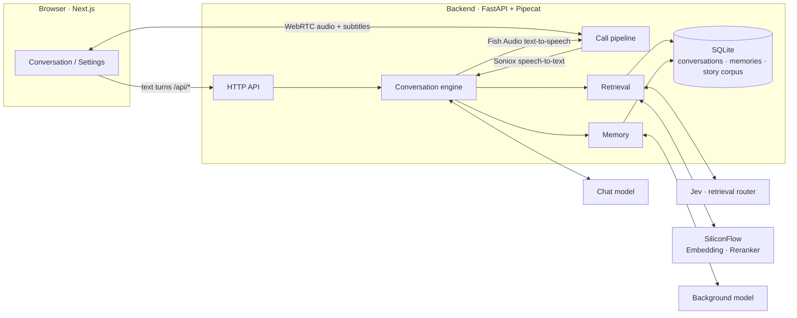
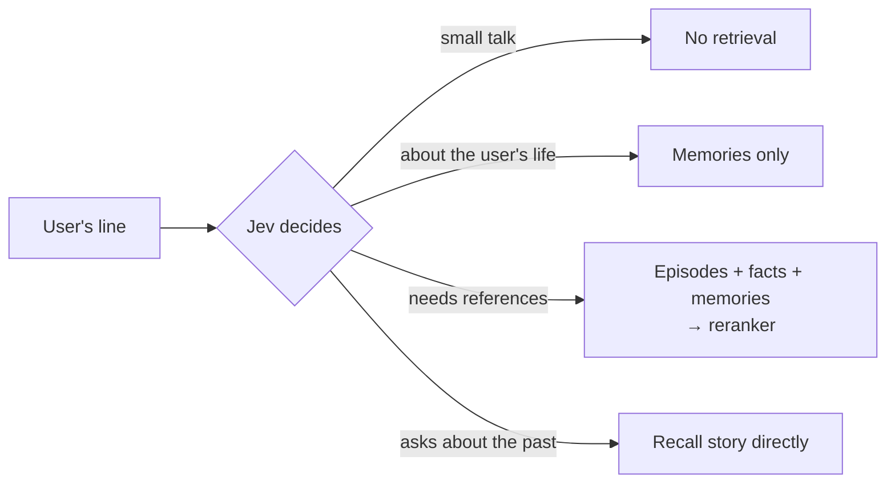

<div align="center">

# Eidolon-SC

**Real-time AI companions of the idols from *THE iDOLM@STER SHINY COLORS***

Voice · Text · Story recall · Memory shared across characters

[简体中文](README.md) · **English** · [日本語](README.ja.md)

[](backend/pyproject.toml)
[](https://fastapi.tiangolo.com/)
[](https://github.com/pipecat-ai/pipecat)
[](frontend/package.json)
[](frontend/package.json)
[](frontend/tsconfig.json)
[](backend/src/eidolon/store.py)
[](docker-compose.yml)
[](LICENSE)
[](docs/adr/0003-corpus-and-voices-stay-private.md)

</div>

---

Eidolon-SC lets you, as **a producer at 283 Production**, text or voice-call the idols from the game. Characters answer in their own Japanese voice with Chinese subtitles, recall the story episodes they actually lived through, and remember what you tell them — which then gets around among the other idols.

It is built for the author and a small circle of friends, not as a public service. The glossary lives in [`CONTEXT.md`](CONTEXT.md), design decisions in [`docs/adr/`](docs/adr/).

> [!NOTE]
> The product itself is Chinese-first: the UI, subtitles, memories and most docs are in Chinese. Users may speak or type in Chinese or Japanese.

> [!IMPORTANT]
> This is an unofficial fan project, not affiliated with Bandai Namco or the rights holders of *THE iDOLM@STER* series. Story data and character voices are **not distributed with this repository**; you must provide them yourself, for private use only ([ADR-0003](docs/adr/0003-corpus-and-voices-stay-private.md)).

## ✨ Features

| | |
|---|---|
| 🎙️ **Real-time voice calls** | Full-duplex calls over WebRTC. Speak Chinese or Japanese; the character reads her Japanese reply in a Fish Audio voice while subtitles appear in sync |
| 🇯🇵 **Japanese voice + Chinese subtitles** | Characters always answer in Japanese, keeping their sentence-final particles and verbal tics, with a Chinese subtitle for every line ([ADR-0001](docs/adr/0001-japanese-replies-with-chinese-subtitles.md)) |
| 📖 **Story recall** | Once the story corpus is imported, a character recalls only the canon episodes **she appears in**, and can answer "what happened that time…?" |
| 🧠 **Memory shared across characters** | Tell Mano something and Kogane will know too — but she'll bring it up as "Mano told me…" ([ADR-0002](docs/adr/0002-shared-memory-with-source-character.md)) |
| ⚡ **On-demand retrieval** | A lightweight model first decides whether a line needs any lookup, so small talk adds no latency |
| 🔌 **Bring your own model** | Speaks OpenAI Chat Completions, OpenAI Responses and Anthropic Messages, so any compatible third-party service works too |
| 📝 **Character sheet drafting** | A background model reads through all of a character's episodes and drafts her character sheet for you to proofread |
| 👥 **Multi-user with limits** | Issue access keys from the CLI; per-user rate limits and fully isolated memories make it safe to share with friends |
| 🚀 **One-command deployment** | Production config ships with Caddy (automatic HTTPS) and coturn (TURN relay) |

## 🧭 Contents

- [Architecture](#-architecture)
- [Quick start](#-quick-start)
- [Configuration](#-configuration)
  - [Models](#models)
  - [Characters](#characters)
  - [Voice calls](#voice-calls)
  - [Story corpus](#story-corpus)
  - [Retrieval during conversation](#retrieval-during-conversation)
  - [Memory](#memory)
  - [Users and access keys](#users-and-access-keys)
- [Deploying to a VPS](#-deploying-to-a-vps)
- [Development](#-development)
- [Project layout](#-project-layout)
- [License](#-license)
- [Acknowledgements](#-acknowledgements)

## 🧩 Architecture



- Typed and spoken input go through **the same conversation engine** and land in the same conversation record; a call is just speech recognition and synthesis wrapped around the engine.
- The chat model streams its reply as `<ja>…</ja><zh>…</zh>` segments, and each Japanese segment is sent to speech synthesis as soon as it arrives, without waiting for the whole reply.

## 🚀 Quick start

**Prerequisites**: Docker with Docker Compose, and a chat model that supports streaming and tool calling.

```sh
git clone https://github.com/Sallyn0225/eidolon-sc.git && cd eidolon-sc
cp .env.example .env   # fill in the chat model's base URL, API key and model name
# prepare character sheets, see "Characters" below
docker compose up --build
```

Then issue an access key:

```sh
docker compose exec backend eidolon user create alice
docker compose exec backend eidolon key issue alice   # the key is shown only once
```

Open <http://localhost:3000>, enter the access key on the settings page, and pick a character to talk to.

> [!TIP]
> A chat model alone is enough for text chat. Add the other services' keys as you go to unlock voice, story recall and memory:
>
> | Feature | Required configuration |
> |---|---|
> | Text chat | `CHAT_LLM_*` |
> | Voice calls | `SONIOX_API_KEY`, `FISH_AUDIO_API_KEY` |
> | Story corpus import | `SILICONFLOW_API_KEY` |
> | Retrieval and memory | `SILICONFLOW_API_KEY`, `AI_GATEWAY_API_KEY`, `JEV_MODEL` |
>
> Every option is documented in [`.env.example`](.env.example) (comments in Chinese).

## 🔧 Configuration

### Models

The **chat model** talks with the user; the **background model** extracts memories and drafts character sheets. Each is configured separately in `.env` and can use any of three protocols (`CHAT_LLM_PROTOCOL`, `BACKGROUND_LLM_PROTOCOL`):

| Value | Protocol | Request URL |
|---|---|---|
| `chat-completions` (default) | OpenAI-compatible Chat Completions | `{base}/chat/completions` |
| `responses` | OpenAI Responses | `{base}/responses` |
| `anthropic` | Anthropic Messages | `{base}/messages` |

You supply the base URL, key and model name, so any third-party service compatible with these protocols works.

- The chat model must support streaming and tool calling. On startup the backend sends one tiny check request (one tool, streamed response). If the model doesn't stream, rejects tools, or the URL/key is wrong, the backend refuses to start and says which requirement failed and what the service returned.
- Reasoning / thinking output emitted before the reply is ignored and never enters the reply.
- The Anthropic protocol requires a per-reply length cap, 16384 tokens by default, adjustable with `CHAT_LLM_MAX_TOKENS` and `BACKGROUND_LLM_MAX_TOKENS` (the other protocols are uncapped when unset). The two are set independently — the background model does not inherit the chat model's cap, so long sheet drafts don't get cut off.
- Any other background-model setting left empty falls back to the chat model's. Setting only `BACKGROUND_LLM_MODEL`, for example, switches to a cheaper model on the same service.

### Characters

Characters are configured in [`characters/characters.toml`](characters/characters.toml): ID, display name, intro, Fish Audio voice ID, and the paths of the character sheet and avatar. Adding a character or swapping a voice ID only takes an edit to this file and a backend restart.

```toml
[[characters]]
id = "mano"
name = "櫻木真乃"
intro = "illumination STARS 的中心。温柔又有点慢热，喜欢鸟……"
voice_id = "a1150f3d14ac46fb8ea59c7803cd8357"
sheet = "sheets/mano.md"
avatar = "avatars/mano.png"
facts = "facts/mano.md"
speakers = ["真乃"]
```

Character sheets, character facts and avatars are **not committed** (ADR-0003). Before starting, write `characters/sheets/mano.md` and `characters/sheets/kogane.md` following [`characters/sheets/example.md`](characters/sheets/example.md); optionally add character facts under `characters/facts/` following [`characters/facts/example.md`](characters/facts/example.md), and avatars under `characters/avatars/`. If a sheet is missing, the backend refuses to start and names the missing file. docker compose mounts `characters/` read-only into the backend container.

<details>
<summary><b>Drafting a character sheet with the background model</b></summary>

<br>

You can also have the background model draft a sheet from the story corpus and proofread it afterwards (import the corpus first; see "Models" above for the background model):

```sh
uv run eidolon --db data/eidolon.db character draft-sheet mano   # inside backend/
# under docker compose, characters/ is read-only: write to the data volume, then copy out
docker compose exec backend eidolon character draft-sheet mano --output /data/drafts/mano.md
docker compose cp backend:/data/drafts/mano.md characters/sheets/mano.md
```

- Source material is only the canon episodes the character appears in. The draft has sections for identity, self-reference, how she addresses others, verbal tics, unit members and hard rules; sections the model misses are left as “（待补充）” (to be filled in). An episode longer than the limit is read in parts, never truncated.
- The first line of a draft is a draft marker. The sheet works normally while it's there (the marker never enters the prompt), but the backend warns at startup that the sheet hasn't been proofread; delete the line once you're done.
- A proofread sheet (no marker) is never overwritten — pass `--force` to regenerate anyway. An unproofread draft is simply replaced.
- When the material exceeds one request's budget (`--budget`, 40,000 characters by default), the background model first takes notes batch by batch, then drafts from the notes; beyond 20 batches, episodes are sampled evenly from the whole corpus. Mano has about 220 episodes (≈330k characters), which takes roughly ten background-model requests.

</details>

### Voice calls

With `SONIOX_API_KEY` and `FISH_AUDIO_API_KEY` set in `.env`, the **Voice call** button on the conversation page comes alive:

- Speak Chinese or Japanese. The character reads her Japanese reply in the configured Fish Audio voice, and both the Japanese text and the Chinese subtitle appear in the transcript.
- Anything typed during a call joins the same conversation, and the character answers it by voice too.
- With **Mute** on, replies are shown as text only, without speech synthesis. Microphone and call audio quality are chosen on the settings page.
- `FISH_AUDIO_MODEL` defaults to `s2.1-pro-free`, which consumes no API credits; switch to a paid model if you have credits.

> [!NOTE]
> Audio flows directly between the browser and the backend over WebRTC (UDP). With local docker compose, a browser on Linux can reach the container directly. Elsewhere (Docker Desktop on macOS, phones), the browser must be able to reach the backend, which usually means configuring a TURN server — see `EIDOLON_ICE_SERVERS` and `EIDOLON_TURN_URLS` in `.env.example`. The public production config ships with coturn; see [`docs/deploy.md`](docs/deploy.md).

### Story corpus

The episodes characters can recall come from the story CSVs of [SCTranslationData](https://github.com/ShinyGroup/SCTranslationData), with gaps optionally filled from the game's raw script JSON. Story data is not committed (ADR-0003): clone it into `corpus/` at the repo root (git-ignored, mounted read-only at `/corpus` in the backend container), set `SILICONFLOW_API_KEY` in `.env`, then import:

```sh
git clone --depth 1 https://github.com/ShinyGroup/SCTranslationData.git corpus/SCTranslationData
docker compose exec backend eidolon story import-csv /corpus/SCTranslationData/data/story
```

<details>
<summary><b>CSV import rules</b></summary>

<br>

- Each CSV becomes one episode, keyed by the raw script referenced by the trailing `info` row; re-importing updates it in place. Unchanged episodes are not re-embedded, so you can re-import any time the source updates.
- Failure endings (W.I.N.G. defeat, missed season goals, G.R.A.D. defeat, failed auditions, broken promises) are identified by script ID and excluded; the producer's choices are not recorded.
- The cast is identified from each line's speaker: each character's `speakers` in `characters.toml` lists her name as it appears in scripts (e.g. `真乃`). Re-import after changing `speakers` or adding a character.
- Embeddings default to SiliconFlow's `Qwen/Qwen3-Embedding-0.6B`, configurable via `EMBEDDING_MODEL`; re-import after switching. Only episodes with a non-empty cast are embedded.
- The story catalog (character → card or event → episode) is generated straight from the corpus, so it always matches the latest import; the import ends by listing each character's catalog size.

</details>

<details>
<summary><b>Filling gaps with raw script JSON</b></summary>

<br>

Episodes missing from SCTranslationData can be filled in from the game's raw script JSON (each file is one script's array of frames, with fields such as `speaker`, `text` and `select`):

```sh
docker compose exec backend eidolon story import-json /corpus/scripts
```

- The script ID is taken from the file path: either the in-game path (`produce_events/100100101.json`) or the translation plugin's naming (`produce_events_100100101.json`). Files whose path has no script ID are skipped with a warning (they couldn't be de-duplicated against the CSV of the same script).
- When files sit under a `source/` directory the way SCTranslationData lays them out, the source is the directory name and the title the file name; with in-game paths, the source is the script ID minus its last two (episode) digits (e.g. `produce_events/2011005`) and the title looks like `produce_events_201100501`.
- The rules match the CSV importer: failure endings excluded, producer choices not recorded, the character's reaction to every choice kept.
- If the same script was already imported from CSV, the CSV version with its Chinese translation wins and JSON won't overwrite it; conversely, a later CSV import replaces the JSON version. JSON-only episodes have no Chinese translation, but retrieval and the story catalog work as usual.

</details>

<details>
<summary><b>One-command sync: translations plus untranslated episodes from the mirror</b></summary>

<br>

`eidolon story sync` imports SCTranslationData's translations, then imports the P-card and S-card episodes the corpus still lacks from ShinyColorsDB's decoded mirror (ADR-0004) as untranslated episodes:

```sh
docker compose exec backend eidolon story sync
```

- An untranslated episode's source is the card name (e.g. `【ほわっとスマイル】櫻木真乃`, matching SCTranslationData's directory names) and its title the in-game episode title; once a translation arrives it replaces the episode by script ID, under the same card. Episodes that already have a translation are never downloaded or overwritten.
- Downloaded scripts are cached in `EIDOLON_MIRROR_CACHE_PATH` (`/data/mirror` in the data volume in the container, `corpus/mirror` locally by default), outside the repo. Unchanged cards are not requested again and changed cards use ETag conditional requests. Requests go out one at a time, about a second apart, so the first full sync takes an hour or two; later ones take minutes.
- If the mirror is unreachable the translations are still imported and the command exits with code 2; rerunning after an interruption picks up where it stopped without downloading scripts again.
- `--idol 1` limits the sync to one idol's cards (the mirror API's idol ID, repeatable); the translations directory defaults to `EIDOLON_STORY_PATH`, or pass `--story`.

</details>

For local development, use `uv run eidolon --db data/eidolon.db story import-csv <dir>` (likewise `import-json`).

### Retrieval during conversation

With `SILICONFLOW_API_KEY`, `AI_GATEWAY_API_KEY` and `JEV_MODEL` set, characters can recall episodes and consult their character facts mid-conversation; if any is missing, they answer from their character sheet alone.



- Every line first goes to Jev (via Vercel AI Gateway) to decide what it needs. Small talk: no retrieval, no added latency. Needs references: the search below. A question like "what happened that time…?": the line is used to **recall story** right away and the result goes into the prompt, saving the chat model a tool-call round. If Jev errors, retrieval runs anyway.
- A search covers the episodes the current character appears in plus her character facts, reranked with SiliconFlow's Qwen3-Reranker (`RERANK_MODEL` to swap); up to 5 sufficiently relevant results go into the prompt (none if nothing is on-topic). If search or reranking fails, the turn proceeds without references.
- The chat model can also call the `recall_story` tool: when the producer asks about a past event, the character searches her own episodes with a one-line summary and gets back the full text of up to 2 best-matching episodes (with the card or event each belongs to in the story catalog and its sibling episodes), then answers from them. At most one tool round per line; turns Jev already routed to story recall don't offer the tool.
- Character facts are the Markdown file referenced by `facts` in `characters.toml`, one entry per heading. They're embedded on a character's first search, and afterwards only changed entries are re-embedded; just restart the backend after editing.

### Memory

Characters remember what users tell them about themselves, and all of a user's characters share those memories: tell Mano something and Kogane will know, but she'll bring it up as "Mano told me…" (ADR-0002). Different users' memories are fully isolated. Memory turns on together with retrieval (requires `SILICONFLOW_API_KEY`, `AI_GATEWAY_API_KEY` and `JEV_MODEL`).

- **Writing down**: after each turn, the background model reads the exchange and writes whatever the user revealed that's worth keeping as a memory in Chinese (e.g. "the producer has a cat named Xiaobai"), recording its owner and source character. Relative times like "next Saturday" are converted to dates in the user's time zone. Things already remembered aren't duplicated. This runs in the background without holding up the reply; the user's next line waits for it to finish (at most 5 seconds).
- **Recalling**: later, when Jev decides the user is talking about their own life (news, plans, family, pets…), only memories are searched; when episodes and facts are searched, memories are searched alongside. Up to 3 relevant memories go into the prompt, each labeled with its source character and date.
- **Across conversations**: a new conversation picks up earlier topics only through the memories it finds, never by carrying over the previous conversation.
- **Management**: under **Settings → Manage memories**, users see every memory the characters have kept, each labeled with who it was told to. They can delete memories one at a time or clear them all after confirmation, but can't add or edit them. Deleted memories never reach a prompt again; memories still being extracted when the user clears are discarded and won't reappear afterwards.

### Users and access keys

Admins manage users and access keys from the command line. A user can hold several keys; conversations belong to the user, so revoking a key doesn't touch their data.

```sh
docker compose exec backend eidolon user create alice      # create a user
docker compose exec backend eidolon key issue alice        # issue a key (shown only once)
docker compose exec backend eidolon key list alice         # list key IDs and status
docker compose exec backend eidolon key revoke <key-id>    # revoke
```

So no single user drains everyone's shared API credits, the following limits apply by default (0 means unlimited):

| Limit | Default | Environment variable |
|---|---|---|
| Text turns per hour | 60 | `EIDOLON_TURNS_PER_HOUR` |
| Voice calls per hour | 5 | `EIDOLON_CALLS_PER_HOUR` |
| Call duration | 10 minutes | `EIDOLON_CALL_MINUTES` |
| Turns per call | 40 | `EIDOLON_TURNS_PER_CALL` |
| History turns sent per turn | 20 | `EIDOLON_HISTORY_TURNS` |

- Limits are per user, with all of a user's keys counted together. Speech and typing during a call don't count separately; failed turns and calls that never connected don't count at all.
- Requests over the limit get a 429 with the time usage resumes, and the frontend tells the user when they can try again.
- When a call hits its limit, the character finishes what she's saying and hangs up, and the frontend explains why.
- The chat model only sees the most recent turns of the conversation; earlier context comes back through memory and retrieval, so long conversations don't grow slower, pricier, or overflow the context window. The conversation record itself is kept in full.

For local development, use `uv run eidolon --db data/eidolon.db ...`. The default user left over from phase 01 is named `default`; issue it a key to keep accessing its existing conversations.

## 🌐 Deploying to a VPS

The production config [`docker-compose.prod.yml`](docker-compose.prod.yml) runs four services:

| Service | Role |
|---|---|
| **caddy** | HTTPS entry point; obtains and renews Let's Encrypt certificates automatically |
| **frontend** / **backend** | Listen on 127.0.0.1 only, never exposed directly |
| **coturn** | STUN/TURN, so phones behind NAT can make voice calls |

```sh
docker compose -f docker-compose.prod.yml up -d --build
```

See [`docs/deploy.md`](docs/deploy.md) (Chinese) for the full walkthrough: domain, firewall ports, corpus import, upgrades, backups and troubleshooting.

## 💻 Development

**Backend** (Python, `backend/`, using [uv](https://docs.astral.sh/uv/)):

```sh
cd backend
uv sync
uv run pytest        # tests
uv run pyright       # type checking
CHAT_LLM_BASE_URL=... CHAT_LLM_API_KEY=... CHAT_LLM_MODEL=... uv run eidolon
# serves on :8000 and reads ../characters/characters.toml (override with EIDOLON_CHARACTERS_PATH)
```

**Frontend** (Next.js, `frontend/`):

```sh
cd frontend
npm install
BACKEND_URL=http://localhost:8000 npm run dev   # serves on :3000, proxies /api/* to the backend
npm run typecheck
npm test
```

## 📁 Project layout

```text
eidolon-sc/
├── backend/                  # Python backend: FastAPI + Pipecat
│   ├── src/eidolon/
│   │   ├── engine.py         #   conversation engine: a turn in, the character's reply out
│   │   ├── call.py           #   voice calls: signalling and the Pipecat pipeline
│   │   ├── retrieval.py      #   retrieval routing, episode/fact search and reranking
│   │   ├── memory.py         #   memories shared across conversations and characters
│   │   ├── story_import.py   #   story corpus import (CSV / JSON)
│   │   ├── sheet_draft.py    #   character sheet drafting
│   │   └── llm/              #   adapters for the three model protocols
│   └── tests/
├── frontend/                 # Next.js frontend
├── characters/               # character config, sheets, facts, avatars (last three not committed)
├── deploy/                   # Caddyfile
├── docs/
│   ├── adr/                  # architecture decision records
│   └── deploy.md             # VPS deployment guide
├── docker-compose.yml        # local development
├── docker-compose.prod.yml   # production deployment
├── .env.example              # every configuration option, documented
└── CONTEXT.md                # domain glossary
```

## 📄 License

The code in this project is released under the [GNU Affero General Public License v3.0](LICENSE) (AGPL-3.0), or (at your option) any later version. If you modify it and let others use it over a network, you must make your modified source code available to those users.

The license covers only the code and documentation in this repository. Story data, character voices, character sheets, character facts and avatars are not in the repository and are not covered; follow the terms of their respective sources (ADR-0003).

## 🙏 Acknowledgements

- [LAPLACE Eidolon](https://laplace.live/eidolon) — the real-time voice AI companion of VTuber Mingqian Nailü (明前奶绿); this project borrows its architecture (none of its code)
- [SCTranslationData](https://github.com/ShinyGroup/SCTranslationData) — story text and Chinese translations
- [Pipecat](https://github.com/pipecat-ai/pipecat) — real-time voice pipeline and WebRTC transport
- [Soniox](https://soniox.com/) — speech recognition
- [Fish Audio](https://fish.audio/) — speech synthesis
- [SiliconFlow](https://siliconflow.cn/) — Qwen3 Embedding / Reranker
- [Vercel AI Gateway](https://vercel.com/ai-gateway) — access to the retrieval router model

<div align="center">

---

<sub>*THE iDOLM@STER SHINY COLORS* and its characters are ©Bandai Namco Entertainment Inc. This is an unofficial fan project for private use by the author and a small circle only.</sub>

</div>
