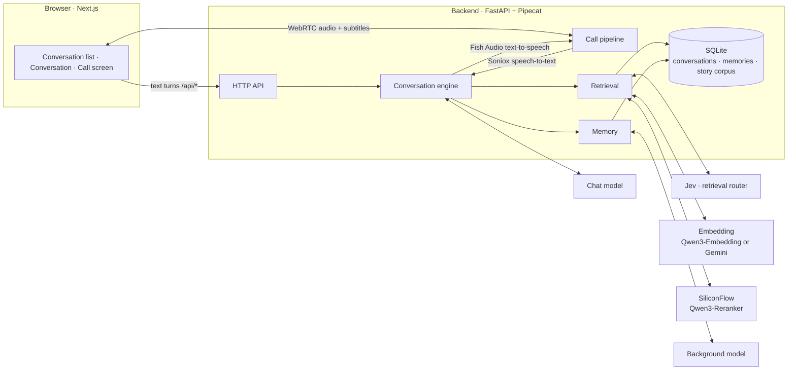
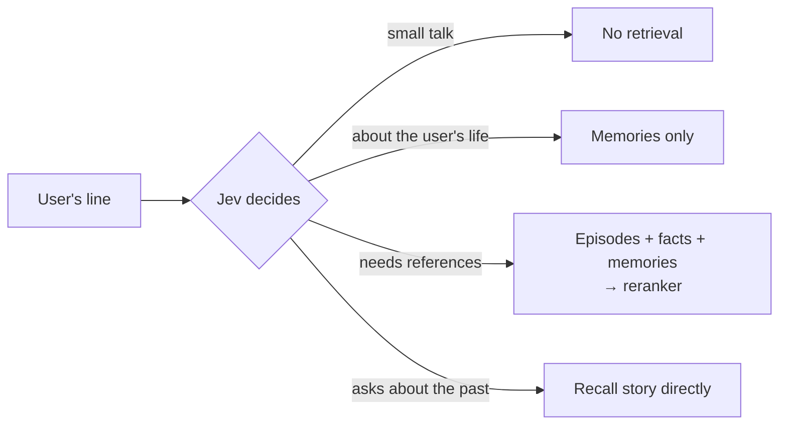

<div align="center">

# Eidolon-SC

**Real-time AI companions of the idols from *THE iDOLM@STER SHINY COLORS***

Voice · Text · Story recall · Memory shared across characters

[简体中文](README.md) · **English** · [日本語](README.ja.md)

[](backend/pyproject.toml)
[](https://fastapi.tiangolo.com/)
[](https://github.com/pipecat-ai/pipecat)
[](frontend/package.json)
[](frontend/package.json)
[](frontend/tsconfig.json)
[](backend/src/eidolon/store.py)
[](docker-compose.yml)
[](LICENSE)
[](docs/adr/0006-open-to-the-public-with-oauth.md)

</div>

---

Eidolon-SC lets you, as **a producer at 283 Production**, text or voice-call the idols from the game. Characters answer in their own Japanese voice with Chinese subtitles, recall the story episodes they actually lived through, and remember what you tell them — which then gets around among the other idols.

Deployed publicly, anyone can sign in with Google or GitHub and use it ([ADR-0006](docs/adr/0006-open-to-the-public-with-oauth.md)). The glossary lives in [`CONTEXT.md`](CONTEXT.md), design decisions in [`docs/adr/`](docs/adr/), and the visual design system in [`DESIGN.md`](DESIGN.md).

> [!NOTE]
> The product itself is Chinese-first: the UI, subtitles, memories and most docs are in Chinese. Users may speak or type in Chinese or Japanese.

> [!IMPORTANT]
> This is an unofficial fan project, not affiliated with Bandai Namco or the rights holders of *THE iDOLM@STER* series. Story data is **not distributed with this repository**; you must provide it yourself ([ADR-0003](docs/adr/0003-corpus-and-voices-stay-private.md)). The characters pass it on indirectly to signed-in users through their replies; that risk is accepted in [ADR-0006](docs/adr/0006-open-to-the-public-with-oauth.md).

## ✨ Features

| | |
|---|---|
| 🎙️ **Real-time voice calls** | Full-duplex calls over WebRTC. Speak Chinese or Japanese; the character reads her Japanese reply in a Fish Audio voice while subtitles appear in sync. The full-screen call screen can be collapsed at any time, back to the transcript |
| 🇯🇵 **Japanese voice + Chinese subtitles** | Characters always answer in Japanese, keeping their sentence-final particles and verbal tics, with a Chinese subtitle for every line ([ADR-0001](docs/adr/0001-japanese-replies-with-chinese-subtitles.md)) |
| 📖 **Story recall** | Once the story corpus is imported, a character recalls only the canon episodes **she appears in**, and can answer "what happened that time…?" |
| 🔄 **Kept in step with the game** | One command syncs the fan translations and the Japanese originals on the mirror, so new cards and events can be recalled within a week; it runs weekly on the server ([ADR-0004](docs/adr/0004-untranslated-episodes-from-shinycolorsdb-mirror.md)) |
| 🧠 **Memory shared across characters** | Tell Mano something and Kogane will know too — but she'll bring it up as "Mano told me…" ([ADR-0002](docs/adr/0002-shared-memory-with-source-character.md)) |
| ⚡ **On-demand retrieval** | A lightweight model first decides whether a line needs any lookup, so small talk adds no latency |
| 🔌 **Bring your own model** | Speaks OpenAI Chat Completions, OpenAI Responses and Anthropic Messages, so any compatible third-party service works too |
| 🧩 **Pick your embedding service** | Choose SiliconFlow's Qwen3-Embedding or Google's Gemini Embedding 2 at deploy time; after switching, one command re-embeds from the text already in the database ([ADR-0005](docs/adr/0005-embedding-provider-chosen-at-deploy.md)) |
| 📝 **Character sheet drafting** | A background model reads through all of a character's episodes and drafts her character sheet for you to proofread |
| 👥 **Open to the public** | Sign in with Google or GitHub; per-user rate limits and fully isolated memories; users can link both sign-in methods and delete all their data for good |
| 🔑 **Bring your own keys** | Users can enter their own LLM, Fish Audio and Soniox keys to use their own credits, exempt from the limits |
| 🚀 **One-command deployment** | Production config ships with Caddy (automatic HTTPS) and coturn (TURN relay) |

## 🧭 Contents

- [Architecture](#-architecture)
- [Quick start](#-quick-start)
- [Configuration](#-configuration)
  - [Models](#models)
  - [Characters](#characters)
  - [Voice calls](#voice-calls)
  - [Story corpus](#story-corpus)
  - [Embedding service](#embedding-service)
  - [Retrieval during conversation](#retrieval-during-conversation)
  - [Memory](#memory)
  - [Sign-in and users](#sign-in-and-users)
  - [Bring your own keys](#bring-your-own-keys)
- [Deploying to a VPS](#-deploying-to-a-vps)
- [Development](#-development)
- [Project layout](#-project-layout)
- [License](#-license)
- [Acknowledgements](#-acknowledgements)

## 🧩 Architecture



- Typed and spoken input go through **the same conversation engine** and land in the same conversation record; a call is just speech recognition and synthesis wrapped around the engine.
- The chat model streams its reply as `<ja>…</ja><zh>…</zh>` segments, and each Japanese segment is sent to speech synthesis as soon as it arrives, without waiting for the whole reply.

## 🚀 Quick start

**Prerequisites**: Docker with Docker Compose, and a chat model that supports streaming and tool calling.

```sh
git clone https://github.com/Sallyn0225/eidolon-sc.git && cd eidolon-sc
cp .env.example .env   # fill in the chat model's base URL, API key and model name; add EIDOLON_DEV_LOGIN=1 to try it locally
# prepare character sheets, see "Characters" below
docker compose up --build
```

Open <http://localhost:3000>, sign in with "dev login" under any name (offered only with `EIDOLON_DEV_LOGIN=1`), agree to the privacy policy and terms of use, and the home page lists the characters: pick one to start a conversation. To sign in with Google or GitHub, first create an OAuth app as described under "Configure OAuth apps" in [`docs/deploy.md`](docs/deploy.md), with the callback URL `http://localhost:3000/api/auth/github/callback` (likewise for Google), or run `scripts/setup-oauth.sh` and follow its prompts.

> [!TIP]
> A chat model alone is enough for text chat. Add the other services' keys as you go to unlock voice, story recall and memory:
>
> | Feature | Required configuration |
> |---|---|
> | Text chat | `CHAT_LLM_*` |
> | Voice calls | `SONIOX_API_KEY`, `FISH_AUDIO_API_KEY` |
> | Story corpus (sync or import) | The embedding service's key: `SILICONFLOW_API_KEY` (default), or `EMBEDDING_PROVIDER=gemini` plus `GEMINI_API_KEY` |
> | Retrieval and memory | The embedding service's key, `SILICONFLOW_API_KEY` (reranking), `AI_GATEWAY_API_KEY`, `JEV_MODEL` |
>
> Every option is documented in [`.env.example`](.env.example) (comments in Chinese).

## 🔧 Configuration

### Models

The **chat model** talks with the user; the **background model** extracts memories and drafts character sheets. Each is configured separately in `.env` and can use any of three protocols (`CHAT_LLM_PROTOCOL`, `BACKGROUND_LLM_PROTOCOL`):

| Value | Protocol | Request URL |
|---|---|---|
| `chat-completions` (default) | OpenAI-compatible Chat Completions | `{base}/chat/completions` |
| `responses` | OpenAI Responses | `{base}/responses` |
| `anthropic` | Anthropic Messages | `{base}/messages` |

You supply the base URL, key and model name, so any third-party service compatible with these protocols works.

- The chat model must support streaming and tool calling. On startup the backend sends one tiny check request (one tool, streamed response). If the model doesn't stream, rejects tools, or the URL/key is wrong, the backend refuses to start and says which requirement failed and what the service returned.
- Reasoning / thinking output emitted before the reply is ignored and never enters the reply.
- The Anthropic protocol requires a per-reply length cap, 16384 tokens by default, adjustable with `CHAT_LLM_MAX_TOKENS` and `BACKGROUND_LLM_MAX_TOKENS` (the other protocols are uncapped when unset). The two are set independently — the background model does not inherit the chat model's cap, so long sheet drafts don't get cut off.
- Any other background-model setting left empty falls back to the chat model's. Setting only `BACKGROUND_LLM_MODEL`, for example, switches to a cheaper model on the same service.

### Characters

Characters are configured in [`characters/characters.toml`](characters/characters.toml): ID, display name, intro, Fish Audio voice ID, image colour, and the paths of the character sheet, avatar and call-screen background. Adding a character or swapping a voice ID only takes an edit to this file and a backend restart.

```toml
[[characters]]
id = "mano"
name = "櫻木真乃"
intro = "illumination STARS 的中心。温柔又有点慢热，喜欢鸟……"
voice_id = "a1150f3d14ac46fb8ea59c7803cd8357"
sheet = "sheets/mano.md"
avatar = "avatars/mano.jpg"
color = "#ffbad6"
facts = "facts/mano.md"
speakers = ["真乃"]
```

Character sheets, character facts, avatars and call-screen backgrounds are committed with the repository (ADR-0003). To add a character, write `characters/sheets/<id>.md` following [`characters/sheets/example.md`](characters/sheets/example.md); optionally add character facts under `characters/facts/` following [`characters/facts/example.md`](characters/facts/example.md), and avatars under `characters/avatars/`. If a sheet is missing, the backend refuses to start and names the missing file.

`color` is the official image colour the original game gives her (`#rrggbb`, required). Everything in the interface that belongs to her (her bubbles, the call button, the sticky note, the call screen) is based on it; the frontend derives light and dark colours from it, keeping text readable in both. If `color` is missing or malformed, the backend refuses to start and names the character. A call-screen background (optional) goes under `characters/backgrounds/`, set with `background = "backgrounds/mano.jpg"`; without one, or if the file is missing, the call screen uses a gradient of her image colour instead. docker compose mounts `characters/` read-only into the backend container.

<details>
<summary><b>Drafting a character sheet with the background model</b></summary>

<br>

You can also have the background model draft a sheet from the story corpus and proofread it afterwards (import the corpus first; see "Models" above for the background model):

```sh
uv run eidolon --db data/eidolon.db character draft-sheet mano   # inside backend/
# under docker compose, characters/ is read-only: write to the data volume, then copy out
docker compose exec backend eidolon character draft-sheet mano --output /data/drafts/mano.md
docker compose cp backend:/data/drafts/mano.md characters/sheets/mano.md
```

- Source material is only the canon episodes the character appears in. The draft has sections for identity, self-reference, how she addresses others, verbal tics, relationships with unit partners and hard rules; sections the model misses are left as “（待补充）” (to be filled in). An episode longer than the limit is read in parts, never truncated.
- The first line of a draft is a draft marker. The sheet works normally while it's there (the marker never enters the prompt), but the backend warns at startup that the sheet hasn't been proofread; delete the line once you're done.
- A proofread sheet (no marker) is never overwritten — pass `--force` to regenerate anyway. An unproofread draft is simply replaced.
- When the material exceeds one request's budget (`--budget`, 40,000 characters by default), the background model first takes notes batch by batch, then drafts from the notes; beyond 20 batches, episodes are sampled evenly from the whole corpus. Mano has about 220 episodes (≈330k characters), which takes roughly ten background-model requests.

</details>

### Voice calls

With `SONIOX_API_KEY` and `FISH_AUDIO_API_KEY` set in `.env`, the call button in the conversation header comes alive. Pressing it opens the call screen and starts calling: full screen on a phone, covering the conversation column on a computer.

- The call screen shows her avatar, the call status and timer, her current line in Japanese with its subtitle, and what you are saying; the full transcript stays in the conversation. The timer starts when the call is connected, and switches to the time left when less than a minute of the per-call limit remains.
- The collapse button at the top left, or Esc, collapses the call screen back to the transcript while the call carries on; a sticky note reading “通话中 mm:ss · 点击返回” (in call · tap to return) stays at the top, and pressing it brings the call screen back. You cannot type on the call screen: collapse it and type in the conversation.

- Speak Chinese or Japanese. The character reads her Japanese reply in the configured Fish Audio voice, and both the Japanese text and the Chinese subtitle appear in the transcript.
- Anything typed during a call joins the same conversation, and the character answers it by voice too.
- Whatever you say or type before the character starts speaking, or before her reply has a complete segment (the Japanese and its subtitle both shown), is a follow-on: it joins the current turn, and she drops the reply she had begun and answers the whole thing afresh. Once the reply has a complete segment, speaking up interrupts her: she stops, the reply is recorded with only its complete segments, and what you just said is answered straight away. Sending typed text interrupts her just the same.
- Three round buttons along the bottom:
  - **Mic mute** (麦克风静音) turns off your microphone in the browser only, so she cannot hear you; typing is unaffected.
  - **Hang up** (挂断) ends the call and the call screen goes away, with no ending page.
  - **Switch microphone** (切换麦克风) lists the available microphones and switches to the one you pick on the spot, without dropping the call and keeping mic mute as it was; that microphone becomes the default for later calls. If the microphone in use is unplugged, the call switches to the system default and says so on the call screen; if no other microphone is available, the call carries on and the call screen says the microphone was disconnected.
- With the **Text only** (只看文字) switch at the top right on, she stays silent and her replies appear only as Japanese text with subtitles; every other rule stays the same. The default microphone and call audio quality are chosen on the settings page.
- Just like a phone call: a ringback tone loops from the moment you press the call button until the call connects, a short tone plays when it connects, and a “beep beep beep” hang-up tone plays when the call ends, whoever hung up and for whatever reason. These are the phone's own sounds, so Text only and collapsing the call screen don't affect them.
- With the **Phone texture** (电话质感) switch on the settings page turned on (it is off by default), her voice sounds as if heard through a handset: only the telephone band is kept, with light compression, instead of studio-clean audio. It takes effect from the next call and is independent of call audio quality.
- When a call ends for a reason (it could not connect, dropped midway, hit the per-call time or turn limit, ran out of quota, an own key failed, or the microphone was refused), the call screen stays on an ending page that gives the reason and whether the call counted towards the quota, with a button to call again or go back to the conversation; when the quota ran out or an own key failed, the main button leads to setting up your own keys instead (去设置自带密钥).
- Leaving the conversation hangs up the call, even while it is still connecting. Leaving from within the page (picking another character in the list, opening settings or memories, the back button on a phone) asks for confirmation first.
- `FISH_AUDIO_MODEL` defaults to `s2.1-pro-free`, which consumes no API credits; switch to a paid model if you have credits.

> [!NOTE]
> Audio flows directly between the browser and the backend over WebRTC (UDP). With local docker compose, a browser on Linux can reach the container directly. Elsewhere (Docker Desktop on macOS, phones), the browser must be able to reach the backend, which usually means configuring a TURN server — see `EIDOLON_ICE_SERVERS` and `EIDOLON_TURN_URLS` in `.env.example`. The public production config ships with coturn; see [`docs/deploy.md`](docs/deploy.md).

### Story corpus

The episodes characters can recall come from two sources, kept up to date by one sync command:

| | Translated episodes | Untranslated episodes |
|---|---|---|
| Source | Story CSVs from [SCTranslationData](https://github.com/ShinyGroup/SCTranslationData) | ShinyColorsDB's decoded mirror ([ADR-0004](docs/adr/0004-untranslated-episodes-from-shinycolorsdb-mirror.md)) |
| Content | Japanese original + fan Chinese translation | Japanese original only |
| Freshness | Waits for fan translators: weeks to months | Within a week of a game update |

They are two states of the same episode: once a translation arrives it replaces the untranslated episode by script ID, under the same card or event in the story catalog. Characters recall both the same way.

Story data is not committed (ADR-0003): clone SCTranslationData into `corpus/` at the repo root (git-ignored, mounted read-only at `/corpus` in the backend container), set the embedding service's key in `.env` (`SILICONFLOW_API_KEY` by default; see [Embedding service](#embedding-service)), then sync:

```sh
git clone --depth 1 https://github.com/ShinyGroup/SCTranslationData.git corpus/SCTranslationData
docker compose exec backend eidolon story sync
```

The first sync fills in everything missing from the mirror and takes an hour or two; you can interrupt it at any time and rerun it to pick up where it stopped. Later syncs take minutes. On a server, cron runs the sync weekly; see [`docs/deploy.md`](docs/deploy.md).

<details>
<summary><b>What the sync does</b></summary>

<br>

`eidolon story sync` imports SCTranslationData's translations, then imports the episodes the corpus still lacks from the mirror as untranslated episodes. Episodes that already have a translation are never downloaded or overwritten.

- **P-card and S-card episodes**: the source is the card name (e.g. `【ほわっとスマイル】櫻木真乃`, matching SCTranslationData's directory names) and the title the in-game episode title.
- **Produce and special episodes**: produce episodes (W.I.N.G., the fan appreciation festival, G.R.A.D., Landing Point, S.T.E.P., and the morning, cheer, audition and TV communications along the way) and special episodes such as birthdays and holidays come from each idol's in-game album (not updated since March 2024). They are filed under the directory name SCTranslationData uses for the same part of the album (e.g. `W.I.N.G.編`, `Morning`), or the album's own name for that part if none of it is translated, and titled as the album titles them. At the end the sync lists the produce episodes it imported whose title contains 「敗」 or 「失敗」 but which the failure-ending rules did not exclude, for you to check by hand.
- **Event episodes**: there is no listing, so they are found by script number (`4001` + a three-digit event number + a two-digit episode): the sync fills in the events and episodes missing within the known range, then tries a few numbers after the latest event, so a sync with no new event costs only a few 404s. Event names come from `deploy/event-names.toml` (write it from [`deploy/event-names.example.toml`](deploy/event-names.example.toml), one line per new event, using the same name as the event's directory in SCTranslationData; it stays out of the repo); edits reach the catalog at the next sync. Events not in the table take the directory name of their episodes SCTranslationData has translated, or else show as 「活动剧情 NNN」 and 「第N話」; the sync lists those numbers at the end. `--events` points at another table.
- **Cache**: downloaded scripts are cached in `EIDOLON_MIRROR_CACHE_PATH` (`/data/mirror` in the data volume in the container, `corpus/mirror` locally by default), outside the repo. Unchanged cards and albums are not requested again, only checked for on disk; changed ones use ETag conditional requests. Delete a script from the cache and the next sync downloads it again. A script the mirror lacks leaves a `.missing` mark: cards and events retry it every sync, albums only once the album changes; delete the mark to retry it right away.
- **Politeness and failures**: requests go out one at a time, about a second apart. If the mirror is unreachable the translations are still imported and the command exits with code 2; rerunning after an interruption picks up where it stopped without downloading scripts again.
- **Options**: `--idol 1` limits the sync to one idol's cards and album and skips events (the mirror API's idol ID, repeatable); the translations directory defaults to `EIDOLON_STORY_PATH`, or pass `--story`.

</details>

<details>
<summary><b>Import rules (shared by translated and untranslated episodes)</b></summary>

<br>

- Each episode is keyed by its raw script ID (for a CSV, the script its trailing `info` row references); re-importing updates it in place. Unchanged episodes are not re-embedded, so you can re-import or sync any time.
- Only canon is kept: failure endings (W.I.N.G. defeat, missed season goals, G.R.A.D. defeat, failed auditions, broken promises) are identified by script ID and excluded; the producer's choices are not recorded, while the character's reaction to every choice is kept.
- The cast is identified from each line's speaker: each character's `speakers` in `characters.toml` lists her name as it appears in scripts (e.g. `真乃`). Re-import after changing `speakers` or adding a character.
- Embeddings use the service chosen at deploy time (see [Embedding service](#embedding-service)); after switching service or model, run `eidolon reembed` — no re-import needed. Only episodes with a non-empty cast are embedded.
- The story catalog (character → card or event → episode) is generated straight from the corpus, so it always matches the latest import; an import ends by listing each character's catalog size.

</details>

<details>
<summary><b>Importing CSVs or raw script JSON by hand</b></summary>

<br>

To skip the mirror, import SCTranslationData's translations alone:

```sh
docker compose exec backend eidolon story import-csv /corpus/SCTranslationData/data/story
```

If you have the game's raw script JSON (each file is one script's array of frames, with fields such as `speaker`, `text` and `select`), you can fill gaps with it too:

```sh
docker compose exec backend eidolon story import-json /corpus/scripts
```

- The script ID is taken from the file path: either the in-game path (`produce_events/100100101.json`) or the translation plugin's naming (`produce_events_100100101.json`). Files whose path has no script ID are skipped with a warning (they couldn't be de-duplicated against the CSV of the same script).
- When files sit under a `source/` directory the way SCTranslationData lays them out, the source is the directory name and the title the file name; with in-game paths, the source is the script ID minus its last two (episode) digits (e.g. `produce_events/2011005`) and the title looks like `produce_events_201100501`.
- If the same script was already imported from CSV, the CSV version with its Chinese translation wins and JSON won't overwrite it; conversely, a later CSV import replaces the JSON version.

</details>

For local development, run `uv run eidolon --db data/eidolon.db story sync` in `backend/` (likewise `import-csv` and `import-json`).

### World setting

The office's president and clerk, the eight units and their idols, the character's own songs (those she sings alone and those her whole unit sings, each with the releases it is on and their dates), and the lives she stood on or is to stand on (each day's date and venue, the days her CV was absent left out) go into every turn after the character sheet ([ADR-0008](docs/adr/0008-real-world-releases-and-lives-are-in-character.md)). The data is `characters/world.json`, beside the character configuration and committed to the repository. To update it, run `uv run eidolon world sync` in `backend/`: it imports the idols and units from im@sparql and the official unit pages, and the releases, their tracks and singers from Lantis's Shiny Colors site (with ふじわらはじめ's API filling in singers Lantis leaves out), and the lives from the idolmaster portal (the old official site before September 2020) with each day's performers and absences from wikiwiki, and prints how many of each there are, what changed since the old file, where the sources disagree and which singers and performers match none of the idols; read the `git diff` before committing. Corrections checked by hand (who actually stood on a day, which performers are no idols) go in `characters/world-corrections.json` beside it, each with its source and a note, and every import applies them. If any source fails, the old file is left as it was. Every character's display name must match one of the idols or the backend will not start; without the file, it runs without the world setting.

### Embedding service

The story corpus, character facts and memories all share one embedding service, chosen at deploy time with `EMBEDDING_PROVIDER` ([ADR-0005](docs/adr/0005-embedding-provider-chosen-at-deploy.md)). Reranking doesn't follow the switch; it always uses SiliconFlow.

| `EMBEDDING_PROVIDER` | Service | Required key | Default model |
|---|---|---|---|
| `siliconflow` (default) | SiliconFlow | `SILICONFLOW_API_KEY` | `Qwen/Qwen3-Embedding-0.6B` |
| `gemini` | Google Gemini API | `GEMINI_API_KEY` (reranking still needs `SILICONFLOW_API_KEY`) | `gemini-embedding-2`, with dimensions set by `EMBEDDING_DIMENSIONS` (default 1536, 128–3072) |

> [!WARNING]
> If you choose Gemini: the Gemini API is **not available in mainland China, Hong Kong or Macao**, so the server must be elsewhere; and **content sent on the free tier is used by Google to improve its products** — what gets embedded includes the story corpus and users' memories. If that matters to you, enable billing (the paid tier is not used for training).

- The database keeps vectors for the current model only. After switching service, model (`EMBEDDING_MODEL`) or dimensions, restart the backend, then run once:

  ```sh
  docker compose exec backend eidolon reembed
  ```

  It re-embeds the story corpus, character facts and every user's memories from the text already in the database, with no need to download or import episodes again; once everything is done it deletes the old model's vectors. The service stays up meanwhile, though retrieval only finds the parts already done. You can interrupt it any time and rerun it to pick up where it stopped; if it fails, the old vectors are not deleted.
- If the backend finds on startup that some corpus passages lack vectors for the current model, it logs a reminder to run `eidolon reembed`.
- A model's stored ID includes its dimensions (e.g. `gemini-embedding-2@1536`), so changing dimensions counts as switching models. Existing deployments that stay on SiliconFlow need to do nothing.

### Retrieval during conversation

With the embedding service's key, `SILICONFLOW_API_KEY` (reranking), `AI_GATEWAY_API_KEY` and `JEV_MODEL` set, characters can recall episodes and consult their character facts mid-conversation; if any is missing, they answer from their character sheet alone.



- Every line first goes to Jev (via Vercel AI Gateway) to decide what it needs. Small talk: no retrieval, no added latency. Needs references: the search below. A question like "what happened that time…?": the line is used to **recall story** right away and the result goes into the prompt, saving the chat model a tool-call round. If Jev errors, retrieval runs anyway.
- A search covers the episodes the current character appears in plus her character facts, reranked with SiliconFlow's Qwen3-Reranker (`Qwen/Qwen3-Reranker-0.6B` by default, `RERANK_MODEL` to swap); up to 5 sufficiently relevant results go into the prompt (none if nothing is on-topic). What counts as "sufficiently relevant" is a threshold set per reranker model (both 0.6B's and 4B's are calibrated), which you can also set by hand with `RERANK_MIN_RELEVANCE` and `RERANK_MEMORY_MIN_RELEVANCE`; `eidolon eval rerank` prints the score distribution on the repo's calibration dataset to help pick one (see [`docs/deploy.md`](docs/deploy.md)). If search or reranking fails, the turn proceeds without references.
- The chat model can also call the `recall_story` tool: when the producer asks about a past event, the character searches her own episodes with a one-line summary and gets back the full text of up to 2 best-matching episodes (with the card or event each belongs to in the story catalog and its sibling episodes), then answers from them. At most one tool round per line; turns Jev already routed to story recall don't offer the tool.
- Character facts are the Markdown file referenced by `facts` in `characters.toml`, one entry per heading. They're embedded on a character's first search, and afterwards only changed entries are re-embedded; just restart the backend after editing.

### Memory

Characters remember what users tell them about themselves, and all of a user's characters share those memories: tell Mano something and Kogane will know, but she'll bring it up as "Mano told me…" (ADR-0002). Different users' memories are fully isolated. Memory turns on together with retrieval (requires the embedding service's key, `SILICONFLOW_API_KEY`, `AI_GATEWAY_API_KEY` and `JEV_MODEL`).

- **Writing down**: after each turn, the background model reads the exchange and writes whatever the user revealed that's worth keeping as a memory in Chinese (e.g. "the producer has a cat named Xiaobai"), recording its owner and source character. Relative times like "next Saturday" are converted to dates in the user's time zone. Things already remembered aren't duplicated. This runs in the background without holding up the reply; the user's next line waits for it to finish (at most 5 seconds).
- **Recalling**: later, when Jev decides the user is talking about their own life (news, plans, family, pets…), only memories are searched; when episodes and facts are searched, memories are searched alongside. Up to 3 relevant memories go into the prompt, each labeled with its source character and date.
- **Across conversations**: a new conversation picks up earlier topics only through the memories it finds, never by carrying over the previous conversation.
- **Management**: under **Settings → Manage memories**, users see every memory the characters have kept, each labeled with who it was told to. They can delete memories one at a time or clear them all after confirmation, but can't add or edit them. Deleted memories never reach a prompt again; memories still being extracted when the user clears are discarded and won't reappear afterwards.

### Sign-in and users

Anyone can sign in with Google or GitHub, with no invitation or approval (ADR-0006). The sign-in page offers whichever OAuth apps are configured in `.env` (`GITHUB_CLIENT_ID` and `GITHUB_CLIENT_SECRET`, `GOOGLE_CLIENT_ID` and `GOOGLE_CLIENT_SECRET`); how to create them is in [`docs/deploy.md`](docs/deploy.md). Or run `scripts/setup-oauth.sh` from the repo root: it opens each page you need, says what goes in each field, writes the values into `.env`, generates `EIDOLON_SECRET_KEY`, then restarts the backend and lists what to check with a real account.

- The first sign-in with an identity makes a new user; later sign-ins with it are that user. GitHub accounts must be at least a year old and Google email addresses verified, or sign-in is refused with the reason.
- After their first sign-in, users agree to the privacy policy and terms of use and confirm they are 13 or older before anything else works. Visitors who are not signed in see only the sign-in page, the privacy policy and the terms.
- Users can link their other sign-in method on the settings page, so either one shows the same memories. Two identities with the same email are never merged automatically, an identity that belongs to someone else cannot be linked, and the last sign-in method cannot be unlinked.
- Sessions are kept by the backend and held by the browser in an httpOnly cookie, lasting 30 days from last use. The settings page signs out this device or every device.
- "Delete all my data" on the settings page, after a second confirmation, deletes the user's memories, conversations, producer profile, sign-in methods, own keys, sessions and usage for good, signing them out everywhere; signing in again with the same identity makes a brand-new user.
- For local development and tests, `EIDOLON_DEV_LOGIN=1` adds a "dev login" by name to the sign-in page. A public deployment (with `EIDOLON_DOMAIN` set) refuses to start with it.

Admins manage users from the command line on the server:

```sh
docker compose exec backend eidolon user list              # ID, name, sign-in methods, created, banned
docker compose exec backend eidolon user ban <user-id>     # signed out everywhere, calls hung up within seconds, cannot sign in
docker compose exec backend eidolon user unban <user-id>
docker compose exec backend eidolon user usage <user-id>   # text turns and calls per hour over the last 24 hours, and how many were exempt
```

So no single user drains the deployer's API credits, the following limits apply by default (0 means unlimited):

| Limit | Default | Environment variable |
|---|---|---|
| Text turns per hour | 60 | `EIDOLON_TURNS_PER_HOUR` |
| Voice calls per hour | 5 | `EIDOLON_CALLS_PER_HOUR` |
| Call duration | 10 minutes | `EIDOLON_CALL_MINUTES` |
| Turns per call | 40 | `EIDOLON_TURNS_PER_CALL` |
| History turns sent per turn | 20 | `EIDOLON_HISTORY_TURNS` |

- Limits are per user, whichever sign-in method or device they use. Speech and typing during a call don't count separately. Turns that fail because a service errs and calls that never connected don't count; a turn the user leaves before the character finishes (say, by closing the page) isn't recorded but still counts. Just moving to another page of the site doesn't leave it: the reply finishes and is recorded.
- Use on the user's own keys is exempt: a text turn on their own LLM doesn't count; a call counts unless its LLM, speech synthesis and speech recognition are all their own. The per-call duration and turn caps are the same for everyone.
- Requests over the limit get a 429 with the time usage resumes, and the frontend tells the user when they can try again.
- When a call hits its limit, the character finishes what she's saying and hangs up, and the frontend explains why.
- The chat model only sees the most recent turns of the conversation; earlier context comes back through memory and retrieval, so long conversations don't grow slower, pricier, or overflow the context window. The conversation record itself is kept in full.

For local development, use `uv run eidolon --db data/eidolon.db ...`.

### Bring your own keys

The deployer pays for everything by default. Users can enter their own API keys on the settings page to share the cost:

| Service | What to enter | Used for |
|---|---|---|
| LLM | Protocol, base_url, key, model | Playing the character (text and calls), writing down memories |
| Speech synthesis (Fish Audio) | Key | The character's voice in calls; the voice ID still comes from the character configuration |
| Speech recognition (Soniox) | Key | Hearing the user in calls |

- Each key is tried once before it is saved; if the try fails, nothing is saved and the provider's error is shown. The LLM must support streaming and tool calls too; in a public deployment its base_url must be HTTPS on the public internet, checked again on every connection, not only when saved.
- Keys are stored encrypted with a key derived from `EIDOLON_SECRET_KEY`, and only their last 4 characters are ever shown. Without `EIDOLON_SECRET_KEY`, the feature is off.
- When an own key fails (out of credit, revoked, …), the turn or call fails, saying which key it was — it **never falls back to the deployer's key**. After `EIDOLON_SECRET_KEY` changes, saved keys can no longer be decrypted: a turn or call that needs one fails before calling any service and asks the user to enter it again. Deleting an own key switches back to the deployer's service.
- Embedding, reranking and deciding whether to recall the story (Jev) are always on the deployer.

## 🌐 Deploying to a VPS

The production config [`docker-compose.prod.yml`](docker-compose.prod.yml) runs four services:

| Service | Role |
|---|---|
| **caddy** | HTTPS entry point; obtains and renews Let's Encrypt certificates automatically |
| **frontend** / **backend** | Listen on 127.0.0.1 only, never exposed directly |
| **coturn** | STUN/TURN, so phones behind NAT can make voice calls |

```sh
docker compose -f docker-compose.prod.yml up -d --build
```

See [`docs/deploy.md`](docs/deploy.md) (Chinese) for the full walkthrough: domain, firewall ports, weekly corpus sync, upgrades, backups and troubleshooting.

## 💻 Development

**Backend** (Python, `backend/`, using [uv](https://docs.astral.sh/uv/)):

```sh
cd backend
uv sync
uv run pytest        # tests
uv run pyright       # type checking
EIDOLON_DEV_LOGIN=1 CHAT_LLM_BASE_URL=... CHAT_LLM_API_KEY=... CHAT_LLM_MODEL=... uv run eidolon
# serves on :8000 and reads ../characters/characters.toml (override with EIDOLON_CHARACTERS_PATH)
```

**Frontend** (Next.js + [Astryx](https://www.npmjs.com/package/@astryxdesign/core), `frontend/`):

```sh
cd frontend
npm install
BACKEND_URL=http://localhost:8000 npm run dev   # serves on :3000, proxies /api/* to the backend
npm run typecheck
npm test
```

The interface is built on the Astryx component library with a custom “notebook” theme (visual design system in [`DESIGN.md`](DESIGN.md)). The theme source is `src/theme/notebookTheme.ts`; after changing it, run `npm run theme:build` to regenerate the prebuilt CSS under `src/theme/built/` (`npm run theme:check` checks the two match). Interface copy lives in `src/i18n/`; only Simplified Chinese exists so far.

## 📁 Project layout

```text
eidolon-sc/
├── backend/                  # Python backend: FastAPI + Pipecat
│   ├── src/eidolon/
│   │   ├── engine.py         #   conversation engine: a turn in, the character's reply out
│   │   ├── accounts.py       #   users, sign-in methods, deleting users
│   │   ├── identity.py       #   signing in with Google and GitHub (OAuth)
│   │   ├── sessions.py       #   session cookies and the cross-site check
│   │   ├── own_keys.py       #   users' own API keys, and whose keys each turn and call runs on
│   │   ├── usage.py          #   usage limits and the record of use
│   │   ├── call.py           #   voice calls: signalling and the Pipecat pipeline
│   │   ├── turn_taking.py    #   follow-on and interruption rules during a call
│   │   ├── call_outcome.py   #   whether a call counts towards the limit, and why it ended
│   │   ├── retrieval.py      #   retrieval routing, episode/fact search and reranking
│   │   ├── memory.py         #   memories shared across conversations and characters
│   │   ├── corpus.py         #   story corpus: storage, vector search and the story catalog
│   │   ├── embedding.py      #   embeddings: SiliconFlow Qwen3-Embedding or Gemini
│   │   ├── reembed.py        #   re-embedding after switching embedding models (eidolon reembed)
│   │   ├── rerank_eval.py    #   reranker threshold calibration (eidolon eval rerank)
│   │   ├── story_import.py   #   story corpus import (CSV / JSON) and the canon rules
│   │   ├── story_sync.py     #   keeping the corpus in step with the game (eidolon story sync)
│   │   ├── mirror.py         #   client for the ShinyColorsDB mirror and API
│   │   ├── world.py          #   world setting: the data file and the section every turn carries
│   │   ├── world_sync.py     #   importing the world setting (eidolon world sync)
│   │   ├── release_sync.py   #   importing releases and songs (Lantis; singers it leaves out from ふじわらはじめ)
│   │   ├── live_sync.py      #   importing lives and who stood on each day (the portal, the old site; performers from wikiwiki)
│   │   ├── script_cache.py   #   cache of the raw scripts the sync downloads
│   │   ├── sheet_draft.py    #   character sheet drafting
│   │   └── llm/              #   adapters for the three model protocols
│   ├── eval/                 #   reranker calibration dataset (questions and labels only, no story text)
│   └── tests/
├── frontend/                 # Next.js + Astryx frontend
├── characters/               # character config, sheets, facts, avatars, call-screen backgrounds
├── corpus/                   # story data and the mirror cache (not committed)
├── deploy/                   # Caddyfile, weekly sync script, sample event-name table
├── scripts/                  # wizards, such as setting up the OAuth apps (setup-oauth.sh)
├── docs/
│   ├── adr/                  # architecture decision records
│   └── deploy.md             # VPS deployment guide
├── docker-compose.yml        # local development
├── docker-compose.prod.yml   # production deployment
├── .env.example              # every configuration option, documented
└── CONTEXT.md                # domain glossary
```

## 📄 License

The code in this project is released under the [GNU Affero General Public License v3.0](LICENSE) (AGPL-3.0), or (at your option) any later version. If you modify it and let others use it over a network, you must make your modified source code available to those users.

The license covers only the code and documentation in this repository. Story data and character voices are not in the repository and are not covered; follow the terms of their respective sources (ADR-0003). The character sheets, facts and avatars in the repository are not covered either: the characters and their settings belong to the rights holders. For the sources and licences of the call sounds, see [`frontend/public/sounds/CREDITS.md`](frontend/public/sounds/CREDITS.md); the connect and hang-up tones are CC0.

## 🙏 Acknowledgements

- [LAPLACE Eidolon](https://laplace.live/eidolon) — the real-time voice AI companion of VTuber Mingqian Nailü (明前奶绿); this project borrows its architecture (none of its code)
- [SCTranslationData](https://github.com/ShinyGroup/SCTranslationData) — story text and Chinese translations
- [Pipecat](https://github.com/pipecat-ai/pipecat) — real-time voice pipeline and WebRTC transport
- [Soniox](https://soniox.com/) — speech recognition
- [Fish Audio](https://fish.audio/) — speech synthesis
- [SiliconFlow](https://siliconflow.cn/) — Qwen3 Embedding / Reranker
- [Google Gemini API](https://ai.google.dev/) — Gemini Embedding (optional embedding service)
- [Vercel AI Gateway](https://vercel.com/ai-gateway) — access to the retrieval router model

<div align="center">

---

<sub>*THE iDOLM@STER SHINY COLORS* and its characters are ©Bandai Namco Entertainment Inc. This is an unofficial fan project, not affiliated with the rights holders; the characters are played by AI.</sub>

</div>
