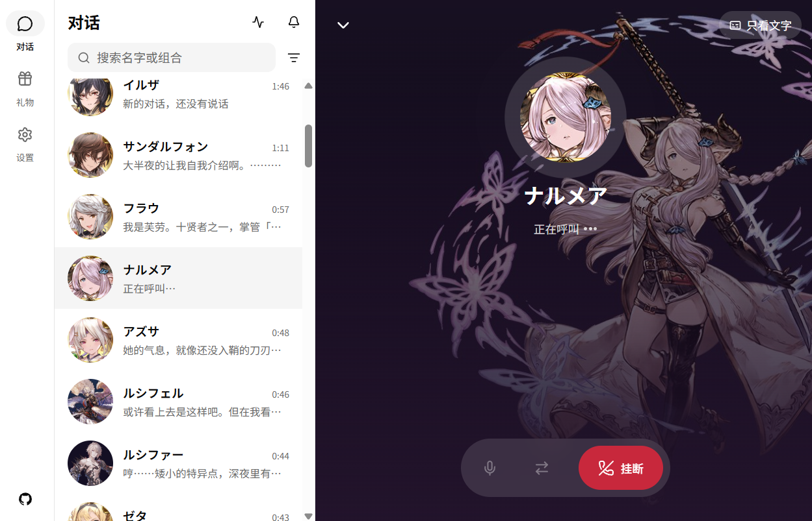
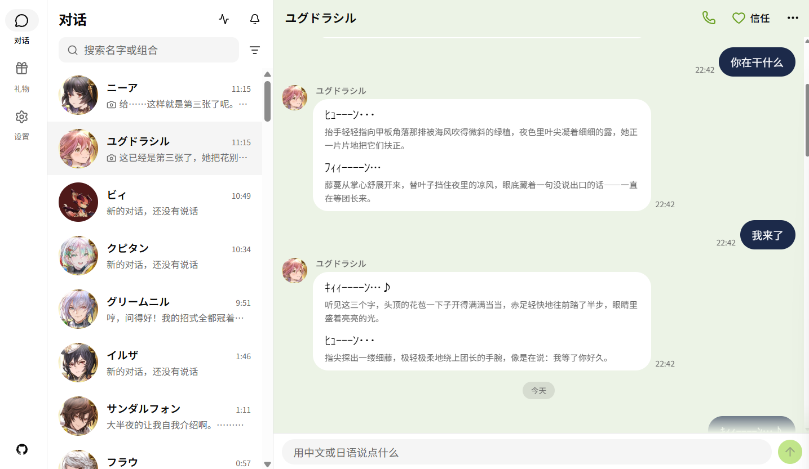
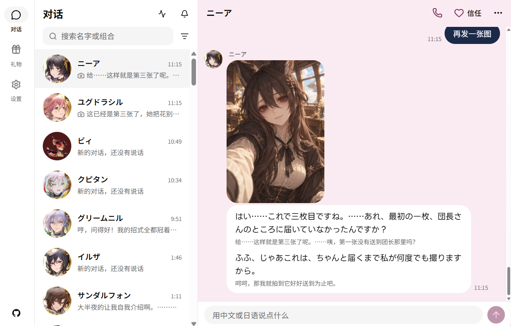
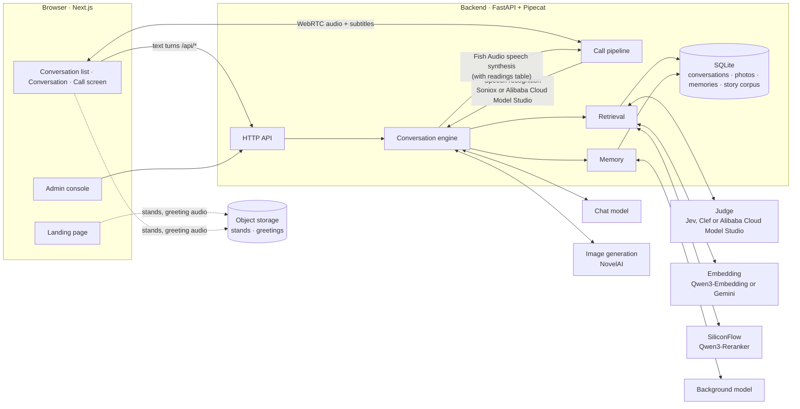

<div align="center">

# Eidolon-GBF

**AI companions for real-time conversations with your Granblue Fantasy crew members**

Voice · Text · Story recall · Memory shared across characters

[简体中文](README.md) · **English** · [日本語](README.ja.md)

[](https://github.com/Sagisawa/eidolon-gbf/actions/workflows/ci.yml)
[](backend/pyproject.toml)
[](https://fastapi.tiangolo.com/)
[](https://github.com/pipecat-ai/pipecat)
[](frontend/package.json)
[](frontend/package.json)
[](docker-compose.yml)
[](LICENSE)

[Features](#-features) · [Quick start](#-quick-start) · [Configuration guide](docs/configuration.en.md) · [Deployment](docs/deploy.md) · [Architecture decisions](docs/adr/)

</div>

---

Eidolon-GBF lets you, as **the Captain of the crew**, text or call your companions on board the Grandcypher. They answer in their original Japanese voices with Chinese subtitles; they can recall the canon story events they experienced in the original game; and they remember what you tell them, letting word "get around" among crew members.

Over **70 crew companions** are already available for direct conversation, including Eternals, Arcarum Evokers, Twelve Divine Generals, Six Dragons, and Archangels. Once deployed publicly, anyone can sign in with Google or GitHub and use it.

> [!NOTE]
> This project is a derivative adaptation and port based on [Eidolon-SC](https://github.com/Sallyn0225/eidolon-sc) by [@Sallyn0225](https://github.com/Sallyn0225), heavily refactoring and migrating the original *THE iDOLM@STER SHINY COLORS* AI companion system to the *Granblue Fantasy* universe.

> [!IMPORTANT]
> This is an unofficial fan project, not affiliated with Cygames or the rights holders of *Granblue Fantasy*; the characters are played by AI. Story data is **not distributed with this repository**; you must prepare it yourself ([ADR-0003](docs/adr/0003-corpus-and-voices-stay-private.md)). Through their replies, characters indirectly pass story content on to signed-in users; for this risk, see [ADR-0006](docs/adr/0006-open-to-the-public-with-oauth.md).

> [!WARNING]
> **Project Status (Work in Progress)**:
> - This project is currently under active development.
> - All **70 crew companions support text chat, canon lore memory retrieval (RAG), and customized photo generation**.
> - **Real-time voice calls (TTS voice models) are currently only configured for Narmaya (ナルメア) and Vikala (ビカラ)**; other crew members' bespoke voice models are being trained and integrated progressively. Community contributions are very welcome!

## 📸 Preview

<p align="center">
  
  
  
  <br>
  <sub>From left to right: Real-time voice call with Narmaya · Text chat with Yggdrasil · Photo generation with Nier</sub>
</p>

## ✨ Features

**Talk with companions**

- 🎙️ **Real-time voice calls**: Full-duplex calls over WebRTC, in Chinese or Japanese. You can interrupt at any time (*currently configured with Narmaya and Vikala voices*).
- 🇯🇵 **Japanese voice + Chinese subtitles**: Companions answer in Japanese, keeping signature verbal tics and personality tones, with a Chinese subtitle for every line ([ADR-0001](docs/adr/0001-japanese-replies-with-chinese-subtitles.md)). Proper names are pronounced accurately using a readings table.
- 🎭 **Living dynamic portraits**: During a call, original Spine portraits breathe, blink, lip-sync, and express changing emotions. When new gacha variants or outfits are added, sync them to switch outfits.
- 📷 **Companions send photos**: Ask, and your companion takes a photo of herself in the current situation and sends it; what she shoots is hers to decide ([configuration guide](docs/configuration.en.md#photos)).
- 💗 **Affinity and gifts**: What you say draws her closer or pushes her away; too many offensive remarks will cause her to hang up and end the conversation. Draw gifts every day and give them to your companions for bespoke responses.

**What companions remember**

- 📖 **Story recall**: Once the story corpus is imported, companions recall only the canon episodes and Fate Episodes **they actually appeared in**.
- 🔄 **In step with the game**: One command syncs fan translations and Japanese originals, so new stories and events can be promptly recalled. Character songs and world lore are deeply integrated.
- 🧠 **Memory shared across characters**: Tell Lyria something and Vikala or Narmaya will also know, bringing it up as "Lyria told me…" ([ADR-0002](docs/adr/0002-shared-memory-with-source-character.md)). You can inspect and delete everything remembered.
- 🗂️ **Past conversations**: Start a new conversation any time; past chats remain for browsing or deletion.
- 🪪 **Captain profile**: Form of address (e.g., "団長ちゃん", "団長っち"), gender, time zone, and birthday can all be changed in settings; companions offer bespoke birthday wishes on your birthday.
- 📊 **Stats**: See how many turns, call minutes, and gifts you've shared with companions, and export a share image.
- ⚡ **On-demand retrieval**: Each turn is first evaluated to check whether a lookup is needed, so casual small talk adds no extra latency.

**Deployment and operations**

- 👥 **Open to the public**: Sign in with Google or GitHub. Usage is rate-limited per user and memories are isolated; users can delete all their data for good, and the database is backed up offsite, encrypted, every day.
- 📦 **Data packages**: Export conversations, photos, memories, and Captain profile as a single zip, and carry on in another deployment. Affinity and gifts stay behind ([ADR-0025](docs/adr/0025-data-packages-leave-affinity-and-gifts-behind.md)).
- 🔑 **Bring your own keys**: Users can enter their own LLM, speech synthesis, speech recognition, and image generation keys to use their own quotas, without counting toward system limits when conditions are met ([configuration guide](docs/configuration.en.md#bring-your-own-keys)). Keys stay strictly in the browser ([ADR-0017](docs/adr/0017-own-api-keys-stay-in-the-browser.md)).
- 🛠️ **Admin console**: See usage, cost, and active calls; adjust models and limits without a restart; ban users and post announcements. No user conversations or memories are visible there.
- 🚦 **Service status**: Users can check directly from the conversation list whether each service is healthy.
- 🔌 **Swappable services**: Models support OpenAI Chat Completions, Responses, and Anthropic Messages interfaces; speech recognition and vector embeddings offer two providers each, and judge models offer three; every service can independently route through a network proxy.
- 🚀 **One-command deployment**: A Docker Compose production configuration with built-in Caddy (automatic HTTPS) and coturn (TURN relay). CI builds images and publishes them to GHCR.

## 🚀 Quick start

Eidolon-GBF supports both **Windows Native One-Click Launch** and **Docker Compose Deployment**.

### Option 1: Windows Native One-Click Launch (Recommended for Desktop)

> 💡 **Advantage**: Lightweight without Docker VM overhead, and WebRTC audio calls connect directly over localhost (no external TURN relay setup required).

1. **Prerequisites**: Install [Python (>= 3.11)](https://www.python.org/) with PATH enabled, and [Node.js (>= 20)](https://nodejs.org/).
2. **Clone and Launch**:
   ```cmd
   git clone https://github.com/Sagisawa/eidolon-gbf.git
   cd eidolon-gbf
   start.bat
   ```
   *The launcher will automatically configure `.venv`, install dependencies, build the frontend, and open <http://127.0.0.1:3000> in your browser.*
3. **Configure API Key**: On first launch, `.env` is automatically created with local dev login enabled (`EIDOLON_DEV_LOGIN=1`). Open `.env` and fill in your chat model credentials (`CHAT_LLM_BASE_URL`, `CHAT_LLM_API_KEY`, `CHAT_LLM_MODEL`).
4. **Shutdown**: Double-click `stop.bat` to terminate all services and free ports.

---

### Option 2: Docker Compose (Linux / Server)

Requires Docker and Docker Compose:

```sh
git clone https://github.com/Sagisawa/eidolon-gbf.git && cd eidolon-gbf
cp .env.example .env    # fill in CHAT_LLM_* credentials and set EIDOLON_DEV_LOGIN=1
docker compose up --build
```

> ⚠️ **Note on Voice Calls in Docker**: Linux hosts can route WebRTC UDP traffic directly. When running inside Docker Desktop on Windows/macOS, WebRTC media calls require a configured TURN server due to VM subnet isolation. Desktop users are strongly advised to use **Option 1 (`start.bat`)** natively.

Open <http://localhost:3000> to see the landing page. Click 「登录」 (Sign in) at the top right, choose 「开发登录」 (Dev login) in the sign-in panel, and enter any name. After you agree to the privacy policy and terms of use and confirm you are 13 or older, you land on the conversation list. Pick a companion to start a conversation.

With only the chat model set, you can chat by text. Add other services' keys as you need them to turn on voice calls, story recall, memory and stands step by step:

| Feature | Required configuration |
|---|---|
| Text chat | `CHAT_LLM_*` |
| Voice calls | `FISH_AUDIO_API_KEY`, plus a speech recognition key: `SONIOX_API_KEY` (default) or Alibaba Cloud Model Studio's `DASHSCOPE_API_KEY` |
| Story corpus | An embedding key: `SILICONFLOW_API_KEY` (default) or `GEMINI_API_KEY` |
| Retrieval and memory | An embedding key, `SILICONFLOW_API_KEY` (reranking), plus a judge: `JEV_API_KEY` (default), or Cloudflare or Alibaba Cloud Model Studio credentials |
| Photos | A judge, plus an image generation key: `NOVELAI_API_KEY` |
| Stands and greetings | `EIDOLON_STAND_ASSETS_URL` and a bucket holding the assets |

How to configure each one and what it does is in the **[Configuration guide](docs/configuration.en.md)**. Every environment variable is documented in [`.env.example`](.env.example).

## 🧩 Architecture



- Typing and speaking go through **the same conversation engine** and are written into the same conversation record. A call just wraps speech recognition and speech synthesis around the engine.
- The chat model streams its output as `<ja>…</ja><zh>…</zh>` segments. Each Japanese segment goes to synthesis as soon as it arrives, without waiting for the whole reply.

## 📚 Documentation

| Document | Contents |
|---|---|
| [Configuration guide](docs/configuration.en.md) | Configuring models, characters, calls, stands, the story corpus, retrieval, memory, photos, sign-in, own keys, the proxy, service status and the admin console, and what each does |
| [Deployment guide](docs/deploy.md) (Chinese) | Deploying to a VPS: domain, firewall, OAuth, weekly story corpus sync, stand and greeting assets, upgrades, backup and restore, troubleshooting |
| [`.env.example`](.env.example) | Every environment variable, with descriptions |
| [Architecture decision records](docs/adr/) | Why it is designed this way: the Japanese voice, shared memory, opening to the public, own keys kept only in the browser and more |
| [`GLOSSARY.md`](GLOSSARY.md) | Domain glossary |
| [`DESIGN.md`](DESIGN.md) · [`PRODUCT.md`](PRODUCT.md) | Visual design system · Product positioning |

## 🌐 Deployment

The production config [`docker-compose.prod.yml`](docker-compose.prod.yml) has four services: caddy (HTTPS entry point), frontend, backend and coturn (TURN relay). CI publishes the frontend and backend images to GHCR:

```sh
docker compose -f docker-compose.prod.yml pull
docker compose -f docker-compose.prod.yml up -d
```

`deploy/db-backup.sh` backs the database up every day, encrypted, to a private bucket, and keeps the backups for 30 days by default. For the full steps, see the [deployment guide](docs/deploy.md) (Chinese).

## 💻 Development

**Backend** (Python 3.11+, `backend/`, using [uv](https://docs.astral.sh/uv/)):

```sh
cd backend
uv sync
uv run pytest && uv run pyright && uv run ruff check
uv run --env-file=../.env eidolon serve   # serves on :8000, reads ../characters/characters.toml
```

**Frontend** (Next.js 16 + [shadcn/ui](https://ui.shadcn.com/) + Tailwind CSS v4, `frontend/`):

```sh
cd frontend
npm install
npm run typecheck && npm test && sh scripts/check-discipline.sh
npm run build && BACKEND_URL=http://localhost:8000 npm run start   # serves on :3000, forwards /api/* to the backend
```

- **Interface**: A restrained LINE-like style, with character image colors in the places that belong to them. The landing page is a visual world of its own, always dark ([ADR-0016](docs/adr/0016-landing-page-is-its-own-visual-world.md)). The visual design system is in [`DESIGN.md`](DESIGN.md); component conventions are in [`frontend/AGENTS.md`](frontend/AGENTS.md).
- **Stands**: To display stands, give the frontend the same `EIDOLON_STAND_ASSETS_URL` as in `.env`.
- **CI**: For every PR and push to main, GitHub Actions runs the checks above and shellcheck, then builds both images. Pushes to main and `v*` tags publish them to GHCR. Dependabot opens dependency updates every Monday.

## 📁 Project layout

```text
eidolon-gbf/
├── backend/          # Python backend: FastAPI + Pipecat; conversation engine, calls, retrieval, memory, sync and the CLI (eidolon)
│   ├── src/eidolon/
│   ├── eval/         #   eval sets for reranking, the judge and memory (questions and labels only, no story text)
│   └── tests/
├── frontend/         # Next.js frontend: landing page, conversations, call screen, settings, admin console
├── characters/       # character config, character sheets, character facts, avatars, readings table, world setting
├── corpus/           # story data and mirror cache (not committed)
├── deploy/           # Caddyfile, story corpus and stand sync scripts, database backup script
├── scripts/          # wizard for setting up OAuth apps (setup-oauth.sh)
├── docs/             # configuration guide, deployment guide, architecture decision records
├── docker-compose.yml          # local development
└── docker-compose.prod.yml     # production deployment
```

## 📄 License

The code in this project is released under the [GNU Affero General Public License v3.0](LICENSE) (AGPL-3.0), or (at your option) any later version. If you modify this project and provide it as a service to others over a network, you must make your modified source code available to those users.

The license covers only the code and documentation in the repository. The following are outside its scope:

- **Content from the original game**: Story data, character voices, and stand assets are not in the repository; when using them, follow the terms of their respective sources (ADR-0003). In the character sheets, character facts, and avatars in the repository, the characters and settings belong to the original rights holders.
- **Spine Runtimes**: [`frontend/public/vendor/spine-3.6/`](frontend/public/vendor/spine-3.6/README.md), used for call-screen dynamic portraits, is included unmodified and is under its own Spine Runtimes license ([ADR-0009](docs/adr/0009-spine-runtime-without-editor-license.md)). [`LICENSING.md`](LICENSING.md) grants an additional permission under section 7 of the AGPL allowing the two to be distributed combined.
- **Fonts and sound effects**: Font subsets for the landing page are under the SIL Open Font License (see `frontend/src/app/(landing)/fonts/`). For the sources and licenses of call sound effects, see [`CREDITS.md`](frontend/public/sounds/CREDITS.md).

## 🙏 Acknowledgements

- [Eidolon-SC](https://github.com/Sallyn0225/eidolon-sc): The original *Shiny Colors* AI companion system created by [@Sallyn0225](https://github.com/Sallyn0225), serving as the foundational prototype for this project
- [LAPLACE Eidolon](https://laplace.live/eidolon): A real-time voice AI companion built for the VTuber Mingqian Nailü (明前奶绿); architectural reference for this project (no code reused)
- [BLHXFY Translation Project](https://github.com/BLHXFY-Group/BLHXFY): Granblue Fantasy Chinese translations and text references
- [Granblue Fantasy Wiki](https://gbf.wiki/): Character lore, dialogues, and references
- [Pipecat](https://github.com/pipecat-ai/pipecat): Real-time voice pipeline and WebRTC transport
- [Fish Audio](https://fish.audio/): Speech synthesis
- [Soniox](https://soniox.com/), [Alibaba Cloud Model Studio](https://www.aliyun.com/product/bailian): Speech recognition
- [SiliconFlow](https://siliconflow.cn/): Qwen3 Embedding and Reranker
- [Google Gemini API](https://ai.google.dev/): Gemini Embedding (optional embedding service)
- [TypeSafe Jev](https://docs.typesafe.ai/), [OpenRouter](https://openrouter.ai/), [Cloudflare Workers AI](https://developers.cloudflare.com/workers-ai/), [Alibaba Cloud Model Studio](https://help.aliyun.com/zh/model-studio/decision-model-api): Judge models
- [Spine Runtimes](https://github.com/EsotericSoftware/spine-runtimes): Rendering dynamic portraits (spine-ts 3.6)
- [Cygames](https://cygames.co.jp/): Creators of the original game *Granblue Fantasy*

<div align="center">

---

<sub>*Granblue Fantasy* and its characters are ©Cygames, Inc. This is an unofficial fan project, not affiliated with the rights holders; characters are played by AI.</sub>

</div>
