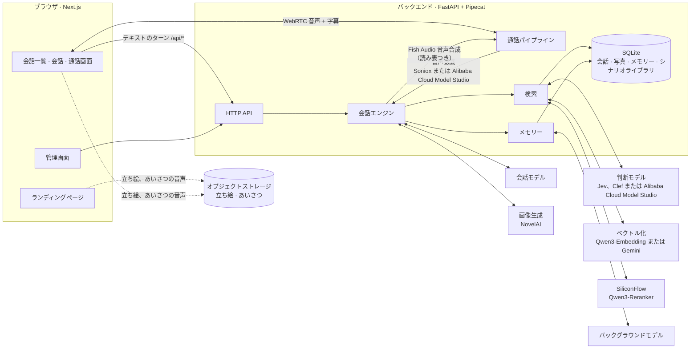

<div align="center">

# Eidolon-GBF

**『グランブルーファンタジー』（Granblue Fantasy）の騎空団メンバーとリアルタイムで話せる AI 分身**

音声 · テキスト · シナリオの記憶 · キャラクター間で共有されるメモリー

[简体中文](README.md) · [English](README.en.md) · **日本語**

[](https://github.com/Sagisawa/eidolon-gbf/actions/workflows/ci.yml)
[](backend/pyproject.toml)
[](https://fastapi.tiangolo.com/)
[](https://github.com/pipecat-ai/pipecat)
[](frontend/package.json)
[](frontend/package.json)
[](docker-compose.yml)
[](LICENSE)

[特長](#-特長) · [クイックスタート](#-クイックスタート) · [設定ガイド](docs/configuration.ja.md) · [デプロイ](docs/deploy.md) · [設計判断](docs/adr/)

</div>

---

Eidolon-GBF では、**騎空団の団長**としてグランサイファーの仲間たちとテキストでチャットしたり、そのまま通話したりできます。仲間たちはオリジナルの日本語音声で応答し、中国語字幕が付きます。原作で自身が経験した物語を思い出すことができ、団長が話したことも覚えていて、仲間たちのあいだで「伝わって」いきます。

十天衆・十賢者・十二神将・六竜・天司などを含む **70 名の騎空団メンバー** が収録済みで、すぐに会話できます。公開サーバーにデプロイすれば、誰でも Google または GitHub でログインして利用できます。

> [!NOTE]
> 本プロジェクトは、[@Sallyn0225](https://github.com/Sallyn0225) 氏によるオープンソースプロジェクト [Eidolon-SC](https://github.com/Sallyn0225/eidolon-sc) をベースに二次創作・移植したものです。元となった『アイドルマスター シャイニーカラーズ』の AI 分身システムを大幅にリファクタリングし、『グランブルーファンタジー』（Granblue Fantasy）の騎空団世界観へと移行・拡張しています。

> [!IMPORTANT]
> 本プロジェクトは非公式のファンメイド作品であり、Cygames および『グランブルーファンタジー』（Granblue Fantasy）の権利者とは一切関係ありません。キャラクターは AI が演じています。シナリオデータは**リポジトリに含まれていない**ため、各自で用意してください（[ADR-0003](docs/adr/0003-corpus-and-voices-stay-private.md)）。キャラクターの返事を通じてシナリオ内容が間接的にログインユーザーへ提供されるリスクについては [ADR-0006](docs/adr/0006-open-to-the-public-with-oauth.md) を参照してください。

> [!WARNING]
> **開発状況について（積極開発中 / Work in Progress）**：
> - 本プロジェクトは現在も積極的な開発・機能拡張を継続しています。
> - 収録されている **70 名の騎空団メンバー全員がテキスト対話、原作シナリオの想起（RAG）、および自撮り写真生成に対応**しています。
> - **リアルタイム音声通話（TTS 音声モデル）は、現時点では「ナルメア」および「ビカラ」のみ設定済み**です。他のキャラクターの専用音声は順次学習・実装を進めています。コミュニティからの貢献も大歓迎です！

## 📸 プレビュー

<p align="center">
  
  
  
  <br>
  <sub>左から：ナルメアとのリアルタイム通話 · ユグドラシルとのテキスト対話 · ニーアからの写真送信</sub>
</p>

## ✨ 特長

**仲間と話す**

- 🎙️ **リアルタイム音声通話**：WebRTC による全二重通話で、中国語でも日本語でも話せます。いつでも割り込めます（*現バージョンではナルメアとビカラの音声を実装済み*）。
- 🇯🇵 **日本語音声 + 中国語字幕**：仲間たちは日本語で答え、おなじみの口癖や声質をそのままに、一文ごとに中国語字幕が付きます（[ADR-0001](docs/adr/0001-japanese-replies-with-chinese-subtitles.md)）。固有名詞は読み表どおり正しく発音します。
- 🎭 **動く立ち絵**：通話中は原作の Spine 立ち絵が呼吸し、まばたきし、口を動かし、感情に合わせて表情を変えます。原作の新ガチャ異格や衣装も同期すれば着せ替えられます。
- 📷 **仲間が写真を送ってくれる**：頼めば、自分の姿とその場のシチュエーションに合わせて写真を撮って送ってくれます。どんな写真を撮るかは彼女自身が決めます（[設定ガイド](docs/configuration.ja.md#写真)）。
- 💗 **好感度とプレゼント**：団長の言葉しだいで心を開いたり距離を置いたりします。失礼な言動が続くと通話を切られ、会話を終了させられることも。毎日の抽選で手に入れたプレゼントを贈ると、特別なリアクションを返してくれます。

**仲間が覚えていること**

- 📖 **原作シナリオの想起**：シナリオライブラリを取り込むと、**自分が登場した**正規の出来事やフェイトエピソードだけを思い出します。
- 🔄 **原作との同期**：中国語翻訳と日本語原文をコマンド 1 つで同期し、新シナリオや新イベントもタイムリーに想起できます。キャラクターソングや世界観設定も深く融合しています。
- 🧠 **キャラクター間で共有されるメモリー**：ルリアに話したことはビカラやナルメアも知っており、「ルリアから聞いたんだけど……」という口ぶりで話題にします（[ADR-0002](docs/adr/0002-shared-memory-with-source-character.md)）。仲間が覚えていることはすべて確認・削除できます。
- 🗂️ **会話履歴**：いつでも新しい会話を始められ、過去の会話はいつでも読み返せます。不要になれば削除も可能です。
- 🪪 **団長プロフィール**：呼び方（例：「団長ちゃん」「団長っち」）、性別、タイムゾーン、誕生日を設定画面で変更できます。誕生日当日は仲間から専用の祝福メッセージが贈られます。
- 📊 **統計**：仲間たちとの会話ターン数、通話時間、贈ったプレゼントの数を確認でき、シェア画像を書き出せます。
- ⚡ **必要なときだけ検索**：発言ごとに検索が必要かどうかを先に判定するため、日常の雑談で余計な遅延が発生しません。

**デプロイと運用**

- 👥 **一般公開**：Google または GitHub でログイン。ユーザーごとに利用枠を制限し、メモリーは相互に隔離されます。ユーザーは自身のデータを完全に削除でき、データベースは毎日暗号化してオフサイトへバックアップされます。
- 📦 **データパッケージ**：会話・写真・メモリー・団長プロフィールを 1 つの zip に書き出し、別のデプロイ先にインポートして続きから利用できます。好感度とプレゼントは引き継がれません（[ADR-0025](docs/adr/0025-data-packages-leave-affinity-and-gifts-behind.md)）。
- 🔑 **自前の API キー**：ユーザーは自分の LLM・音声合成・音声認識・画像生成のキーで利用でき、条件を満たせばシステム利用上限を消費しません（[設定ガイド](docs/configuration.ja.md#自前の-api-キー)）。キーはブラウザ内にのみ保持されます（[ADR-0017](docs/adr/0017-own-api-keys-stay-in-the-browser.md)）。
- 🛠️ **管理画面**：利用量・費用・進行中の通話の監視、モデルや制限の無停止変更、ユーザーの凍結、お知らせの配信が可能。管理者が一般ユーザーの会話やメモリーを閲覧することはできません。
- 🚦 **サービス状況**：各サービスが正常に稼働しているか、ユーザーが会話一覧から確認できます。
- 🔌 **サービスの差し替え**：モデルは OpenAI Chat Completions、Responses、Anthropic Messages の 3 種類に対応。音声認識・ベクトル化は各 2 社、判定モデルは 3 社から選択可能で、サービスごとに個別のプロキシ設定も可能です。
- 🚀 **ワンコマンド本番デプロイ**：Caddy（HTTPS 自動化）と coturn（TURN 中継）を含む Docker Compose 本番構成を同梱。CI がイメージをビルドして GHCR へ公開します。

## 🚀 クイックスタート

Eidolon-GBF は **Windows ネイティブワンクリック起動** と **Docker Compose コンテナデプロイ** の両方に対応しています。

### 方法 1：Windows ネイティブワンクリック起動（デスクトップ推奨）

> 💡 **利点**：Docker 仮想マシンのオーバーヘッドがなく軽量で、WebRTC 音声通話もローカルループバックで直結します（TURN リレーサーバーの追加設定が不要）。

1. **事前準備**：[Python (>= 3.11)](https://www.python.org/)（PATH への追加にチェック）と [Node.js (>= 20)](https://nodejs.org/) をインストール。
2. **クローンして起動**：
   ```cmd
   git clone https://github.com/Sagisawa/eidolon-gbf.git
   cd eidolon-gbf
   start.bat
   ```
   *起動スクリプトが自動で `.venv` 仮想環境の作成、依存関係のインストール、フロントエンドのビルドを行い、ブラウザで <http://127.0.0.1:3000> を開きます。*
3. **API キーの設定**：初回起動時に `.env.example` から `.env` が自動生成され、開発ログイン（`EIDOLON_DEV_LOGIN=1`）が有効になります。`.env` をメモ帳などで開き、会話モデルの認証情報（`CHAT_LLM_BASE_URL`・`CHAT_LLM_API_KEY`・`CHAT_LLM_MODEL`）を記入してください。
4. **停止方法**：`stop.bat` をダブルクリックするだけでポートを解放して終了します。

---

### 方法 2：Docker Compose デプロイ（Linux / サーバー）

Docker と Docker Compose が必要です：

```sh
git clone https://github.com/Sagisawa/eidolon-gbf.git && cd eidolon-gbf
cp .env.example .env    # CHAT_LLM_* を記入し、EIDOLON_DEV_LOGIN=1 を設定
docker compose up --build
```

> ⚠️ **音声通話のネットワークに関する注意**：Linux ではコンテナが直接 WebRTC UDP 通信を行えますが、Windows / macOS の Docker Desktop 仮想環境内ではサブネット分離のため TURN サーバーの設定が必要となります。デスクトップでの利用には**方法 1（`start.bat`）**を推奨します。

<http://localhost:3000> を開くとランディングページです。右上の「登录」（ログイン）を押し、ログインパネルで「开发登录」（開発ログイン）を選んで好きな名前を入れ、プライバシーポリシーと利用規約に同意し、13 歳以上であることを申告すると会話一覧に入ります。仲間を選べば会話が始まります。

会話モデルだけを設定した状態ではテキストチャットができます。必要に応じてほかのサービスのキーを追加すれば、音声通話・シナリオの記憶・メモリー・立ち絵が段階的に有効になります：

| 機能 | 必要な設定 |
|---|---|
| テキストチャット | `CHAT_LLM_*` |
| 音声通話 | `FISH_AUDIO_API_KEY` と音声認識のキー：`SONIOX_API_KEY`（デフォルト）または Alibaba Cloud Model Studio の `DASHSCOPE_API_KEY` |
| シナリオライブラリ | ベクトル化のキー：`SILICONFLOW_API_KEY`（デフォルト）または `GEMINI_API_KEY` |
| 検索とメモリー | ベクトル化のキー、`SILICONFLOW_API_KEY`（並べ替え用）、判断モデル：`JEV_API_KEY`（デフォルト）、Cloudflare または Alibaba Cloud Model Studio の認証情報 |
| 写真 | 判断モデルと画像生成のキー：`NOVELAI_API_KEY` |
| 立ち絵とあいさつ | `EIDOLON_STAND_ASSETS_URL` と素材を置くストレージバケット |

それぞれの設定方法と設定したときの効果は **[設定ガイド](docs/configuration.ja.md)** を、すべての環境変数の説明は [`.env.example`](.env.example) を参照してください。

## 🧩 アーキテクチャ



- 文字入力も音声も**同じ会話エンジン**を通り、同じ会話記録に書き込まれます。通話はエンジンの外側に音声認識と音声合成を被せただけのものです。
- 会話モデルは `<ja>…</ja><zh>…</zh>` の区切り形式でストリーミング出力し、日本語が届いた時点で音声合成に回すため、返事全体が終わるのを待つ必要がありません。

## 📚 ドキュメント

| ドキュメント | 内容 |
|---|---|
| [設定ガイド](docs/configuration.ja.md) | モデル、キャラクター、通話、立ち絵、シナリオライブラリ、検索、メモリー、写真、ログイン、自前の API キー、ネットワークプロキシ、サービス状況、管理画面の設定と効果 |
| [デプロイガイド](docs/deploy.md)（中国語） | VPS へのデプロイ：ドメイン、ファイアウォール、OAuth、シナリオライブラリの週次同期、立ち絵とあいさつの素材、アップグレード、バックアップと復元、トラブルシューティング |
| [`.env.example`](.env.example) | すべての環境変数とその説明 |
| [アーキテクチャ決定記録](docs/adr/) | なぜこう設計したか：日本語の声、共有メモリー、一般公開、自前のキーはブラウザーにだけ保存、など |
| [`GLOSSARY.md`](GLOSSARY.md) | ドメイン用語集 |
| [`DESIGN.md`](DESIGN.md) · [`PRODUCT.md`](PRODUCT.md) | ビジュアル仕様 · プロダクトの位置づけ |

## 🌐 デプロイ

本番構成 [`docker-compose.prod.yml`](docker-compose.prod.yml) は caddy（HTTPS の入口）、frontend、backend、coturn（TURN 中継）の 4 つのサービスからなり、フロントエンドとバックエンドのイメージは CI が GHCR に公開します：

```sh
docker compose -f docker-compose.prod.yml pull
docker compose -f docker-compose.prod.yml up -d
```

データベースは `deploy/db-backup.sh` が毎日暗号化して非公開のストレージバケットにバックアップし、初期状態では 30 日間保存します。詳しい手順は [デプロイガイド](docs/deploy.md)（中国語）を参照してください。

## 💻 開発

**バックエンド**（Python 3.11+、`backend/`、[uv](https://docs.astral.sh/uv/) を使用）：

```sh
cd backend
uv sync
uv run pytest && uv run pyright && uv run ruff check
uv run --env-file=../.env eidolon serve   # :8000 で起動し、../characters/characters.toml を読み込む
```

**フロントエンド**（Next.js 16 + [shadcn/ui](https://ui.shadcn.com/) + Tailwind CSS v4、`frontend/`）：

```sh
cd frontend
npm install
npm run typecheck && npm test && sh scripts/check-discipline.sh
npm run build && BACKEND_URL=http://localhost:8000 npm run start   # :3000 で起動し、/api/* をバックエンドへ転送
```

- **画面**：控えめな LINE 風のデザインで、キャラクターに属する場所にはそれぞれのイメージカラーを使います。ランディングページは常にダークの、独立したビジュアルの世界です（[ADR-0016](docs/adr/0016-landing-page-is-its-own-visual-world.md)）。ビジュアル仕様は [`DESIGN.md`](DESIGN.md)、コンポーネントの書き方の決まりは [`frontend/AGENTS.md`](frontend/AGENTS.md) にあります。
- **立ち絵**：立ち絵を表示するときは、フロントエンドにも `.env` と同じ `EIDOLON_STAND_ASSETS_URL` を渡します。
- **CI**：PR と main へのプッシュごとに、GitHub Actions が上記のチェックと shellcheck を実行し、2 つのイメージをビルドします。main と `v*` タグへのプッシュでは GHCR に公開します。Dependabot が毎週月曜に依存関係の更新を提案します。

## 📁 ディレクトリ構成

```text
eidolon-gbf/
├── backend/          # Python バックエンド：FastAPI + Pipecat。会話エンジン、通話、検索、メモリー、同期とコマンドライン（eidolon）
│   ├── src/eidolon/
│   ├── eval/         #   並べ替え・判断モデル・メモリーの評価用データセット（質問とラベルのみ、シナリオ本文は含まない）
│   └── tests/
├── frontend/         # Next.js フロントエンド：ランディングページ、会話、通話画面、設定、管理画面
├── characters/       # キャラクター設定、キャラクターシート、資料、アイコン、読み表、世界設定
├── corpus/           # シナリオデータとミラーのキャッシュ（リポジトリ外）
├── deploy/           # Caddyfile、シナリオライブラリと立ち絵の同期スクリプト、データベースのバックアップスクリプト
├── scripts/          # OAuth アプリ設定のウィザード（setup-oauth.sh）
├── docs/             # 設定ガイド、デプロイガイド、アーキテクチャ決定記録
├── docker-compose.yml          # ローカル開発用
└── docker-compose.prod.yml     # 本番デプロイ用
```

## 📄 ライセンス

本プロジェクトのコードは [GNU Affero General Public License v3.0](LICENSE)（AGPL-3.0）、または（あなたの選択により）それ以降の任意のバージョンの下で公開されています。本プロジェクトを改変してネットワーク経由で他者にサービスを提供する場合は、その利用者に改変後のソースコードを公開する必要があります。

ライセンスの対象はリポジトリ内のコードとドキュメントだけで、次のものは対象外です：

- **原作のコンテンツ**：シナリオデータ、キャラクター音声、立ち絵素材はリポジトリに含まれておらず、利用時はそれぞれの提供元の条件に従う必要があります（ADR-0003）。リポジトリ内のキャラクター設定・キャラクター資料・アイコンについても、キャラクターと設定は原作の権利者に帰属します。
- **Spine Runtimes**：通話画面の立ち絵に使う [`frontend/public/vendor/spine-3.6/`](frontend/public/vendor/spine-3.6/README.md) は無改変で収録しており、それ自身の Spine Runtimes ライセンスが適用されます（[ADR-0009](docs/adr/0009-spine-runtime-without-editor-license.md)）。[`LICENSING.md`](LICENSING.md) に AGPL 第 7 条の追加許可があり、両者を組み合わせて頒布することを認めています。
- **フォントと効果音**：ランディングページのフォントサブセットには SIL Open Font License が適用されます（`frontend/src/app/(landing)/fonts/` を参照）。通話の効果音の出典とライセンスは [`CREDITS.md`](frontend/public/sounds/CREDITS.md) を参照してください。

## 🙏 謝辞

- [Eidolon-SC](https://github.com/Sallyn0225/eidolon-sc)：[@Sallyn0225](https://github.com/Sallyn0225) 氏による原版『シャイニーカラーズ』AI システム。本プロジェクトの基盤プロトタイプ
- [LAPLACE Eidolon](https://laplace.live/eidolon)：VTuber・明前奶绿のために作られたリアルタイム音声 AI 分身。本プロジェクトのアーキテクチャの参考（コードは流用していません）
- [BLHXFY 翻訳プロジェクト](https://github.com/BLHXFY-Group/BLHXFY)：『グランブルーファンタジー』テキストおよび中国語訳リファレンス
- [Granblue Fantasy Wiki](https://gbf.wiki/)：キャラクター設定、セリフ、設定考証
- [Pipecat](https://github.com/pipecat-ai/pipecat)：リアルタイム音声パイプラインと WebRTC 通信
- [Fish Audio](https://fish.audio/)：音声合成
- [Soniox](https://soniox.com/)、[Alibaba Cloud Model Studio](https://www.aliyun.com/product/bailian)：音声認識
- [SiliconFlow](https://siliconflow.cn/)：Qwen3 Embedding と Reranker
- [Google Gemini API](https://ai.google.dev/)：Gemini Embedding（選択可能なベクトル化サービス）
- [TypeSafe Jev](https://docs.typesafe.ai/)、[OpenRouter](https://openrouter.ai/)、[Cloudflare Workers AI](https://developers.cloudflare.com/workers-ai/)、[Alibaba Cloud Model Studio](https://help.aliyun.com/zh/model-studio/decision-model-api)：判断モデル
- [Spine Runtimes](https://github.com/EsotericSoftware/spine-runtimes)：立ち絵の再生（spine-ts 3.6）
- [Cygames](https://cygames.co.jp/)：『グランブルーファンタジー』（Granblue Fantasy）原作ゲームの開発・運営元

<div align="center">

---

<sub>『グランブルーファンタジー』（Granblue Fantasy）およびそのキャラクターの著作権は ©Cygames, Inc. に帰属します。本プロジェクトは非公式のファンメイド作品であり、権利者とは関係ありません。キャラクターは AI が演じています。</sub>

</div>
