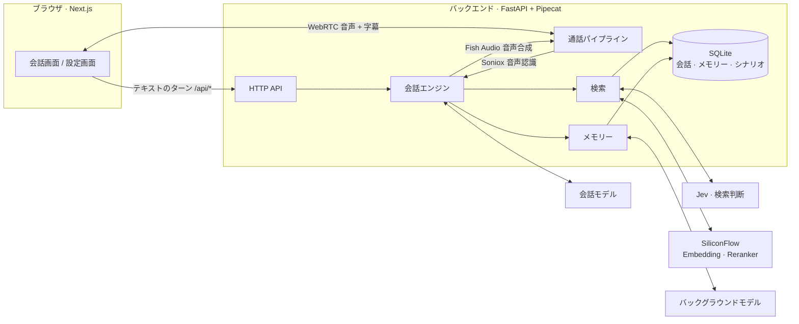
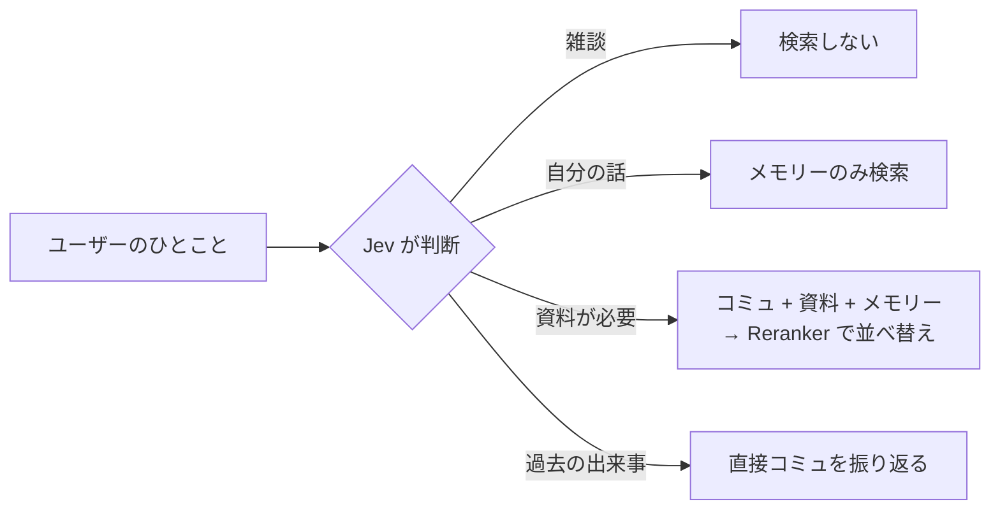

<div align="center">

# Eidolon-SC

**『アイドルマスター シャイニーカラーズ』のアイドルとリアルタイムで話せる AI 分身システム**

音声通話 · テキスト · コミュの記憶 · キャラクター間で共有されるメモリー

[简体中文](README.md) · [English](README.en.md) · **日本語**

[](backend/pyproject.toml)
[](https://fastapi.tiangolo.com/)
[](https://github.com/pipecat-ai/pipecat)
[](frontend/package.json)
[](frontend/package.json)
[](frontend/tsconfig.json)
[](backend/src/eidolon/store.py)
[](docker-compose.yml)
[](LICENSE)
[](docs/adr/0003-corpus-and-voices-stay-private.md)

</div>

---

Eidolon-SC では、**283プロのプロデューサー**として原作のアイドルとチャットしたり、そのまま音声通話したりできます。アイドルは日本語の声で答え、中国語字幕が付きます。自分が原作で経験したコミュを思い出し、あなたが話したことも覚えていて——ほかのアイドルにも「伝わって」いきます。

作者本人と身近な仲間内で使うためのプロジェクトで、一般向けのサービスは提供していません。用語集は [`CONTEXT.md`](CONTEXT.md)、設計判断は [`docs/adr/`](docs/adr/) にあります。

> [!NOTE]
> UI・字幕・メモリー・ドキュメントの大半は中国語です。ユーザーは中国語でも日本語でも話しかけられます。

> [!IMPORTANT]
> 本プロジェクトは非公式のファンメイド作品であり、バンダイナムコエンターテインメントおよび『アイドルマスター』シリーズの権利者とは一切関係ありません。シナリオデータとキャラクター音声は**リポジトリに含まれていません**。各自で用意し、私的利用の範囲でのみ使用してください（[ADR-0003](docs/adr/0003-corpus-and-voices-stay-private.md)）。

## ✨ 特長

| | |
|---|---|
| 🎙️ **リアルタイム音声通話** | WebRTC による全二重通話。中国語でも日本語でも話せて、アイドルは Fish Audio の音声で日本語の返事を読み上げ、字幕も同時に表示 |
| 🇯🇵 **日本語の声 + 中国語字幕** | アイドルは常に日本語で答え、語尾や口癖をそのまま残しつつ、一文ごとに中国語字幕を付与（[ADR-0001](docs/adr/0001-japanese-replies-with-chinese-subtitles.md)） |
| 📖 **コミュの記憶** | シナリオを取り込むと、アイドルは**自分が登場した**正規ルートのコミュだけを思い出し、「あのときって……」という質問に答えられる |
| 🧠 **キャラクター間で共有されるメモリー** | 真乃に話したことは恋鐘も知っている——ただし「真乃から聞いたんやけど……」という口ぶりで（[ADR-0002](docs/adr/0002-shared-memory-with-source-character.md)） |
| ⚡ **必要なときだけ検索** | 軽量モデルがまず検索の要否を判断するので、雑談では余計な遅延ゼロ |
| 🔌 **モデルは自由に差し替え可能** | OpenAI Chat Completions・OpenAI Responses・Anthropic Messages の 3 方式に対応し、互換のサードパーティサービスも利用可能 |
| 📝 **キャラクターシートの下書き生成** | バックグラウンドモデルがアイドルのコミュをすべて読み、キャラクターシートの下書きを作成。あとは人の手で校正 |
| 👥 **マルチユーザーと利用上限** | CLI でアクセスキーを発行。ユーザーごとの利用上限と完全に分離されたメモリーで、友人との共有も安心 |
| 🚀 **ワンコマンドでデプロイ** | Caddy（HTTPS 自動化）と coturn（TURN 中継）入りの本番構成を同梱 |

## 🧭 目次

- [アーキテクチャ](#-アーキテクチャ)
- [クイックスタート](#-クイックスタート)
- [設定](#-設定)
  - [モデル](#モデル)
  - [キャラクター](#キャラクター)
  - [音声通話](#音声通話)
  - [シナリオライブラリ](#シナリオライブラリ)
  - [会話中の検索](#会話中の検索)
  - [メモリー](#メモリー)
  - [ユーザーとアクセスキー](#ユーザーとアクセスキー)
- [VPS へのデプロイ](#-vps-へのデプロイ)
- [開発](#-開発)
- [ディレクトリ構成](#-ディレクトリ構成)
- [ライセンス](#-ライセンス)
- [謝辞](#-謝辞)

## 🧩 アーキテクチャ



- 文字入力も音声も**同じ会話エンジン**を通り、同じ会話記録に書き込まれます。通話はエンジンの外側に音声認識と音声合成を被せただけのものです。
- 会話モデルは `<ja>…</ja><zh>…</zh>` の区切り形式でストリーミング出力し、日本語部分が届いた時点で音声合成に回すため、返事全体を待つ必要がありません。

## 🚀 クイックスタート

**必要なもの**：Docker と Docker Compose、そしてストリーミング出力とツール呼び出しに対応した会話モデル。

```sh
git clone https://github.com/Sallyn0225/eidolon-sc.git && cd eidolon-sc
cp .env.example .env   # 会話モデルの URL・API キー・モデル名を記入
# キャラクターシートを用意（下記「キャラクター」参照）
docker compose up --build
```

続いてアクセスキーを発行します：

```sh
docker compose exec backend eidolon user create alice
docker compose exec backend eidolon key issue alice   # キーは一度だけ表示されます
```

<http://localhost:3000> を開き、設定画面でアクセスキーを入力すれば、キャラクター選択画面からアイドルを選んで話せます。

> [!TIP]
> 会話モデルだけでもテキストチャットは可能です。ほかのサービスのキーを追加していくことで、音声・コミュの記憶・メモリーが段階的に有効になります：
>
> | 機能 | 必要な設定 |
> |---|---|
> | テキストチャット | `CHAT_LLM_*` |
> | 音声通話 | `SONIOX_API_KEY`、`FISH_AUDIO_API_KEY` |
> | シナリオの取り込み | `SILICONFLOW_API_KEY` |
> | 検索とメモリー | `SILICONFLOW_API_KEY`、`AI_GATEWAY_API_KEY`、`JEV_MODEL` |
>
> 全設定項目の説明は [`.env.example`](.env.example) にあります（コメントは中国語）。

## 🔧 設定

### モデル

**会話モデル**はユーザーとの会話を、**バックグラウンドモデル**はメモリーの抽出とキャラクターシートの下書きを担当します。両者は `.env` で別々に設定し、それぞれ 3 種類の方式から選べます（`CHAT_LLM_PROTOCOL`、`BACKGROUND_LLM_PROTOCOL`）：

| 値 | 方式 | リクエスト先 |
|---|---|---|
| `chat-completions`（デフォルト） | OpenAI 互換 Chat Completions | `{URL}/chat/completions` |
| `responses` | OpenAI Responses | `{URL}/responses` |
| `anthropic` | Anthropic Messages | `{URL}/messages` |

URL・キー・モデル名は自分で指定するので、これらの方式に対応したサードパーティサービスも利用できます。

- 会話モデルはストリーミング出力とツール呼び出しに対応している必要があります。バックエンドは起動時に小さなチェックリクエスト（ツール 1 つ、ストリーミング指定）を送り、ストリーミングで返らない・ツールを受け付けない・URL やキーが誤っている場合は起動を拒否し、どの条件を満たしていないか、サービスが何を返したかを表示します。
- 返事の前に出力される思考内容（reasoning / thinking）は無視され、返事には含まれません。
- Anthropic 方式では返事ごとの長さ上限が必須で、デフォルトは 16384 トークンです。`CHAT_LLM_MAX_TOKENS`・`BACKGROUND_LLM_MAX_TOKENS` で調整できます（ほかの方式は未設定なら無制限）。この項目は 2 つのモデルで独立しており、長いシートの下書きが途切れないよう、バックグラウンドモデルは会話モデルの上限を引き継ぎません。
- バックグラウンドモデルのそれ以外の項目は、未設定なら会話モデルの設定を引き継ぎます。たとえば `BACKGROUND_LLM_MODEL` だけ指定すれば、同じサービス上で安価なモデルに切り替えられます。

### キャラクター

キャラクターは [`characters/characters.toml`](characters/characters.toml) で設定します：ID、表示名、紹介文、Fish Audio の音声 ID、キャラクターシートとアイコンの場所。キャラクターの追加や音声 ID の差し替えは、このファイルを編集してバックエンドを再起動するだけです。

```toml
[[characters]]
id = "mano"
name = "櫻木真乃"
intro = "illumination STARS 的中心。温柔又有点慢热，喜欢鸟……"
voice_id = "a1150f3d14ac46fb8ea59c7803cd8357"
sheet = "sheets/mano.md"
avatar = "avatars/mano.png"
facts = "facts/mano.md"
speakers = ["真乃"]
```

キャラクターシート・キャラクター資料・アイコンは**リポジトリに含めません**（ADR-0003）。起動前に [`characters/sheets/example.md`](characters/sheets/example.md) を参考に `characters/sheets/mano.md` と `characters/sheets/kogane.md` を書いてください。キャラクター資料（任意）は [`characters/facts/example.md`](characters/facts/example.md) を参考に `characters/facts/` 以下へ、アイコン（任意）は `characters/avatars/` 以下に置きます。シートが欠けているとバックエンドは起動を拒否し、どのファイルが足りないかを示します。docker compose は `characters/` をバックエンドコンテナに読み取り専用でマウントします。

<details>
<summary><b>バックグラウンドモデルでキャラクターシートの下書きを作る</b></summary>

<br>

シナリオをもとにバックグラウンドモデルに下書きを書かせ、あとから人の手で校正することもできます（先にシナリオの取り込みが必要。バックグラウンドモデルの設定は上記「モデル」参照）：

```sh
uv run eidolon --db data/eidolon.db character draft-sheet mano   # backend/ 内で実行
# docker compose では characters/ が読み取り専用なので、データボリュームに書き出してからコピー
docker compose exec backend eidolon character draft-sheet mano --output /data/drafts/mano.md
docker compose cp backend:/data/drafts/mano.md characters/sheets/mano.md
```

- 素材はそのアイドルが登場する正規ルートのコミュのみです。下書きは身分、一人称、他者への呼び方、口癖、ユニットメンバー、厳守ルールの順に構成され、モデルが書き漏らした節には「（待补充）」（要追記）が残ります。上限を超えるコミュは分割して読み、切り捨てはしません。
- 下書きの 1 行目は下書きマーカーです。マーカーがあってもシートは普通に使えます（マーカーはプロンプトに入りません）が、バックエンド起動時に未校正の警告が出ます。校正が済んだらこの行を削除してください。
- 校正済み（マーカーなし）のシートは上書きされません。どうしても再生成したい場合は `--force` を付けます。未校正の下書きはそのまま新しい下書きに置き換わります。
- 素材が 1 リクエストの上限（`--budget`、デフォルト 40000 字）を超える場合は、まずバッチごとにノートを取らせ、そのノートから下書きを書きます。20 バッチを超える場合は全コミュから均等に抽出します。真乃はおよそ 220 コミュ・33 万字で、バックグラウンドモデルへのリクエストは 10 回程度です。

</details>

### 音声通話

`.env` に `SONIOX_API_KEY` と `FISH_AUDIO_API_KEY` を設定すると、会話画面の「音声通話」ボタンが使えるようになります：

- 中国語でも日本語でも話せます。アイドルは設定された Fish Audio の音声で日本語の返事を読み上げ、日本語の原文と中国語字幕が会話記録に同時に表示されます。
- 通話中に入力した文字も話した内容と同じ会話に入り、アイドルはやはり音声で答えます。
- 「ミュート」をオンにすると、音声合成はせず文字だけを表示します。マイクと通話音質は設定画面で選べます。
- `FISH_AUDIO_MODEL` のデフォルトは API クレジットを消費しない `s2.1-pro-free` です。クレジットがあれば有料モデルに切り替えられます。

> [!NOTE]
> ブラウザとバックエンドは WebRTC（UDP）で直接つながります。ローカルで docker compose を使う場合、Linux 上のブラウザはコンテナへ直接接続できます。それ以外（macOS の Docker Desktop、スマートフォンからのアクセス）ではブラウザからバックエンドに到達できる必要があり、通常は TURN サーバーの設定が要ります。`.env.example` の `EIDOLON_ICE_SERVERS` と `EIDOLON_TURN_URLS` を参照してください。公開サーバー向けの本番構成には coturn が同梱されています（[`docs/deploy.md`](docs/deploy.md)）。

### シナリオライブラリ

アイドルが思い出せる原作のコミュは [SCTranslationData](https://github.com/ShinyGroup/SCTranslationData) のシナリオ CSV から取り込み、足りない分はゲームの生スクリプト JSON で補えます。シナリオデータはリポジトリに含めません（ADR-0003）。リポジトリ直下の `corpus/` に clone し（git 管理外で、docker compose がバックエンドコンテナの `/corpus` に読み取り専用でマウント）、`.env` に `SILICONFLOW_API_KEY` を設定してから取り込みます：

```sh
git clone --depth 1 https://github.com/ShinyGroup/SCTranslationData.git corpus/SCTranslationData
docker compose exec backend eidolon story import-csv /corpus/SCTranslationData/data/story
```

<details>
<summary><b>CSV 取り込みのルール</b></summary>

<br>

- CSV 1 つが 1 コミュになり、ファイル末尾の `info` 行が指す元スクリプトを主キーとします。再取り込みすると上書き更新され、内容が変わっていないコミュは再ベクトル化されないので、原作の更新後はいつでも取り込み直せます。
- 失敗エンド（W.I.N.G. 敗退、シーズン目標未達成、G.R.A.D. 敗退、オーディション落選、約束を守れなかった場合）はスクリプト番号で識別して除外します。プロデューサーの選択肢は記録しません。
- 登場キャラクターはセリフの話者で識別します。`characters.toml` の各キャラクターの `speakers` に、スクリプト上での名前（例：`真乃`）を列挙します。`speakers` の変更やキャラクター追加のあとは再取り込みが必要です。
- ベクトル化のデフォルトは SiliconFlow の `Qwen/Qwen3-Embedding-0.6B` で、`EMBEDDING_MODEL` で変更できます。モデルを変えたら再取り込みしてください。登場キャラクターが空でないコミュだけがベクトル化されます。
- コミュ目録は「キャラクター → カードまたはイベント → 話」の階層で、シナリオライブラリから直接生成されるため、常に最新の取り込み結果と一致します。取り込みの最後に各キャラクターの目録規模が表示されます。

</details>

<details>
<summary><b>ゲームの生スクリプト JSON で補完する</b></summary>

<br>

SCTranslationData にないコミュは、ゲームの生スクリプト JSON で補えます（各ファイルは 1 スクリプト分のフレーム配列で、`speaker`・`text`・`select` などのフィールドを持ちます）：

```sh
docker compose exec backend eidolon story import-json /corpus/scripts
```

- スクリプト番号はファイルパスから取得します。ゲーム内のパス（`produce_events/100100101.json`）でも、翻訳プラグインの命名（`produce_events_100100101.json`）でも構いません。パスにスクリプト番号がないファイルは警告を出してスキップします（同じスクリプトの CSV と重複排除できないため）。
- SCTranslationData のように「出典/」ディレクトリ以下に置いた場合は、出典がディレクトリ名、タイトルがファイル名になります。ゲーム内のパスで置いた場合は、出典は末尾 2 桁（話数）を除いたスクリプト番号（例：`produce_events/2011005`）、タイトルは `produce_events_201100501` のような名前になります。
- ルールは CSV と同じです：失敗エンドは除外、プロデューサーの選択肢は記録せず、各選択肢に対するアイドルの反応はすべて残します。
- 同じスクリプトがすでに CSV から取り込まれている場合は中国語訳付きの CSV 版を優先し、JSON では上書きしません。逆に、あとから取り込んだ CSV は JSON 版を置き換えます。JSON のみから取り込んだコミュには中国語訳がありませんが、検索とコミュ目録は通常どおり使えます。

</details>

<details>
<summary><b>コマンド 1 つで同期：翻訳版＋ミラーの原文コミュ</b></summary>

<br>

`eidolon story sync` は SCTranslationData の翻訳版を取り込んだあと、ShinyColorsDB のデコード済みミラー（ADR-0004）から、シナリオライブラリにまだない P カード・S カード・プロデュース・イベントのコミュを原文コミュとして取り込みます：

```sh
docker compose exec backend eidolon story sync
```

- 原文コミュの出典はカード名（例：`【ほわっとスマイル】櫻木真乃`。SCTranslationData のディレクトリ名と同じ形式）、タイトルはゲーム内のコミュタイトルです。翻訳版が揃うと同じスクリプト番号で置き換わり、同じカードの下に残ります。翻訳版があるコミュはダウンロードも上書きもしません。
- プロデュースコミュ（W.I.N.G.・感謝祭・G.R.A.D.・Landing Point・S.T.E.P.、およびモーニング・応援・オーディション・TV 出演などのコミュ）と、誕生日やシーズンなどのスペシャルコミュは、各アイドルのゲーム内アルバム（2024 年 3 月以降は更新なし）から取ります。出典は SCTranslationData がアルバムの同じ部分に使っているディレクトリ名（例：`W.I.N.G.編`、`Morning`）、その部分に翻訳が 1 つもなければアルバムの名前で、タイトルはアルバムのタイトルです。敗北エンドはダウンロードも取り込みもしません。同期の最後に、今回取り込んだプロデュースコミュのうちタイトルに「敗」「失敗」を含むのに敗北エンドのルールで除外されなかったものを一覧表示するので、手で確認してください。アルバムに変化がなければ条件付きリクエスト 1 件だけで、アルバムにあってミラーにないスクリプトはアルバムが変わるまで再試行しません。
- イベントコミュには一覧がないため、スクリプト番号（`4001` + 3 桁のイベント番号 + 2 桁の話数）から推測します。既知の範囲で欠けているイベントと話を補い、最新のイベントの後ろをいくつか試すので、新しいイベントがなければ 404 のリクエストが数件増えるだけです。イベント名は `deploy/event-names.toml` から取ります（`deploy/event-names.example.toml` を参考に作成し、新しいイベントごとに 1 行追加。名前は SCTranslationData のそのイベントのディレクトリ名と同じにします。リポジトリには入りません）。編集すると次回の同期でシナリオ目録に反映されます。表にないイベントは SCTranslationData で翻訳済みの話のディレクトリ名を使い、1 話も翻訳がなければ「活动剧情 NNN」「第N話」と表示され、同期の最後にその番号が一覧表示されます。`--events` で別の表を指定できます。
- ダウンロードしたスクリプトは `EIDOLON_MIRROR_CACHE_PATH`（コンテナではデータボリューム内の `/data/mirror`、ローカルのデフォルトは `corpus/mirror`）にキャッシュされ、リポジトリには入りません。変化のないカードは再リクエストせず、変化したカードとアルバムは ETag による条件付きリクエストを使います。リクエストは 1 件ずつ約 1 秒間隔なので、初回の全量同期は 1〜2 時間かかり、以降は数分で終わります。
- ミラーに接続できない場合も翻訳版は通常どおり取り込まれ、コマンドは終了コード 2 で終わります。中断後に再実行すると続きから再開し、ダウンロード済みのスクリプトは再ダウンロードしません。
- `--idol 1` で特定のアイドルのカードとアルバムだけを同期できます（イベントは同期しません。ミラー API のアイドル番号、複数指定可）。翻訳版のディレクトリはデフォルトで `EIDOLON_STORY_PATH`、`--story` でも指定できます。

</details>

ローカル開発では `uv run eidolon --db data/eidolon.db story import-csv <ディレクトリ>` を使います（`import-json` も同様）。

### 会話中の検索

`.env` に `SILICONFLOW_API_KEY`・`AI_GATEWAY_API_KEY`・`JEV_MODEL` を設定すると、アイドルは会話中にコミュを思い出したり、キャラクター資料を参照したりできます。どれか 1 つでも欠けていれば、キャラクターシートだけで返事をします。



- ひとことごとに、まず Jev（Vercel AI Gateway 経由）が何が必要かを判断します。雑談なら検索せず、遅延も増えません。資料が必要なら下記の検索を行います。「あのときって……」のように過去の出来事を尋ねられた場合は、その発言でそのまま「コミュを振り返る」を実行して結果をプロンプトに入れ、会話モデルがツールを呼ぶ 1 往復を省きます。Jev がエラーの場合は通常どおり検索します。
- 検索時は、現在のアイドルが登場するコミュと彼女のキャラクター資料を同時に検索し、SiliconFlow の Qwen3-Reranker（`RERANK_MODEL` で変更可）で並べ替え、関連度が十分高いものを最大 5 件プロンプトに入れます（話題と無関係なら 1 件も入れません）。検索や並べ替えでエラーが起きた場合、そのターンは検索結果なしで通常どおり返事をします。
- 会話モデルは「コミュを振り返る」ツール（`recall_story`）も呼べます。プロデューサーに過去の出来事を聞かれると、アイドルは要約した一文で自分が登場したコミュを検索し、最も関連する最大 2 コミュの本文（コミュ目録上のカード／イベントと、同じ場所にあるほかのコミュ付き）を受け取って答えます。ツール呼び出しはひとことにつき最大 1 往復で、Jev がすでに「振り返り」と判断したターンではツールを提供しません。
- キャラクター資料は `characters.toml` の `facts` が指す Markdown ファイルで、見出しごとに 1 項目です。あるアイドルを初めて検索したときにベクトル化され、以降は変更のあった項目だけが再ベクトル化されます。編集後はバックエンドを再起動するだけで反映されます。

### メモリー

アイドルはユーザーが自分について話したことを覚えていて、同じユーザーのすべてのアイドルがそのメモリーを共有します。真乃に話したことは恋鐘も知っていますが、「真乃から聞いたんやけど……」という口ぶりで持ち出します（ADR-0002）。ユーザー同士のメモリーは完全に分離されています。メモリーは検索と同時に有効になります（`SILICONFLOW_API_KEY`・`AI_GATEWAY_API_KEY`・`JEV_MODEL` が必要）。

- **書き込み**：各ターンの終了後、バックグラウンドモデルがそのやり取りを読み、ユーザーが明かした長く覚えておく価値のあることを中国語のメモリーとして書き留めます（例：「プロデューサーは小白という名前の猫を飼っている」）。所属ユーザーと話した相手のアイドルも記録し、「来週の土曜日」のような相対的な日時はユーザーのタイムゾーンで日付に換算します。すでに覚えていることは重複して記録しません。この処理はバックグラウンドで行われ返事を遅らせませんが、ユーザーの次の発言はその完了を待ちます（最大 5 秒）。
- **思い出す**：以降の会話で、Jev がユーザー自身の話（近況、予定、家族やペットなど）だと判断した場合はメモリーだけを検索し、コミュやキャラクター資料を検索するときもメモリーを一緒に検索します。話題に関連するメモリーを最大 3 件プロンプトに入れ、それぞれに話した相手のアイドルと日付を添えます。
- **会話をまたいで**：新しい会話では、検索で見つかったメモリーだけを手がかりに以前の話題をつなぎ、前回の会話内容は持ち越しません。
- **管理**：「設定 → メモリーの管理」画面で、アイドルたちが覚えたすべてのメモリーを、どのアイドルに話したものかと一緒に確認できます。1 件ずつ削除することも、確認のうえ一括消去することもできますが、手動で追加・編集はできません。削除したメモリーは二度とプロンプトに入らず、一括消去の時点でバックグラウンド抽出中だったメモリーも破棄され、消去後に現れることはありません。

### ユーザーとアクセスキー

管理者はコマンドラインでユーザーとアクセスキーを管理します。1 人のユーザーが複数のキーを持てて、会話記録はユーザー自身に属するため、キーを 1 本失効させてもユーザーのデータには影響しません。

```sh
docker compose exec backend eidolon user create alice      # ユーザー作成
docker compose exec backend eidolon key issue alice        # キー発行（表示は一度きり）
docker compose exec backend eidolon key list alice         # キー番号と状態の確認
docker compose exec backend eidolon key revoke <キー番号>   # 失効
```

特定のユーザーが共有の API クレジットを使い切らないよう、デフォルトで次の上限があります（0 で無制限）：

| 上限 | デフォルト | 環境変数 |
|---|---|---|
| 1 時間あたりのテキストターン | 60 回 | `EIDOLON_TURNS_PER_HOUR` |
| 1 時間あたりの音声通話 | 5 回 | `EIDOLON_CALLS_PER_HOUR` |
| 1 回の通話時間 | 10 分 | `EIDOLON_CALL_MINUTES` |
| 1 回の通話のターン数 | 40 ターン | `EIDOLON_TURNS_PER_CALL` |
| 1 ターンで送る履歴ターン数 | 20 | `EIDOLON_HISTORY_TURNS` |

- 上限はユーザー単位で、同じユーザーの複数のキーは合算されます。通話中の発言や入力は別途カウントされず、返事に失敗したターンやつながらなかった通話はカウントされません。
- 上限を超えたリクエストには、利用再開時刻付きで 429 が返り、フロントエンドは「何時以降にまた使えるか」を表示します。
- 通話が上限に達すると、アイドルは話している途中の言葉を言い終えてから電話を切り、フロントエンドが理由を説明します。
- 会話モデルは各ターンで会話の直近のターンだけを読み、それ以前の内容はメモリーと検索でつなぎます。これにより長い会話でも遅く・高くならず、コンテキストウィンドウを超えることもありません。会話記録自体はすべて保存されます。

ローカル開発では `uv run eidolon --db data/eidolon.db ...` を使います。フェーズ 01 から残っているデフォルトユーザー名は `default` で、これにキーを発行すれば既存の会話に引き続きアクセスできます。

## 🌐 VPS へのデプロイ

本番構成 [`docker-compose.prod.yml`](docker-compose.prod.yml) は 4 つのサービスで構成されます：

| サービス | 役割 |
|---|---|
| **caddy** | HTTPS の入口。Let's Encrypt 証明書を自動で取得・更新 |
| **frontend** / **backend** | 127.0.0.1 のみで待ち受け、インターネットに直接公開しない |
| **coturn** | STUN/TURN。NAT 配下のスマートフォンからも音声通話できるように |

```sh
docker compose -f docker-compose.prod.yml up -d --build
```

ドメイン、ファイアウォールのポート、シナリオの週次自動同期、アップグレード、バックアップ、トラブルシューティングの詳しい手順は [`docs/deploy.md`](docs/deploy.md)（中国語）を参照してください。

## 💻 開発

**バックエンド**（Python、`backend/`、[uv](https://docs.astral.sh/uv/) を使用）：

```sh
cd backend
uv sync
uv run pytest        # テスト
uv run pyright       # 型チェック
CHAT_LLM_BASE_URL=... CHAT_LLM_API_KEY=... CHAT_LLM_MODEL=... uv run eidolon
# :8000 で起動し、../characters/characters.toml を読み込む（EIDOLON_CHARACTERS_PATH で変更可）
```

**フロントエンド**（Next.js、`frontend/`）：

```sh
cd frontend
npm install
BACKEND_URL=http://localhost:8000 npm run dev   # :3000 で起動し、/api/* をバックエンドへ転送
npm run typecheck
npm test
```

## 📁 ディレクトリ構成

```text
eidolon-sc/
├── backend/                  # Python バックエンド：FastAPI + Pipecat
│   ├── src/eidolon/
│   │   ├── engine.py         #   会話エンジン：1 ターンを受け取り、アイドルの返事を返す
│   │   ├── call.py           #   音声通話：シグナリングと Pipecat パイプライン
│   │   ├── retrieval.py      #   検索判断、コミュ／資料の検索と並べ替え
│   │   ├── memory.py         #   会話・キャラクターをまたいで共有されるメモリー
│   │   ├── story_import.py   #   シナリオの取り込み（CSV / JSON）
│   │   ├── sheet_draft.py    #   キャラクターシートの下書き生成
│   │   └── llm/              #   3 種類のモデル方式のアダプター
│   └── tests/
├── frontend/                 # Next.js フロントエンド
├── characters/               # キャラクター設定・シート・資料・アイコン（後ろ 3 つはリポジトリ外）
├── deploy/                   # Caddyfile
├── docs/
│   ├── adr/                  # アーキテクチャ決定記録
│   └── deploy.md             # VPS デプロイガイド
├── docker-compose.yml        # ローカル開発用
├── docker-compose.prod.yml   # 本番デプロイ用
├── .env.example              # 全設定項目とその説明
└── CONTEXT.md                # ドメイン用語集
```

## 📄 ライセンス

本プロジェクトのコードは [GNU Affero General Public License v3.0](LICENSE)（AGPL-3.0）、または（あなたの選択により）それ以降の任意のバージョンの下で公開されています。改変したものをネットワーク経由で他者に提供する場合は、その利用者に改変後のソースコードを公開する必要があります。

ライセンスの対象はリポジトリ内のコードとドキュメントのみです。シナリオデータ、キャラクター音声、キャラクターシート、キャラクター資料、アイコンはリポジトリに含まれず、ライセンスの対象外です。それぞれの提供元の条件に従ってください（ADR-0003）。

## 🙏 謝辞

- [LAPLACE Eidolon](https://laplace.live/eidolon) —— VTuber・明前奶绿のリアルタイム音声 AI 分身。本プロジェクトはそのアーキテクチャを参考にしています（コードは流用していません）
- [SCTranslationData](https://github.com/ShinyGroup/SCTranslationData) —— シナリオテキストと中国語訳
- [Pipecat](https://github.com/pipecat-ai/pipecat) —— リアルタイム音声パイプラインと WebRTC 通信
- [Soniox](https://soniox.com/) —— 音声認識
- [Fish Audio](https://fish.audio/) —— 音声合成
- [SiliconFlow](https://siliconflow.cn/) —— Qwen3 Embedding / Reranker
- [Vercel AI Gateway](https://vercel.com/ai-gateway) —— 検索判断モデルの呼び出し

<div align="center">

---

<sub>『アイドルマスター シャイニーカラーズ』およびそのキャラクターの著作権は ©Bandai Namco Entertainment Inc. に帰属します。本プロジェクトは非公式のファンメイド作品であり、作者と身近な仲間内での私的利用に限ります。</sub>

</div>
