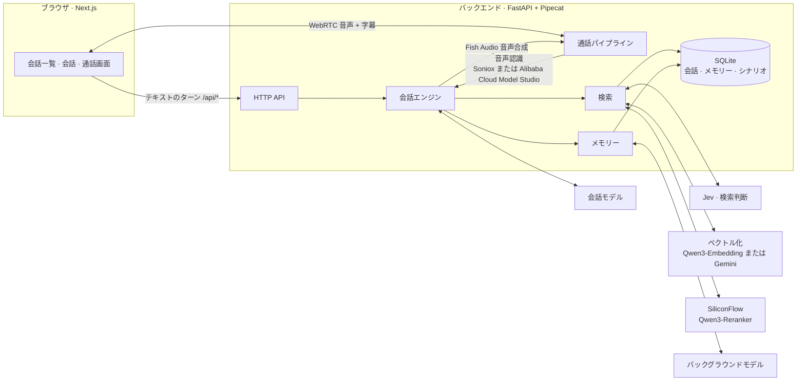
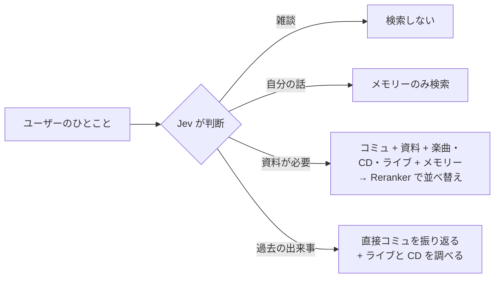

<div align="center">

# Eidolon-SC

**『アイドルマスター シャイニーカラーズ』のアイドルとリアルタイムで話せる AI 分身システム**

音声通話 · テキスト · コミュの記憶 · キャラクター間で共有されるメモリー

[简体中文](README.md) · [English](README.en.md) · **日本語**

[](backend/pyproject.toml)
[](https://fastapi.tiangolo.com/)
[](https://github.com/pipecat-ai/pipecat)
[](frontend/package.json)
[](frontend/package.json)
[](frontend/tsconfig.json)
[](backend/src/eidolon/store.py)
[](docker-compose.yml)
[](LICENSE)
[](docs/adr/0006-open-to-the-public-with-oauth.md)

</div>

---

Eidolon-SC では、**283プロのプロデューサー**として原作のアイドルとチャットしたり、そのまま音声通話したりできます。アイドルは日本語の声で答え、中国語字幕が付きます。自分が原作で経験したコミュを思い出し、あなたが話したことも覚えていて——ほかのアイドルにも「伝わって」いきます。

公開サーバーにデプロイすれば、誰でも Google または GitHub でログインして使えます（[ADR-0006](docs/adr/0006-open-to-the-public-with-oauth.md)）。用語集は [`CONTEXT.md`](CONTEXT.md)、設計判断は [`docs/adr/`](docs/adr/)、画面のビジュアル仕様は [`DESIGN.md`](DESIGN.md) にあります。

> [!NOTE]
> UI・字幕・メモリー・ドキュメントの大半は中国語です。ユーザーは中国語でも日本語でも話しかけられます。

> [!IMPORTANT]
> 本プロジェクトは非公式のファンメイド作品であり、バンダイナムコエンターテインメントおよび『アイドルマスター』シリーズの権利者とは一切関係ありません。シナリオデータは**リポジトリに含まれていません**。各自で用意してください（[ADR-0003](docs/adr/0003-corpus-and-voices-stay-private.md)）。アイドルの返事を通じて間接的にログインユーザーへ提供されるリスクについては [ADR-0006](docs/adr/0006-open-to-the-public-with-oauth.md) を参照してください。

## ✨ 特長

| | |
|---|---|
| 🎙️ **リアルタイム音声通話** | WebRTC による全二重通話。中国語でも日本語でも話せて、アイドルは Fish Audio の音声で日本語の返事を読み上げ、字幕も同時に表示。全画面の通話画面はいつでも閉じて会話記録に戻れる |
| 🇯🇵 **日本語の声 + 中国語字幕** | アイドルは常に日本語で答え、語尾や口癖をそのまま残しつつ、一文ごとに中国語字幕を付与（[ADR-0001](docs/adr/0001-japanese-replies-with-chinese-subtitles.md)） |
| 📖 **コミュの記憶** | シナリオを取り込むと、アイドルは**自分が登場した**正規ルートのコミュだけを思い出し、「あのときって……」という質問に答えられる |
| 🔄 **原作との同期** | ファン翻訳とミラー上の日本語原文をコマンド 1 つで同期し、新しいカードやイベントも 1 週間以内に思い出せる。サーバーでは毎週自動実行（[ADR-0004](docs/adr/0004-untranslated-episodes-from-shinycolorsdb-mirror.md)） |
| 🧠 **キャラクター間で共有されるメモリー** | 真乃に話したことは恋鐘も知っている——ただし「真乃から聞いたんやけど……」という口ぶりで（[ADR-0002](docs/adr/0002-shared-memory-with-source-character.md)） |
| ⚡ **必要なときだけ検索** | 軽量モデルがまず検索の要否を判断するので、雑談では余計な遅延ゼロ |
| 🔌 **モデルは自由に差し替え可能** | OpenAI Chat Completions・OpenAI Responses・Anthropic Messages の 3 方式に対応し、互換のサードパーティサービスも利用可能 |
| 🧩 **ベクトル化サービスは 2 択** | デプロイ時に SiliconFlow の Qwen3-Embedding と Google の Gemini Embedding 2 から選択。切り替えたあとはコマンド 1 つで、データベース内の原文から再ベクトル化（[ADR-0005](docs/adr/0005-embedding-provider-chosen-at-deploy.md)） |
| 📝 **キャラクターシートの下書き生成** | バックグラウンドモデルがアイドルのコミュをすべて読み、キャラクターシートの下書きを作成。あとは人の手で校正 |
| 👥 **一般公開** | Google または GitHub でログイン。ユーザーごとの利用上限と完全に分離されたメモリー。2 つのログイン方法の連携や、自分のデータの完全削除も可能 |
| 🔑 **自前の API キー** | ユーザーは自分の LLM・Fish Audio・音声認識（Soniox または Alibaba Cloud Model Studio）のキーを登録して自分のクレジットで使え、利用上限の対象外になります |
| 🚀 **ワンコマンドでデプロイ** | Caddy（HTTPS 自動化）と coturn（TURN 中継）入りの本番構成を同梱 |

## 🧭 目次

- [アーキテクチャ](#-アーキテクチャ)
- [クイックスタート](#-クイックスタート)
- [設定](#-設定)
  - [モデル](#モデル)
  - [キャラクター](#キャラクター)
  - [音声通話](#音声通話)
  - [シナリオライブラリ](#シナリオライブラリ)
  - [ベクトル化サービス](#ベクトル化サービス)
  - [会話中の検索](#会話中の検索)
  - [メモリー](#メモリー)
  - [ログインとユーザー](#ログインとユーザー)
  - [自前の API キー](#自前の-api-キー)
- [VPS へのデプロイ](#-vps-へのデプロイ)
- [開発](#-開発)
- [ディレクトリ構成](#-ディレクトリ構成)
- [ライセンス](#-ライセンス)
- [謝辞](#-謝辞)

## 🧩 アーキテクチャ



- 文字入力も音声も**同じ会話エンジン**を通り、同じ会話記録に書き込まれます。通話はエンジンの外側に音声認識と音声合成を被せただけのものです。
- 会話モデルは `<ja>…</ja><zh>…</zh>` の区切り形式でストリーミング出力し、日本語部分が届いた時点で音声合成に回すため、返事全体を待つ必要がありません。

## 🚀 クイックスタート

**必要なもの**：Docker と Docker Compose、そしてストリーミング出力とツール呼び出しに対応した会話モデル。

```sh
git clone https://github.com/Sallyn0225/eidolon-sc.git && cd eidolon-sc
cp .env.example .env   # 会話モデルの URL・API キー・モデル名を記入。ローカルで試すなら EIDOLON_DEV_LOGIN=1 も追加
# キャラクターシートを用意（下記「キャラクター」参照）
docker compose up --build
```

<http://localhost:3000> を開き、ログイン画面の「開発ログイン」で好きな名前を入れてログインし（`EIDOLON_DEV_LOGIN=1` のときだけ表示）、プライバシーポリシーと利用規約に同意すれば、トップページの会話一覧でアイドルを選んで話せます。Google や GitHub でログインするには、先に [`docs/deploy.md`](docs/deploy.md) の「OAuth アプリの設定」に従ってアプリを作成し、コールバック URL を `http://localhost:3000/api/auth/github/callback`（Google も同様）にします。`scripts/setup-oauth.sh` を実行して、案内に従って設定することもできます。

> [!TIP]
> 会話モデルだけでもテキストチャットは可能です。ほかのサービスのキーを追加していくことで、音声・コミュの記憶・メモリーが段階的に有効になります：
>
> | 機能 | 必要な設定 |
> |---|---|
> | テキストチャット | `CHAT_LLM_*` |
> | 音声通話 | `FISH_AUDIO_API_KEY` と音声認識サービスのキー：`SONIOX_API_KEY`（デフォルト）、または `STT_PROVIDER=bailian` と `DASHSCOPE_API_KEY` |
> | シナリオ（同期または取り込み） | ベクトル化サービスのキー：`SILICONFLOW_API_KEY`（デフォルト）、または `EMBEDDING_PROVIDER=gemini` と `GEMINI_API_KEY` |
> | 検索とメモリー | ベクトル化サービスのキー、`SILICONFLOW_API_KEY`（並べ替え用）、`JEV_API_KEY` |
>
> 全設定項目の説明は [`.env.example`](.env.example) にあります（コメントは中国語）。

## 🔧 設定

### モデル

**会話モデル**はユーザーとの会話を、**バックグラウンドモデル**はメモリーの抽出とキャラクターシートの下書きを担当します。両者は `.env` で別々に設定し、それぞれ 3 種類の方式から選べます（`CHAT_LLM_PROTOCOL`、`BACKGROUND_LLM_PROTOCOL`）：

| 値 | 方式 | リクエスト先 |
|---|---|---|
| `chat-completions`（デフォルト） | OpenAI 互換 Chat Completions | `{URL}/chat/completions` |
| `responses` | OpenAI Responses | `{URL}/responses` |
| `anthropic` | Anthropic Messages | `{URL}/messages` |

URL・キー・モデル名は自分で指定するので、これらの方式に対応したサードパーティサービスも利用できます。

- 会話モデルはストリーミング出力とツール呼び出しに対応している必要があります。バックエンドは起動時に小さなチェックリクエスト（ツール 1 つ、ストリーミング指定）を送り、ストリーミングで返らない・ツールを受け付けない・URL やキーが誤っている場合は起動を拒否し、どの条件を満たしていないか、サービスが何を返したかを表示します。
- 返事の前に出力される思考内容（reasoning / thinking）は無視され、返事には含まれません。
- Anthropic 方式では返事ごとの長さ上限が必須で、デフォルトは 16384 トークンです。`CHAT_LLM_MAX_TOKENS`・`BACKGROUND_LLM_MAX_TOKENS` で調整できます（ほかの方式は未設定なら無制限）。この項目は 2 つのモデルで独立しており、長いシートの下書きが途切れないよう、バックグラウンドモデルは会話モデルの上限を引き継ぎません。
- バックグラウンドモデルのそれ以外の項目は、未設定なら会話モデルの設定を引き継ぎます。たとえば `BACKGROUND_LLM_MODEL` だけ指定すれば、同じサービス上で安価なモデルに切り替えられます。

### キャラクター

キャラクターは [`characters/characters.toml`](characters/characters.toml) で設定します：ID、表示名、紹介文、Fish Audio の音声 ID、イメージカラー、キャラクターシート・アイコン・通話画面の背景画像の場所。キャラクターの追加や音声 ID の差し替えは、このファイルを編集してバックエンドを再起動するだけです。

```toml
[[characters]]
id = "mano"
name = "櫻木真乃"
intro = "illumination STARS 的中心。温柔又有点慢热，喜欢鸟……"
voice_id = "a1150f3d14ac46fb8ea59c7803cd8357"
sheet = "sheets/mano.md"
avatar = "avatars/mano.jpg"
color = "#ffbad6"
facts = "facts/mano.md"
speakers = ["真乃"]
```

キャラクターシート・キャラクター資料・アイコン・通話画面の背景画像はリポジトリに含めます（ADR-0003）。キャラクターを追加するときは [`characters/sheets/example.md`](characters/sheets/example.md) を参考に `characters/sheets/<キャラクターID>.md` を書いてください。キャラクター資料（任意）は [`characters/facts/example.md`](characters/facts/example.md) を参考に `characters/facts/` 以下へ、アイコン（任意）は `characters/avatars/` 以下に置きます。シートが欠けているとバックエンドは起動を拒否し、どのファイルが足りないかを示します。

`color` は原作で公式に決められたそのアイドルのイメージカラー（`#rrggbb`、必須）です。画面上で彼女に属するもの（彼女の吹き出し、通話ボタン、付箋、通話画面）はすべてこの色が基調になり、フロントエンドはここからライト・ダークの 2 組の色を導き、どちらでも文字が読めるようにします。`color` がない、または形式が正しくないと、バックエンドは起動を拒否し、どのアイドルかを示します。通話画面の背景画像（任意）は `characters/backgrounds/` 以下に置き、`background = "backgrounds/mano.jpg"` で指定します。指定がないかファイルが存在しない場合、通話画面はイメージカラーのグラデーションで代用します。docker compose は `characters/` をバックエンドコンテナに読み取り専用でマウントします。

通話画面には原作の Spine 立ち絵を重ねることもできます（任意）：アイドル番号 `idol_id` とデフォルト衣装 `default_outfit`（例：`stand/1030010010`）を設定し、`.env` に立ち絵素材の URL `EIDOLON_STAND_ASSETS_URL` を指定します。立ち絵素材はリポジトリに含めず S3 互換のオブジェクトストレージに置きます（`deploy/stand-sync.sh` が立ち絵のミラーから衣装リストとサムネイルを作ってアップロードします）。設定方法は [`docs/deploy.md`](docs/deploy.md) の「立绘素材」を参照してください。3 つのうち 1 つでも欠けていると、通話画面は背景画像だけを表示します。

<details>
<summary><b>バックグラウンドモデルでキャラクターシートの下書きを作る</b></summary>

<br>

シナリオをもとにバックグラウンドモデルに下書きを書かせ、あとから人の手で校正することもできます（先にシナリオの取り込みが必要。バックグラウンドモデルの設定は上記「モデル」参照）：

```sh
uv run eidolon --db data/eidolon.db character draft-sheet mano   # backend/ 内で実行
# docker compose では characters/ が読み取り専用なので、データボリュームに書き出してからコピー
docker compose exec backend eidolon character draft-sheet mano --output /data/drafts/mano.md
docker compose cp backend:/data/drafts/mano.md characters/sheets/mano.md
```

- 素材はそのアイドルが登場する正規ルートのコミュのみです。下書きは身分、一人称、他者への呼び方、口癖、ユニットの仲間との関係、厳守ルールの順に構成され、モデルが書き漏らした節には「（待补充）」（要追記）が残ります。上限を超えるコミュは分割して読み、切り捨てはしません。
- 下書きの 1 行目は下書きマーカーです。マーカーがあってもシートは普通に使えます（マーカーはプロンプトに入りません）が、バックエンド起動時に未校正の警告が出ます。校正が済んだらこの行を削除してください。
- 校正済み（マーカーなし）のシートは上書きされません。どうしても再生成したい場合は `--force` を付けます。未校正の下書きはそのまま新しい下書きに置き換わります。
- 素材が 1 リクエストの上限（`--budget`、デフォルト 40000 字）を超える場合は、まずバッチごとにノートを取らせ、そのノートから下書きを書きます。20 バッチを超える場合は全コミュから均等に抽出します。真乃はおよそ 220 コミュ・33 万字で、バックグラウンドモデルへのリクエストは 10 回程度です。

</details>

### 音声通話

`.env` に `FISH_AUDIO_API_KEY` と音声認識サービスのキー（下の表を参照）を設定すると、会話画面のヘッダーにある通話ボタンが使えるようになります。押すと通話画面が開いて発信が始まります。スマートフォンでは全画面、パソコンでは右側の会話欄を覆います。

音声認識はデプロイ時に `STT_PROVIDER` でどちらかを選び、デプロイ全体でその一つだけを使います（[ADR-0010](docs/adr/0010-speech-recognition-provider-chosen-at-deploy-and-per-own-key.md)）。自前の音声認識キーを登録したユーザーは、ここでの選択と関係なく自分でサービスを選びます。

| `STT_PROVIDER` | サービス | 必要なキー | モデル |
|---|---|---|---|
| `soniox`（デフォルト） | Soniox | `SONIOX_API_KEY` | Pipecat デフォルトの Soniox リアルタイムモデル |
| `bailian` | Alibaba Cloud Model Studio | `DASHSCOPE_API_KEY`。北京・シンガポールどちらのリージョンのキーでもよく、自動で判別します | `qwen-audio-3.1-asr-flash-streaming`（`BAILIAN_STT_MODEL`、現在はこれのみ）。先に Model Studio のコンソールで有効にしておく必要があります |

> [!WARNING]
> Alibaba Cloud Model Studio を選ぶ場合：バックエンドは起動時にキーを一度試し、両方のリージョンで拒否された、モデルが有効になっていない、または接続できない場合は、理由を示して起動を拒否します。公開デプロイで北京リージョンのキーを使うと、**見知らぬユーザーの声が中国本土で処理され、中国の法律のもとで保存されます**（保存期間は非公開）。従量課金の呼び出しのデータは学習に使わないと Alibaba Cloud は約束しています。プライバシーポリシーには両方のサービスを挙げ、この点を明記しています（ADR-0010）。

- 通話画面には彼女のアイコン、通話の状態とタイマー、いま話している一文の日本語原文と字幕、そしてあなたが話している内容が表示されます。すべての記録は会話のほうで見られます。タイマーはつながった時点から数え、1 回の通話時間の上限まで 1 分を切ると残り時間の表示に変わります。
- 左上の閉じるボタンか Esc で通話画面を閉じると、通話は続いたまま会話記録に戻り、上部に「通话中 mm:ss · 点击返回」（通話中 · タップで戻る）の付箋が残ります。付箋を押すと通話画面が再び開きます。通話画面では文字を入力できないので、入力したいときは閉じて会話のほうで入力します。

- 中国語でも日本語でも話せます。アイドルは設定された Fish Audio の音声で日本語の返事を読み上げ、日本語の原文と中国語字幕が会話記録に同時に表示されます。
- 通話中に入力した文字も話した内容と同じ会話に入り、アイドルはやはり音声で答えます。
- アイドルが話し始める前、または話し始めても返事にまだ完全なひとまとまり（日本語と字幕の両方）が出ていないうちに続けて話したり入力したりした内容は、補足として同じターンにまとめられ、アイドルは言いかけた返事をやめて全体に改めて答えます。完全なひとまとまりが出たあとに話しかけると割り込みになり、アイドルは話すのをやめ、その返事は完全に出ていた部分だけが記録されて、新しく話した内容にすぐ答えます。入力した文字を送信した場合も同じく割り込みになります。
- 下部には丸いボタンが 3 つあります：
  - **マイクミュート**（麦克风静音）：ブラウザ側でマイクを切るだけで、アイドルにはあなたの声が聞こえなくなります。文字入力はそのまま使えます。
  - **切る**（挂断）：通話が終わり、終了ページは出さずに通話画面が消えます。
  - **マイク切り替え**（切换麦克风）：使えるマイクの一覧から選ぶと、通話を切らずにその場で切り替わり、マイクミュートもそのまま保たれます。選んだマイクはこれ以降の通話の既定のマイクになります。使用中のマイクが抜かれた場合はシステムの既定のマイクに切り替わり、通話画面にその旨を表示します。ほかに使えるマイクがない場合は、通話はそのまま続き、マイクが切断されたことを表示します。
- 右上の「文字だけ」（只看文字）スイッチをオンにすると、アイドルは声を出さず、返事は日本語原文と字幕だけで表示されます。ほかのルールは変わりません。既定のマイクと通話音質は設定画面で選べます。
- 実際の電話と同じように、通話ボタンを押してからつながるまで呼び出し音がループで流れ、つながった瞬間に接続音が一度鳴り、通話が終わると（誰が切ったか、なぜ終わったかにかかわらず）「プープープー」の終話音が鳴ります。これらは電話そのものの音なので、「文字だけ」や通話画面を閉じることの影響を受けません。
- 設定画面の「電話らしい音質」（电话质感）スイッチ（既定はオフ）をオンにすると、アイドルの声が受話器越しのように聞こえます。電話の帯域だけを残して軽く圧縮し、スタジオ録音のようなクリアさをなくします。次の通話から有効になり、通話音質とは独立しています。
- 通話が何らかの理由で終わったとき（つながらなかった、途中で切れた、1 回の通話時間やターン数の上限に達した、利用上限に達した、自前のキーでエラーが起きた、マイクの使用が拒否された）は、通話画面が終了ページにとどまり、理由と、その通話が利用上限にカウントされるかどうかを示します。かけ直すことも会話に戻ることもできます。利用上限に達した場合と自前のキーでエラーが起きた場合は、メインのボタンが「自前のキーを設定する」（去设置自带密钥）に変わります。
- 会話を離れると通話は切れます。接続中でも同じです。ページ内の操作で離れるとき（一覧で別のアイドルを選ぶ、設定やメモリーを開く、スマートフォンの戻るボタン）は、先に確認が出ます。
- `FISH_AUDIO_MODEL` のデフォルトは API クレジットを消費しない `s2.1-pro-free` です。クレジットがあれば有料モデルに切り替えられます。

> [!NOTE]
> ブラウザとバックエンドは WebRTC（UDP）で直接つながります。ローカルで docker compose を使う場合、Linux 上のブラウザはコンテナへ直接接続できます。それ以外（macOS の Docker Desktop、スマートフォンからのアクセス）ではブラウザからバックエンドに到達できる必要があり、通常は TURN サーバーの設定が要ります。`.env.example` の `EIDOLON_ICE_SERVERS` と `EIDOLON_TURN_URLS` を参照してください。公開サーバー向けの本番構成には coturn が同梱されています（[`docs/deploy.md`](docs/deploy.md)）。

### シナリオライブラリ

アイドルが思い出せる原作のコミュには 2 つの出どころがあり、同期コマンド 1 つでまとめて最新に保ちます：

| | 翻訳版 | 原文コミュ |
|---|---|---|
| 出どころ | [SCTranslationData](https://github.com/ShinyGroup/SCTranslationData) のシナリオ CSV | ShinyColorsDB のデコード済みミラー（[ADR-0004](docs/adr/0004-untranslated-episodes-from-shinycolorsdb-mirror.md)） |
| 内容 | 日本語原文 + ファンによる中国語訳 | 日本語原文のみ |
| 鮮度 | 有志の翻訳待ち：数週間〜数か月 | ゲーム更新から 1 週間以内 |

どちらも同じコミュの 2 つの状態です。翻訳版が揃うと同じスクリプト番号で原文コミュを置き換え、コミュ目録では同じカードやイベントの下に残ります。アイドルが思い出すときに両者の区別はありません。

シナリオデータはリポジトリに含めません（ADR-0003）。SCTranslationData をリポジトリ直下の `corpus/` に clone し（git 管理外で、docker compose がバックエンドコンテナの `/corpus` に読み取り専用でマウント）、`.env` にベクトル化サービスのキー（デフォルトは `SILICONFLOW_API_KEY`。[ベクトル化サービス](#ベクトル化サービス)参照）を設定してから同期します：

```sh
git clone --depth 1 https://github.com/ShinyGroup/SCTranslationData.git corpus/SCTranslationData
docker compose exec backend eidolon story sync
```

初回の同期ではミラーにある不足分をすべて補うため 1〜2 時間かかりますが、いつ中断しても再実行すれば続きから再開します。以降は数分で終わります。サーバーでは cron が毎週自動で同期します（[`docs/deploy.md`](docs/deploy.md) 参照）。

<details>
<summary><b>同期でやること</b></summary>

<br>

`eidolon story sync` は SCTranslationData の翻訳版を取り込んだあと、シナリオライブラリにまだないコミュをミラーから原文コミュとして取り込みます。翻訳版があるコミュはダウンロードも上書きもしません。

- **P カード・S カードのコミュ**：出典はカード名（例：`【ほわっとスマイル】櫻木真乃`。SCTranslationData のディレクトリ名と同じ形式）、タイトルはゲーム内のコミュタイトルです。
- **プロデュースコミュとスペシャルコミュ**：プロデュースコミュ（W.I.N.G.・感謝祭・G.R.A.D.・Landing Point・S.T.E.P.、およびモーニング・応援・オーディション・TV 出演などのコミュ）と、誕生日やシーズンなどのスペシャルコミュは、各アイドルのゲーム内アルバム（2024 年 3 月以降は更新なし）から取ります。出典は SCTranslationData がアルバムの同じ部分に使っているディレクトリ名（例：`W.I.N.G.編`、`Morning`）、その部分に翻訳が 1 つもなければアルバムの名前で、タイトルはアルバムのタイトルです。同期の最後に、今回取り込んだプロデュースコミュのうちタイトルに「敗」「失敗」を含むのに敗北エンドのルールで除外されなかったものを一覧表示するので、手で確認してください。
- **イベントコミュ**：一覧がないため、スクリプト番号（`4001` + 3 桁のイベント番号 + 2 桁の話数）から推測します。既知の範囲で欠けているイベントと話を補い、最新のイベントの後ろをいくつか試すので、新しいイベントがなければ 404 のリクエストが数件増えるだけです。イベント名は `deploy/event-names.toml` から取ります（[`deploy/event-names.example.toml`](deploy/event-names.example.toml) を参考に作成し、新しいイベントごとに 1 行追加。名前は SCTranslationData のそのイベントのディレクトリ名と同じにします。リポジトリには入りません）。編集すると次回の同期でコミュ目録に反映されます。表にないイベントは SCTranslationData で翻訳済みの話のディレクトリ名を使い、1 話も翻訳がなければ「活动剧情 NNN」「第N話」と表示され、同期の最後にその番号が一覧表示されます。`--events` で別の表を指定できます。
- **キャッシュ**：ダウンロードしたスクリプトは `EIDOLON_MIRROR_CACHE_PATH`（コンテナではデータボリューム内の `/data/mirror`、ローカルのデフォルトは `corpus/mirror`）にキャッシュされ、リポジトリには入りません。変化のないカードとアルバムは再リクエストせず、ディスク上のファイルだけを確認します。変化したものは ETag による条件付きリクエストを使います。キャッシュからスクリプトを削除すると、次回の同期で再ダウンロードされます。ミラーにないスクリプトには `.missing` マークが残ります。カードとイベントは毎回の同期で再試行し、アルバムのものはアルバムが変わるまで再試行しません。マークを削除すればすぐに再試行します。
- **礼儀と障害時の動作**：リクエストは 1 件ずつ約 1 秒間隔で送ります。ミラーに接続できない場合も翻訳版は通常どおり取り込まれ、コマンドは終了コード 2 で終わります。中断後に再実行すると続きから再開し、ダウンロード済みのスクリプトは再ダウンロードしません。
- **オプション**：`--idol 1` で特定のアイドルのカードとアルバムだけを同期できます（イベントは同期しません。ミラー API のアイドル番号、複数指定可）。翻訳版のディレクトリはデフォルトで `EIDOLON_STORY_PATH`、`--story` でも指定できます。

</details>

<details>
<summary><b>取り込みのルール（翻訳版・原文コミュ共通）</b></summary>

<br>

- 各コミュは元スクリプトの番号を主キーとします（CSV ではファイル末尾の `info` 行が指すスクリプト）。再取り込みすると上書き更新され、内容が変わっていないコミュは再ベクトル化されないので、いつでも取り込み直しや同期ができます。
- 正規ルートのみを収録します：失敗エンド（W.I.N.G. 敗退、シーズン目標未達成、G.R.A.D. 敗退、オーディション落選、約束を守れなかった場合）はスクリプト番号で識別して除外し、プロデューサーの選択肢は記録せず、各選択肢に対するアイドルの反応はすべて残します。
- 登場キャラクターはセリフの話者で識別します。`characters.toml` の各キャラクターの `speakers` に、スクリプト上での名前（例：`真乃`）を列挙します。`speakers` の変更やキャラクター追加のあとは再取り込みが必要です。
- ベクトル化にはデプロイ時に選んだサービスを使います（[ベクトル化サービス](#ベクトル化サービス)参照）。サービスやモデルを変えたら `eidolon reembed` を実行してください。再取り込みは不要です。登場キャラクターが空でないコミュだけがベクトル化されます。
- コミュ目録は「キャラクター → カードまたはイベント → 話」の階層で、シナリオライブラリから直接生成されるため、常に最新の取り込み結果と一致します。取り込みの最後に各キャラクターの目録規模が表示されます。

</details>

<details>
<summary><b>CSV やゲームの生スクリプト JSON を手動で取り込む</b></summary>

<br>

ミラーを使わない場合は、SCTranslationData の翻訳版だけを取り込めます：

```sh
docker compose exec backend eidolon story import-csv /corpus/SCTranslationData/data/story
```

ゲームの生スクリプト JSON が手元にあれば（各ファイルは 1 スクリプト分のフレーム配列で、`speaker`・`text`・`select` などのフィールドを持ちます）、それで補うこともできます：

```sh
docker compose exec backend eidolon story import-json /corpus/scripts
```

- スクリプト番号はファイルパスから取得します。ゲーム内のパス（`produce_events/100100101.json`）でも、翻訳プラグインの命名（`produce_events_100100101.json`）でも構いません。パスにスクリプト番号がないファイルは警告を出してスキップします（同じスクリプトの CSV と重複排除できないため）。
- SCTranslationData のように「出典/」ディレクトリ以下に置いた場合は、出典がディレクトリ名、タイトルがファイル名になります。ゲーム内のパスで置いた場合は、出典は末尾 2 桁（話数）を除いたスクリプト番号（例：`produce_events/2011005`）、タイトルは `produce_events_201100501` のような名前になります。
- 同じスクリプトがすでに CSV から取り込まれている場合は中国語訳付きの CSV 版を優先し、JSON では上書きしません。逆に、あとから取り込んだ CSV は JSON 版を置き換えます。

</details>

ローカル開発では `backend/` で `uv run eidolon --db data/eidolon.db story sync` を使います（`import-csv`・`import-json` も同様）。

### 世界設定

事務所の社長と事務員、8 つのユニットと所属アイドル、そのキャラクター自身の曲（ソロ曲と、所属ユニット全員で歌う曲。収録 CD と発売日つき）、そして彼女が立った／これから立つライブ（公演日ごとの日付と会場。声優さんが出演を見合わせた日は含めません）は、毎ターン人設の後ろに付けて渡します（[ADR-0008](docs/adr/0008-real-world-releases-and-lives-are-in-character.md)）。データはキャラクター設定の隣にある `characters/world.json` で、リポジトリにコミット済みです。更新するときは `backend/` で `uv run eidolon world sync` を実行します。アイドルとユニットは im@sparql と公式のユニットページから、CD・収録曲・歌唱者は Lantis のシャイニーカラーズサイトから取り込み（Lantis に書かれていない歌唱者はふじわらはじめの API で補います）、ライブはアイドルマスター公式ポータル（2020 年 9 月より前は旧公式サイト）から、公演日ごとの出演者と出演見合わせは wikiwiki から、公演日ごとのセットリストは imas-db から取り込みます（曲ごとに誰が歌ったか。バックダンスは歌唱に数えません。合同ライブで他ブランドの曲をカバーした場合は、どのブランドの曲かを添えてそのまま記録しますが、彼女の曲にはなりません）。各項目の件数、旧ファイルからの増減、ソース間で食い違う箇所（imas-db とライブのデータで公演日が食い違う日も含みます。昼夜 2 公演の日などで、こうした日にはセットリストを書きません）、アイドルに対応づけられなかった歌唱者・出演者を表示するので、`git diff` を確認してからコミットしてください。手で確かめた訂正（ある曲を誰が歌っているか・曲ではないトラックか、ある公演日に実際に出演したのは誰か、アイドルではない出演者は誰か）は隣の `characters/world-corrections.json` に出典とメモつきで書いておくと、毎回の取り込みで適用されます。どれか 1 つでもソースの取得に失敗すると、旧ファイルはそのまま残ります。キャラクター設定の表示名がデータのアイドルと一致しないキャラクターがいるとバックエンドは起動しません。ファイルがない場合は世界設定なしで動きます。

### ベクトル化サービス

シナリオライブラリ・キャラクター資料・メモリーは同じベクトル化サービスを使い、デプロイ時に `EMBEDDING_PROVIDER` でどちらかを選びます（[ADR-0005](docs/adr/0005-embedding-provider-chosen-at-deploy.md)）。並べ替え（Reranker）は切り替わらず、常に SiliconFlow を使います。

| `EMBEDDING_PROVIDER` | サービス | 必要なキー | デフォルトモデル |
|---|---|---|---|
| `siliconflow`（デフォルト） | SiliconFlow | `SILICONFLOW_API_KEY` | `Qwen/Qwen3-Embedding-0.6B` |
| `gemini` | Google Gemini API | `GEMINI_API_KEY`（並べ替えには引き続き `SILICONFLOW_API_KEY` が必要） | `gemini-embedding-2`。次元数は `EMBEDDING_DIMENSIONS` で指定（デフォルト 1536、128〜3072） |

> [!WARNING]
> Gemini を選ぶ場合：Gemini API は**中国本土・香港・マカオでは利用できない**ため、サーバーはそれ以外の地域に置く必要があります。また、**無料枠で送った内容は Google のサービス改善に利用されます**。ベクトル化に送られる内容にはシナリオライブラリとユーザーのメモリーが含まれるので、気になる場合は課金を有効にしてください（有料枠の内容は学習に使われません）。

- データベースには現在のモデルのベクトルだけを保持します。サービス・モデル（`EMBEDDING_MODEL`）・次元数を変えたら、バックエンドを再起動してから一度だけ実行します：

  ```sh
  docker compose exec backend eidolon reembed
  ```

  データベースにある原文から、シナリオライブラリ・キャラクター資料・作品資料（楽曲・CD・ライブ、世界設定のデータファイルから作成）・全ユーザーのメモリーを再ベクトル化します。コミュの再ダウンロードや再取り込みは不要で、すべて完了すると古いモデルのベクトルを削除します。実行中もサービスは通常どおり使えますが、検索できるのは処理済みの部分だけです。いつ中断しても再実行すれば続きから再開し、エラーが起きた場合は古いベクトルは削除されません。
- バックエンドの起動時に、現在のモデルのベクトルが欠けている段落がシナリオライブラリにあれば、`eidolon reembed` を実行するようログで知らせます。
- モデルの保存上の識別子には次元数が付く（例：`gemini-embedding-2@1536`）ため、次元数の変更はモデルの変更と同じ扱いになります。SiliconFlow をそのまま使い続ける既存のデプロイでは、何もする必要はありません。

### 会話中の検索

`.env` にベクトル化サービスのキー・`SILICONFLOW_API_KEY`（並べ替え用）・`JEV_API_KEY` を設定すると、アイドルは会話中にコミュを思い出したり、キャラクター資料を参照したりできます。どれか 1 つでも欠けていれば、キャラクターシートだけで返事をします。

Jev はデフォルトで [OpenRouter](https://openrouter.ai/typesafe/jev-1.13) 経由で呼び出します。`JEV_API_KEY` には OpenRouter のキーを設定し、モデルは `typesafe/jev-1.13` に固定しています（`JEV_MODEL` で変更可）。Jev は TypeSafe の System One API を使っており、Vercel AI Gateway と TypeSafe 本体も同じ API を提供しています。Vercel を使う場合は `JEV_BASE_URL=https://ai-gateway.vercel.sh/typesafe/v1`（Vercel の無料枠では Jev を呼べないため、先にクレジットを購入してください）、TypeSafe に直接つなぐ場合は `JEV_BASE_URL=https://api.typesafe.ai/v1` を設定し、どちらの場合も `JEV_API_KEY` と `JEV_MODEL` をその提供元のものに変えてください（モデル名の書き方は提供元ごとに異なり、TypeSafe 直結では `jev-1.13.0` です）。旧 `AI_GATEWAY_API_KEY` は `JEV_API_KEY` に名前が変わりました。旧変数だけが設定されているとバックエンドは起動しません。



- ひとことごとに、まず Jev（デフォルトは OpenRouter 経由）が何が必要かを判断します。雑談なら検索せず、遅延も増えません。資料が必要なら下記の検索を行います。「あのときって……」のように過去の出来事を尋ねられた場合は、その発言でそのまま「コミュを振り返る」を実行して結果をプロンプトに入れ、会話モデルがツールを呼ぶ 1 往復を省きます。Jev がエラーの場合は通常どおり検索します。
- 検索時は、現在のアイドルが登場するコミュ、彼女のキャラクター資料、全アイドル共通の作品資料（楽曲・CD・ライブの公演日ごとに 1 項目）を同時に検索し、SiliconFlow の Qwen3-Reranker（デフォルトは `Qwen/Qwen3-Reranker-0.6B`、`RERANK_MODEL` で変更可）で並べ替え、関連度が十分高いものを最大 5 件プロンプトに入れます（話題と無関係なら 1 件も入れません）。「十分高い」のしきい値は並べ替えモデルごとに決まっており（0.6B と 4B は調整済み）、`RERANK_MIN_RELEVANCE`・`RERANK_MEMORY_MIN_RELEVANCE` で手動設定もできます。`eidolon eval rerank` はリポジトリ内の調整用データセットでスコア分布を表示し、しきい値決めを助けます（[`docs/deploy.md`](docs/deploy.md) 参照）。検索や並べ替えでエラーが起きた場合、そのターンは検索結果なしで通常どおり返事をします。
- 会話モデルは「コミュを振り返る」ツール（`recall_story`）も呼べます。プロデューサーに過去の出来事を聞かれると、アイドルは要約した一文で自分が登場したコミュを検索し、最も関連する最大 2 コミュの本文（コミュ目録上のカード／イベントと、同じ場所にあるほかのコミュ付き）を受け取って答えます。このツールはコミュだけを検索します。ツール呼び出しはひとことにつき最大 1 往復で、Jev がすでに「振り返り」と判断したターンではツールを提供しません。
- キャラクター資料は `characters.toml` の `facts` が指す Markdown ファイルで、見出しごとに 1 項目です。あるアイドルを初めて検索したときにベクトル化され、以降は変更のあった項目だけが再ベクトル化されます。編集後はバックエンドを再起動するだけで反映されます。
- 作品資料の項目は世界設定のデータファイル `characters/world.json` から作られます：楽曲は歌唱メンバーと収録 CD、CD は発売日と収録曲、ライブの公演日は日付・会場・出演アイドル・セットリストを記し、声優の名前は含みません。セットリストは検索されたときだけ現れ、毎ターンには含めません。キャラクター資料と同じく初めての検索時にベクトル化され（現在のデータで約 1400 項目あるため初回は時間がかかります。先に `eidolon reembed` を実行しておくこともできます）、以降は変更のあった項目だけが再ベクトル化されます。データを取り込み直したらバックエンドを再起動してください。データファイルがなければ作品資料は検索しません。プロンプトでは、作品資料とキャラクター資料はそれぞれ「作品资料」「角色资料」の見出しの下に入ります。
- Jev が「振り返り」と判断したターンでは、コミュと一緒に作品資料のライブと CD も検索して並べ替えます。コミュにその経緯の記録がないときは、なかったことにはならないと伝え、作り話も否定もしないようにします。

### メモリー

アイドルはユーザーが自分について話したことを覚えていて、同じユーザーのすべてのアイドルがそのメモリーを共有します。真乃に話したことは恋鐘も知っていますが、「真乃から聞いたんやけど……」という口ぶりで持ち出します（ADR-0002）。ユーザー同士のメモリーは完全に分離されています。メモリーは検索と同時に有効になります（ベクトル化サービスのキー・`SILICONFLOW_API_KEY`・`JEV_API_KEY` が必要）。

- **書き込み**：各ターンの終了後、バックグラウンドモデルがそのやり取りを読み、ユーザーが明かした長く覚えておく価値のあることを中国語のメモリーとして書き留めます（例：「プロデューサーは小白という名前の猫を飼っている」）。所属ユーザーと話した相手のアイドルも記録し、「来週の土曜日」のような相対的な日時はユーザーのタイムゾーンで日付に換算します。すでに覚えていることは重複して記録しません。この処理はバックグラウンドで行われ返事を遅らせませんが、ユーザーの次の発言はその完了を待ちます（最大 5 秒）。
- **思い出す**：以降の会話で、Jev がユーザー自身の話（近況、予定、家族やペットなど）だと判断した場合はメモリーだけを検索し、コミュやキャラクター資料を検索するときもメモリーを一緒に検索します。話題に関連するメモリーを最大 3 件プロンプトに入れ、それぞれに話した相手のアイドルと日付を添えます。
- **会話をまたいで**：新しい会話では、検索で見つかったメモリーだけを手がかりに以前の話題をつなぎ、前回の会話内容は持ち越しません。
- **管理**：「設定 → メモリーの管理」画面で、アイドルたちが覚えたすべてのメモリーを、どのアイドルに話したものかと一緒に確認できます。1 件ずつ削除することも、確認のうえ一括消去することもできますが、手動で追加・編集はできません。削除したメモリーは二度とプロンプトに入らず、一括消去の時点でバックグラウンド抽出中だったメモリーも破棄され、消去後に現れることはありません。

### ログインとユーザー

招待や審査なしに、誰でも Google または GitHub でログインできます（ADR-0006）。ログイン画面には `.env` で設定した OAuth アプリ（`GITHUB_CLIENT_ID`・`GITHUB_CLIENT_SECRET`、`GOOGLE_CLIENT_ID`・`GOOGLE_CLIENT_SECRET`）のログイン方法だけが表示されます。作成手順は [`docs/deploy.md`](docs/deploy.md) を参照してください。リポジトリのルートで `scripts/setup-oauth.sh` を実行すれば、必要なページを順に開き、各欄に何を入れるかを説明し、値を `.env` に書き込み、`EIDOLON_SECRET_KEY` も生成したうえで、最後にバックエンドを再起動して実際のアカウントで確認すべき点を一覧にします。

- ある ID で初めてログインすると新しいユーザーになり、以降同じ ID でログインすれば同じユーザーです。GitHub アカウントは登録から 1 年以上、Google はメールアドレスの確認済みが必要で、満たさない場合は理由を示してログインを拒否します。
- 初回ログイン後、プライバシーポリシーと利用規約に同意し 13 歳以上であることを申告するまで、ほかの機能は使えません。未ログインの訪問者に見えるのはログイン画面・プライバシーポリシー・利用規約だけです。
- 設定画面でもう一方のログイン方法を連携すれば、どちらでログインしても同じメモリーが見えます。メールアドレスが同じでも自動では統合されず、他のユーザーの ID は連携できず、最後のログイン方法は解除できません。
- ログイン状態はバックエンドのセッションに保存され、ブラウザは httpOnly cookie で保持します。最後に使ってから 30 日間有効です。設定画面からこの端末だけ、またはすべての端末からログアウトできます。
- 設定画面の「データをすべて削除」は、再確認のうえ、そのユーザーのメモリー・会話・プロデューサープロフィール・ログイン方法・自前のキー・セッション・利用記録を完全に削除し、すべての端末でログアウトします。その後同じ ID でログインすると、まったく新しいユーザーになります。
- ローカル開発とテストでは、`EIDOLON_DEV_LOGIN=1` でログイン画面に名前だけでログインできる「開発ログイン」が加わります。`EIDOLON_DOMAIN` を設定した公開デプロイでは、このスイッチがあると起動を拒否します。

管理者はサーバー上のコマンドラインでユーザーを管理します：

```sh
docker compose exec backend eidolon user list                # ID・名前・ログイン方法・作成日時・停止中かどうか
docker compose exec backend eidolon user ban <ユーザー ID>    # 利用停止：全端末でログアウト、通話は数秒以内に切断、以後ログイン不可
docker compose exec backend eidolon user unban <ユーザー ID>
docker compose exec backend eidolon user usage <ユーザー ID>  # 直近 24 時間の 1 時間ごとのテキストターンと通話の回数、うち上限対象外の回数
```

特定のユーザーがデプロイした人の API クレジットを使い切らないよう、デフォルトで次の上限があります（0 で無制限）：

| 上限 | デフォルト | 環境変数 |
|---|---|---|
| 1 時間あたりのテキストターン | 60 回 | `EIDOLON_TURNS_PER_HOUR` |
| 1 時間あたりの音声通話 | 5 回 | `EIDOLON_CALLS_PER_HOUR` |
| 1 回の通話時間 | 10 分 | `EIDOLON_CALL_MINUTES` |
| 1 回の通話のターン数 | 40 ターン | `EIDOLON_TURNS_PER_CALL` |
| 1 ターンで送る履歴ターン数 | 20 | `EIDOLON_HISTORY_TURNS` |

- 上限はユーザー単位で、どのログイン方法・端末から使っても合算されます。通話中の発言や入力は別途カウントされません。サービスのエラーで失敗したターンやつながらなかった通話はカウントされませんが、アイドルが話し終える前にユーザーが離れた（ページを閉じたなど）ターンは記録されないもののカウントされます。サイト内の別のページに移っただけなら、返事は最後まで続き、記録されます。
- 自前のキーでの利用は対象外です：自前の LLM を使ったテキストターンはカウントされず、通話は LLM・音声合成・音声認識の 3 つすべてが自前のキーのときだけカウントされません。1 回の通話時間とターン数の上限は全員共通です。
- 上限を超えたリクエストには、利用再開時刻付きで 429 が返り、フロントエンドは「何時以降にまた使えるか」を表示します。
- 通話が上限に達すると、アイドルは話している途中の言葉を言い終えてから電話を切り、フロントエンドが理由を説明します。
- 会話モデルは各ターンで会話の直近のターンだけを読み、それ以前の内容はメモリーと検索でつなぎます。これにより長い会話でも遅く・高くならず、コンテキストウィンドウを超えることもありません。会話記録自体はすべて保存されます。

ローカル開発では `uv run eidolon --db data/eidolon.db ...` を使います。

### 自前の API キー

費用はデフォルトですべてデプロイした人が負担します。ユーザーは設定画面で自分の API キーを登録して、費用を分担できます：

| サービス | 入力するもの | 用途 |
|---|---|---|
| LLM | インターフェースの種類・base_url・キー・モデル名 | アイドルを演じる（テキストと通話）、メモリーの抽出 |
| 音声合成（Fish Audio） | キー | 通話中のアイドルの声（ボイスはキャラクター設定のまま） |
| 音声認識（Soniox または Alibaba Cloud Model Studio） | サービスとキー | 通話中にユーザーの声を聞き取る。デプロイした人の選択とは関係ありません |

- 保存前に一度試しに呼び出し、失敗したら保存せず、プロバイダーのエラーを表示します。LLM はストリーミング出力とツール呼び出しに対応している必要があり、公開デプロイでは base_url が HTTPS の公開アドレスでなければなりません。保存時だけでなく、接続のたびに確認します。
- 音声認識に Alibaba Cloud Model Studio を選ぶ場合、入力するのはキーだけです。リージョンは試しに呼び出すときに自動で判別し、モデルはデプロイした人の `BAILIAN_STT_MODEL` に従います（デプロイが Soniox の場合はデフォルトのモデル）。モデルが有効になっていなければ、Model Studio のコンソールで有効にするよう案内します。
- キーは `EIDOLON_SECRET_KEY` から導出した鍵で暗号化して保存し、画面には末尾 4 文字だけを表示します。`EIDOLON_SECRET_KEY` を設定していないと、この機能は使えません。
- 自前のキーの呼び出しに失敗したとき（残高不足、失効など）、そのターンや通話は失敗し、どのキーに問題があるかを表示します。**デプロイした人のキーに切り替えることはありません**。`EIDOLON_SECRET_KEY` を変えると保存済みのキーは復号できなくなり、それを使うターンや通話はどのサービスも呼び出す前に失敗し、ユーザーに再入力を求めます。自前のキーを削除すると、デプロイした人のサービスに戻ります。
- ベクトル化、リランク、シナリオを思い出すかどうかの判断（Jev）は常にデプロイした人の負担です。

## 🌐 VPS へのデプロイ

本番構成 [`docker-compose.prod.yml`](docker-compose.prod.yml) は 4 つのサービスで構成されます：

| サービス | 役割 |
|---|---|
| **caddy** | HTTPS の入口。Let's Encrypt 証明書を自動で取得・更新 |
| **frontend** / **backend** | 127.0.0.1 のみで待ち受け、インターネットに直接公開しない |
| **coturn** | STUN/TURN。NAT 配下のスマートフォンからも音声通話できるように |

```sh
docker compose -f docker-compose.prod.yml up -d --build
```

ドメイン、ファイアウォールのポート、シナリオの週次自動同期、アップグレード、バックアップ、トラブルシューティングの詳しい手順は [`docs/deploy.md`](docs/deploy.md)（中国語）を参照してください。

## 💻 開発

**バックエンド**（Python、`backend/`、[uv](https://docs.astral.sh/uv/) を使用）：

```sh
cd backend
uv sync
uv run pytest        # テスト
uv run pyright       # 型チェック
EIDOLON_DEV_LOGIN=1 CHAT_LLM_BASE_URL=... CHAT_LLM_API_KEY=... CHAT_LLM_MODEL=... uv run eidolon
# :8000 で起動し、../characters/characters.toml を読み込む（EIDOLON_CHARACTERS_PATH で変更可）
```

**フロントエンド**（Next.js + [Astryx](https://www.npmjs.com/package/@astryxdesign/core)、`frontend/`）：

```sh
cd frontend
npm install
BACKEND_URL=http://localhost:8000 npm run dev   # :3000 で起動し、/api/* をバックエンドへ転送
npm run typecheck
npm test
```

画面は Astryx コンポーネントライブラリに独自の「手帳」テーマを組み合わせて作っています（ビジュアル仕様は [`DESIGN.md`](DESIGN.md)）。テーマのソースは `src/theme/notebookTheme.ts` で、変更したら `npm run theme:build` で `src/theme/built/` 以下のビルド済み CSS を作り直します（`npm run theme:check` で両者が一致しているか確認できます）。画面の文言は `src/i18n/` にまとめてあり、いまのところ簡体字中国語だけです。

## 📁 ディレクトリ構成

```text
eidolon-sc/
├── backend/                  # Python バックエンド：FastAPI + Pipecat
│   ├── src/eidolon/
│   │   ├── engine.py         #   会話エンジン：1 ターンを受け取り、アイドルの返事を返す
│   │   ├── accounts.py       #   ユーザー、ログイン方法、ユーザーの削除
│   │   ├── identity.py       #   Google と GitHub でのログイン（OAuth）
│   │   ├── sessions.py       #   セッション cookie とクロスサイトのチェック
│   │   ├── own_keys.py       #   ユーザーの自前の API キーと、各ターン・各通話が誰のキーを使うか
│   │   ├── usage.py          #   利用上限と利用記録
│   │   ├── call.py           #   音声通話：シグナリングと Pipecat パイプライン
│   │   ├── bailian.py        #   Alibaba Cloud Model Studio のリアルタイム音声認識
│   │   ├── turn_taking.py    #   通話中の補足と割り込みのルール
│   │   ├── call_outcome.py   #   通話が上限に数えられるか、終了時にブラウザへ伝える内容
│   │   ├── retrieval.py      #   検索判断、参考資料ソース（コミュ・キャラクター資料・作品資料）の検索と並べ替え、振り返り
│   │   ├── memory.py         #   会話・キャラクターをまたいで共有されるメモリー
│   │   ├── corpus.py         #   シナリオライブラリ：保存、ベクトル検索、コミュ目録
│   │   ├── embedding.py      #   ベクトル化：SiliconFlow Qwen3-Embedding または Gemini
│   │   ├── reembed.py        #   ベクトル化モデル変更後の再ベクトル化（eidolon reembed）
│   │   ├── rerank_eval.py    #   並べ替えしきい値の調整（eidolon eval rerank）
│   │   ├── story_import.py   #   シナリオの取り込み（CSV / JSON）と正規ルートのルール
│   │   ├── story_sync.py     #   原作との同期（eidolon story sync）
│   │   ├── mirror.py         #   ShinyColorsDB のミラーと API のクライアント
│   │   ├── world.py          #   世界設定：データファイルと毎ターン渡す節
│   │   ├── world_sync.py     #   世界設定の取り込み（eidolon world sync）
│   │   ├── work_facts.py     #   作品資料：楽曲・CD・ライブ、全アイドル共通
│   │   ├── references.py     #   参考資料ソースの interface（コミュ・キャラクター資料・作品資料）
│   │   ├── release_sync.py   #   CD と楽曲の取り込み（Lantis、歌唱者の補完はふじわらはじめ）
│   │   ├── live_sync.py      #   ライブと公演日ごとの出演者の取り込み（公式ポータル・旧公式サイト、出演者は wikiwiki）
│   │   ├── setlist_sync.py   #   公演日ごとのセットリストの取り込み（imas-db）
│   │   ├── roster.py         #   名簿：取り込み元の人名・声優名・ユニット名をアイドルとユニットに対応づける
│   │   ├── sync_tools.py     #   取り込み共通の小さな道具
│   │   ├── script_cache.py   #   同期でダウンロードした生スクリプトのキャッシュ
│   │   ├── sheet_draft.py    #   キャラクターシートの下書き生成
│   │   └── llm/              #   3 種類のモデル方式のアダプター
│   ├── eval/                 #   並べ替えの調整用データセット（質問とラベルのみ、シナリオ本文は含まない）
│   └── tests/
├── frontend/                 # Next.js + Astryx フロントエンド
├── characters/               # キャラクター設定・シート・資料・アイコン・通話画面の背景画像
├── corpus/                   # シナリオデータとミラーのキャッシュ（リポジトリ外）
├── deploy/                   # Caddyfile、毎週の同期スクリプト、イベント名対応表のサンプル
├── scripts/                  # OAuth アプリ設定などのウィザード（setup-oauth.sh）
├── docs/
│   ├── adr/                  # アーキテクチャ決定記録
│   └── deploy.md             # VPS デプロイガイド
├── docker-compose.yml        # ローカル開発用
├── docker-compose.prod.yml   # 本番デプロイ用
├── .env.example              # 全設定項目とその説明
└── CONTEXT.md                # ドメイン用語集
```

## 📄 ライセンス

本プロジェクトのコードは [GNU Affero General Public License v3.0](LICENSE)（AGPL-3.0）、または（あなたの選択により）それ以降の任意のバージョンの下で公開されています。改変したものをネットワーク経由で他者に提供する場合は、その利用者に改変後のソースコードを公開する必要があります。

ライセンスの対象はリポジトリ内のコードとドキュメントのみです。シナリオデータとキャラクター音声はリポジトリに含まれず、ライセンスの対象外です。それぞれの提供元の条件に従ってください（ADR-0003）。リポジトリ内のキャラクターシート・キャラクター資料・アイコンもライセンスの対象外で、キャラクターと設定は原作の権利者に帰属します。通話の効果音の出典とライセンスは [`frontend/public/sounds/CREDITS.md`](frontend/public/sounds/CREDITS.md) を参照してください。接続音と終話音は CC0 です。

通話画面の立ち絵に使う Spine ランタイム（[`frontend/public/vendor/spine-3.6/`](frontend/public/vendor/spine-3.6/README.md)）は Esoteric Software の Spine Runtimes を無改変で収録したもので、**AGPL の対象外**です。それ自身の Spine Runtimes ライセンスが適用されます（ADR-0009）。本プロジェクトのライセンスの冒頭に AGPL 第 7 条の追加許可があり、本プロジェクトと Spine Runtimes を組み合わせて一緒に頒布することを認めています。立ち絵の素材自体はリポジトリに含まれず、ライセンスの対象外です（ADR-0003 の改訂）。

## 🙏 謝辞

- [LAPLACE Eidolon](https://laplace.live/eidolon) —— VTuber・明前奶绿のリアルタイム音声 AI 分身。本プロジェクトはそのアーキテクチャを参考にしています（コードは流用していません）
- [SCTranslationData](https://github.com/ShinyGroup/SCTranslationData) —— シナリオテキストと中国語訳
- [Pipecat](https://github.com/pipecat-ai/pipecat) —— リアルタイム音声パイプラインと WebRTC 通信
- [Soniox](https://soniox.com/) —— 音声認識
- [Alibaba Cloud Model Studio](https://www.alibabacloud.com/product/modelstudio) —— リアルタイム音声認識（Soniox の代わりに選べます）
- [Fish Audio](https://fish.audio/) —— 音声合成
- [SiliconFlow](https://siliconflow.cn/) —— Qwen3 Embedding / Reranker
- [Google Gemini API](https://ai.google.dev/) —— Gemini Embedding（選択式のベクトル化サービス）
- [TypeSafe Jev](https://docs.typesafe.ai/) と [OpenRouter](https://openrouter.ai/) —— 検索判断モデルとその呼び出し

<div align="center">

---

<sub>『アイドルマスター シャイニーカラーズ』およびそのキャラクターの著作権は ©Bandai Namco Entertainment Inc. に帰属します。本プロジェクトは非公式のファンメイド作品であり、権利者とは関係ありません。アイドルは AI が演じています。</sub>

</div>
