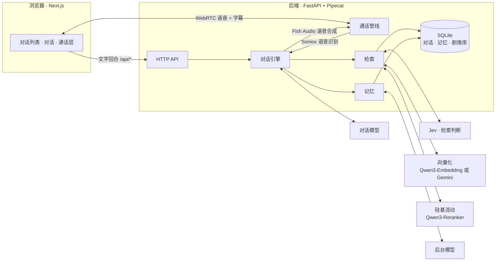
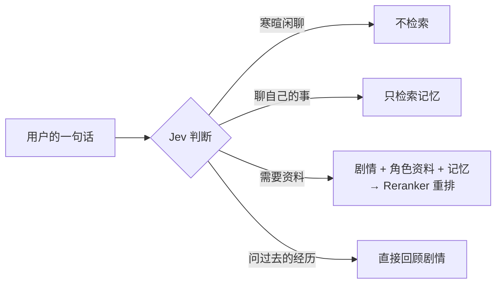

<div align="center">

# Eidolon-SC

**和《偶像大师 闪耀色彩》的偶像实时对话的 AI 分身系统**

语音 · 文字 · 剧情回忆 · 跨角色共享记忆

**简体中文** · [English](README.en.md) · [日本語](README.ja.md)

[](backend/pyproject.toml)
[](https://fastapi.tiangolo.com/)
[](https://github.com/pipecat-ai/pipecat)
[](frontend/package.json)
[](frontend/package.json)
[](frontend/tsconfig.json)
[](backend/src/eidolon/store.py)
[](docker-compose.yml)
[](LICENSE)
[](docs/adr/0006-open-to-the-public-with-oauth.md)

</div>

---

Eidolon-SC 让你以 **283 事务所制作人**的身份，和原作中的偶像打字聊天或直接语音通话。角色用日语原声回答并附上中文字幕，能回忆自己在原作中经历过的剧情，还会记住你说过的事——并在其他偶像之间「传开」。

部署到公网后，任何人都能用 Google 或 GitHub 登录使用（[ADR-0006](docs/adr/0006-open-to-the-public-with-oauth.md)）。术语表见 [`CONTEXT.md`](CONTEXT.md)，设计决策见 [`docs/adr/`](docs/adr/)，界面的视觉规范见 [`DESIGN.md`](DESIGN.md)。

> [!IMPORTANT]
> 本项目是非官方的粉丝作品，与万代南梦宫及《偶像大师》系列版权方无关。剧情数据**不随仓库分发**，需要自行准备（[ADR-0003](docs/adr/0003-corpus-and-voices-stay-private.md)）；角色通过回复间接地把它们提供给登录的用户，这一风险见 [ADR-0006](docs/adr/0006-open-to-the-public-with-oauth.md)。

## ✨ 特性

| | |
|---|---|
| 🎙️ **实时语音通话** | 基于 WebRTC 的全双工通话；中文、日语都能说，角色用 Fish Audio 音色读日语原文，字幕同步显示；全屏的通话层可以随时收起，回到文字记录 |
| 🇯🇵 **日语原声 + 中文字幕** | 角色始终用日语回答，保留语气词和口癖，每句附中文字幕（[ADR-0001](docs/adr/0001-japanese-replies-with-chinese-subtitles.md)） |
| 📖 **回忆原作剧情** | 导入原作剧情库后，角色只回忆**自己出场过**的成功路线剧情，可以回答「那次……是怎么回事」 |
| 🔄 **与原作同步** | 一条命令同步粉丝汉化和镜像上的日语原文，新卡、新活动一周内就能回忆；服务器上每周自动运行（[ADR-0004](docs/adr/0004-untranslated-episodes-from-shinycolorsdb-mirror.md)） |
| 🧠 **跨角色共享记忆** | 对真乃说过的事，恋鐘也会知道，但会以「听真乃说……」的口吻提起（[ADR-0002](docs/adr/0002-shared-memory-with-source-character.md)） |
| ⚡ **按需检索** | 先由轻量模型判断这句话要不要查资料，寒暄闲聊零额外延迟 |
| 🔌 **模型可自由替换** | 支持 OpenAI Chat Completions、OpenAI Responses、Anthropic Messages 三种接口，也可接任意兼容的第三方服务 |
| 🧩 **向量化服务二选一** | 部署时在硅基流动 Qwen3-Embedding 与 Google Gemini Embedding 2 之间选择，换了之后一条命令用库里的原文重新向量化（[ADR-0005](docs/adr/0005-embedding-provider-chosen-at-deploy.md)） |
| 📝 **人设初稿生成** | 由后台模型读完角色的全部剧情，写出人设初稿，再人工校对 |
| 👥 **对公众开放** | 用 Google 或 GitHub 登录，按用户限流、记忆互相隔离；用户可以绑定两种登录方式，也可以彻底删除自己的全部数据 |
| 🔑 **自带密钥** | 用户可以填自己的 LLM、Fish Audio、Soniox 密钥，用自己的额度，不计入限额 |
| 🚀 **一键部署** | 自带 Caddy（自动 HTTPS）+ coturn（TURN 中继）的生产配置 |

## 🧭 目录

- [架构](#-架构)
- [快速开始](#-快速开始)
- [配置](#-配置)
  - [模型](#模型)
  - [角色](#角色)
  - [语音通话](#语音通话)
  - [剧情库](#剧情库)
  - [向量化服务](#向量化服务)
  - [对话中的检索](#对话中的检索)
  - [记忆](#记忆)
  - [登录与用户](#登录与用户)
  - [自带密钥](#自带密钥)
- [部署到 VPS](#-部署到-vps)
- [开发](#-开发)
- [项目结构](#-项目结构)
- [许可证](#-许可证)
- [致谢](#-致谢)

## 🧩 架构



- 打字和说话走**同一个对话引擎**，写进同一条对话记录；通话只是在引擎外面包了一层语音识别和语音合成。
- 对话模型以 `<ja>…</ja><zh>…</zh>` 的分段格式流式输出，日语部分一到就送去合成语音，不必等整段回复结束。

## 🚀 快速开始

**前置条件**：Docker 与 Docker Compose，以及一个支持流式输出和工具调用的对话模型。

```sh
git clone https://github.com/Sallyn0225/eidolon-sc.git && cd eidolon-sc
cp .env.example .env   # 填写对话模型的地址、密钥和模型名，本地试用再加一行 EIDOLON_DEV_LOGIN=1
# 准备人设文件，见下方「角色」
docker compose up --build
```

打开 <http://localhost:3000>，在登录页用「开发登录」随便填一个名字登录（`EIDOLON_DEV_LOGIN=1` 时才有），同意隐私政策和使用条款后，首页是对话列表，点一位角色就能开始对话。要用 Google 或 GitHub 登录，先按 [`docs/deploy.md`](docs/deploy.md) 的「配置 OAuth 应用」创建应用，回调地址用 `http://localhost:3000/api/auth/github/callback`（Google 同理）；也可以运行 `scripts/setup-oauth.sh`，按它的提示一步步配置。

> [!TIP]
> 只填对话模型时就能文字聊天。按需再补上其他服务的密钥，逐步开启语音、剧情回忆和记忆：
>
> | 功能 | 需要的配置 |
> |---|---|
> | 文字对话 | `CHAT_LLM_*` |
> | 语音通话 | `SONIOX_API_KEY`、`FISH_AUDIO_API_KEY` |
> | 剧情库（同步或导入） | 向量化服务的 key：`SILICONFLOW_API_KEY`（默认），或 `EMBEDDING_PROVIDER=gemini` 加 `GEMINI_API_KEY` |
> | 检索与记忆 | 向量化服务的 key、`SILICONFLOW_API_KEY`（重排）、`AI_GATEWAY_API_KEY`、`JEV_MODEL` |
>
> 所有配置项的说明见 [`.env.example`](.env.example)。

## 🔧 配置

### 模型

「对话模型」负责和用户对话，「后台模型」负责抽取记忆、生成人设初稿。两者在 `.env` 里分别配置，各自可以选三种接口之一（`CHAT_LLM_PROTOCOL`、`BACKGROUND_LLM_PROTOCOL`）：

| 取值 | 接口 | 请求地址 |
|---|---|---|
| `chat-completions`（默认） | OpenAI 兼容的 Chat Completions | `{地址}/chat/completions` |
| `responses` | OpenAI Responses | `{地址}/responses` |
| `anthropic` | Anthropic Messages | `{地址}/messages` |

地址、密钥、模型名都自己填，所以也可以接各种兼容这些接口的第三方服务。

- 对话模型必须支持流式输出和工具调用。后端启动时先发一次很小的检查请求（带一个工具、要求流式返回）：模型不以流式返回、不接受工具、或者地址密钥有误时，后端拒绝启动，并说明是哪一项不满足、服务返回了什么。
- 模型在回复前输出的思考内容（reasoning / thinking）会被忽略，不会进入回复。
- Anthropic 接口要求给出每次回复的长度上限，默认 16384 token，可以用 `CHAT_LLM_MAX_TOKENS`、`BACKGROUND_LLM_MAX_TOKENS` 调整（另两种接口不填就不限制）。这一项两个模型各自设置，后台模型不沿用对话模型的上限，以免把较长的人设初稿截断。
- 后台模型的其余各项不填时沿用对话模型的设置，例如只填 `BACKGROUND_LLM_MODEL`，就是在同一个服务上换一个便宜的模型。

### 角色

角色由 [`characters/characters.toml`](characters/characters.toml) 配置：标识、显示名、简介、Fish Audio 音色 ID、印象色，以及人设文件、头像和通话层背景图的位置。新增角色或替换音色 ID 只需要改这个文件，然后重启后端。

```toml
[[characters]]
id = "mano"
name = "櫻木真乃"
intro = "illumination STARS 的中心。温柔又有点慢热，喜欢鸟……"
voice_id = "a1150f3d14ac46fb8ea59c7803cd8357"
sheet = "sheets/mano.md"
avatar = "avatars/mano.jpg"
color = "#ffbad6"
facts = "facts/mano.md"
speakers = ["真乃"]
```

人设文件、角色资料、头像和通话层背景图都随仓库提交（ADR-0003）。新增角色时参照 [`characters/sheets/example.md`](characters/sheets/example.md) 写好 `characters/sheets/<角色标识>.md`；角色资料（可选）参照 [`characters/facts/example.md`](characters/facts/example.md) 写在 `characters/facts/` 下；头像（可选）放在 `characters/avatars/` 下。缺少人设文件时后端会拒绝启动并指出缺哪一份。

`color` 是原作官方为她定的印象色（`#rrggbb`，必填），界面上属于她的地方（她的气泡、电话键、便利贴、通话层）都以它为基调，前端从它推出浅色、深色两套颜色并保证文字看得清。缺少 `color` 或格式不对时，后端拒绝启动并指出是哪位角色。通话层背景图（可选）放在 `characters/backgrounds/` 下，用 `background = "backgrounds/mano.jpg"` 指定；没有或文件不存在时，通话层用印象色的渐变代替。docker compose 会把 `characters/` 只读挂载进后端容器。

<details>
<summary><b>用后台模型生成人设初稿</b></summary>

<br>

人设也可以先让后台模型根据剧情库写一份初稿，再人工校对（需要先导入剧情库，后台模型的配置见上方「模型」）：

```sh
uv run eidolon --db data/eidolon.db character draft-sheet mano   # 在 backend/ 下
# docker compose 下 characters/ 是只读的，先写到数据卷再拷出来：
docker compose exec backend eidolon character draft-sheet mano --output /data/drafts/mano.md
docker compose cp backend:/data/drafts/mano.md characters/sheets/mano.md
```

- 素材只有这位角色出场过的剧情（正式经历）。初稿依次包含身份、自称、对他人的称呼、口癖、组合成员、硬性规则几节，模型漏掉的小节会留下「（待补充）」；一段剧情超出上限时会拆成几段读，不会截断。
- 初稿第一行是草稿标记。标记在的时候人设照常可用（标记不会进入提示词），但后端启动时会提醒这份人设还没校对；校对完删掉这一行即可。
- 已经校对过（没有草稿标记）的人设文件不会被覆盖，确实要重新生成时加 `--force`；还没校对的草稿会直接被新草稿替换。
- 剧情素材超出一次请求的上限（`--budget`，默认 40000 字）时，先分批让后台模型做笔记，再根据笔记写初稿；素材多到超过 20 批时，先从全部剧情里均匀抽取。真乃约 220 段剧情、33 万字，大约需要请求后台模型十次。

</details>

### 语音通话

在 `.env` 里填好 `SONIOX_API_KEY` 和 `FISH_AUDIO_API_KEY` 后，对话页页首的电话键就能用了。点一下就打开通话层并开始呼叫：手机上占满全屏，电脑上盖住右边的对话栏。

- 通话层显示她的头像、通话状态和计时，当前这句的日语原文和字幕，以及你正在说的话；完整的记录在对话里看。计时从接通算起，离单次通话的时长上限不到一分钟时改为显示剩余时间。
- 左上角的收起键或 Esc 收起通话层，回到文字记录，通话照常继续；页首留一张「通话中 mm:ss · 点击返回」的便利贴，点一下重新展开。通话层上不能打字，想打字就收起，在对话里打。

- 说中文或日语都可以，角色用配置的 Fish Audio 音色读日语原文，日语原文和中文字幕同时显示在对话记录里。
- 通话中打字输入的内容和说的话进入同一条对话，角色同样用语音回复。
- 角色还没开口、或者开口了但回复还没有完整的一段（日语连同字幕都已出现）时，你接着说的话或打的字会作为补充并入当前回合，角色放下刚才的回复，针对整段话重新回答；回复已经有完整的一段后你再开口，就会打断她：她停下来，这条回复只记下已经完整的几段，你新说的话马上得到回应。你发出打好的字也一样会打断她。
- 底部三个圆形按钮：
  - **麦克风静音**：只在浏览器里关掉麦克风，角色听不到你说话；打字不受影响。
  - **挂断**：通话结束，通话层随之消失，不留结束页。
  - **切换麦克风**：列出可用的麦克风，选中后当场换过去，通话不断，麦克风静音照旧；选中的麦克风成为以后通话的默认麦克风。正在用的麦克风被拔掉时换成系统默认，并在通话层上提示；没有别的麦克风可用时，通话照常继续，提示麦克风断开了。
- 右上角的「只看文字」开关打开后，角色不出声，回复只显示日语原文和字幕，其余规则不变。默认麦克风和通话音质在设置页选择。
- 通话因故结束（没能接通、中途断开、到了时长或轮数上限、限额用完、自带密钥出错、麦克风被拒）时，通话层停在结束页，写明原因和这次算不算进限额，可以重拨或回到对话；限额用完和自带密钥出错这两种，主操作换成「去设置自带密钥」。
- 离开对话就挂断通话，还在接通中时也一样。在页面里离开（在列表里点另一位角色、进入设置或记忆、手机上的返回键）之前会先确认。
- `FISH_AUDIO_MODEL` 默认为不消耗 API 额度的 `s2.1-pro-free`，有额度时可以换成付费模型。

> [!NOTE]
> 浏览器和后端之间直接走 WebRTC（UDP）。本机用 docker compose 启动时，Linux 上的浏览器可以直接连到容器；其他情况（macOS 的 Docker Desktop、手机访问）需要浏览器能连通后端，通常要配置 TURN 服务器，见 `.env.example` 里的 `EIDOLON_ICE_SERVERS` 和 `EIDOLON_TURN_URLS`。公网部署的生产配置自带 coturn，见 [`docs/deploy.md`](docs/deploy.md)。

### 剧情库

角色能回忆的原作剧情有两个来源，由一条同步命令一起维护：

| | 汉化版 | 原文剧情 |
|---|---|---|
| 来源 | [SCTranslationData](https://github.com/ShinyGroup/SCTranslationData) 的剧情 CSV | ShinyColorsDB 的解码镜像（[ADR-0004](docs/adr/0004-untranslated-episodes-from-shinycolorsdb-mirror.md)） |
| 内容 | 日语原文 + 粉丝中文翻译 | 只有日语原文 |
| 时效 | 等粉丝翻译，几周到几个月 | 游戏更新后一周内 |

两者是同一段剧情的两个状态：汉化版到位后按同一剧本编号取代原文剧情，仍在剧情目录的同一张卡或同一个活动下；角色回忆时两者没有区别。

剧情数据不进仓库（ADR-0003）：把 SCTranslationData 克隆到仓库根目录的 `corpus/`（已被 git 忽略，docker compose 会把它只读挂载到后端容器的 `/corpus`），在 `.env` 里填好向量化服务的 key（默认 `SILICONFLOW_API_KEY`，见[向量化服务](#向量化服务)），然后同步：

```sh
git clone --depth 1 https://github.com/ShinyGroup/SCTranslationData.git corpus/SCTranslationData
docker compose exec backend eidolon story sync
```

首次同步要把镜像上缺的剧情全部补齐，大约一到两个小时，可以随时中断、重新运行接着做；之后每次只要几分钟。部署到服务器后由 cron 每周自动同步，见 [`docs/deploy.md`](docs/deploy.md)。

<details>
<summary><b>同步做了什么</b></summary>

<br>

`eidolon story sync` 先导入 SCTranslationData 的汉化版，再从镜像把剧情库里还缺的剧情作为原文剧情导入。已有汉化版的剧情不会被下载，也不会被覆盖。

- **P 卡、S 卡剧情**：出处是卡名（如 `【ほわっとスマイル】櫻木真乃`，和 SCTranslationData 的目录名一致），标题是游戏里的剧情标题。
- **培育剧情与特别剧情**：培育剧情（W.I.N.G.、感谢祭、G.R.A.D.、Landing Point、S.T.E.P. 及早间、应援、试镜、电视出演等交流）和生日、节日等特别剧情来自各偶像的游戏内相册（2024 年 3 月之后不再更新）。出处沿用 SCTranslationData 对相册同一部分的目录名（如 `W.I.N.G.編`、`Morning`），这一部分一段都没有翻译时用相册的名称；标题是相册里的标题。同步结束时会列出本次导入的培育剧情中标题带「敗」「失敗」、却没有被失败结局规则排除的剧情，请人工核对。
- **活动剧情**：没有目录，按剧本编号（`4001` + 三位活动编号 + 两位话数）推算：补齐已知范围内缺的活动和话数，再从最新的活动往后试探几个编号，所以没有新活动时只多几次 404 请求。活动名来自 `deploy/event-names.toml`（参照 [`deploy/event-names.example.toml`](deploy/event-names.example.toml) 编写，每出一个新活动加一行，名字和 SCTranslationData 里这个活动的目录名一致；不进仓库），改完后下一次同步就更新剧情目录。没填的活动沿用 SCTranslationData 里已翻译的几话的目录名，一话都没有翻译时显示为「活动剧情 NNN」「第N話」，同步结束时会列出这些活动编号。也可以用 `--events` 指定对照表。
- **缓存**：下载的剧本缓存在 `EIDOLON_MIRROR_CACHE_PATH`（容器里是数据卷中的 `/data/mirror`，本地默认 `corpus/mirror`），不进仓库。没有变化的卡和相册不再请求，只在本地核对剧本文件；变化了的用 ETag 做条件请求。删掉缓存里的某个剧本，下次同步会重新下载。镜像上没有的剧本会留下一个 `.missing` 标记：卡牌和活动每次同步都再试，相册里的要等相册变化后才再试，删掉标记可以让它马上再试。
- **礼貌与容错**：请求逐个发出，间隔约一秒。镜像连不上时汉化版照常导入，命令以退出码 2 结束；中途中断后重新运行会接着做，已下载的剧本不会重新下载。
- **参数**：`--idol 1` 只同步某位偶像的卡和相册、不同步活动剧情（镜像 API 的偶像编号，可重复）；汉化版目录默认取 `EIDOLON_STORY_PATH`，也可以用 `--story` 指定。

</details>

<details>
<summary><b>导入规则（汉化版与原文剧情通用）</b></summary>

<br>

- 每段剧情以原始剧本编号为主键（CSV 取文件末尾 `info` 行指向的剧本），重复导入会覆盖更新；内容没有变化的剧情不会重新向量化，所以随时可以重新导入或同步。
- 只收录正式经历：失败结局（W.I.N.G. 敗退、季度目标未达成、G.R.A.D. 败退、试镜落败、约定未遵守）按原始剧本编号识别并排除；制作人的选项不收录，角色对每个选项的反应都保留。
- 出场角色按台词的说话人识别：`characters.toml` 里每位角色的 `speakers` 列出她在剧本里的名字（如 `真乃`）。修改 `speakers` 或新增角色后需要重新导入。
- 向量化使用部署时选定的服务（见[向量化服务](#向量化服务)）；换服务或模型后运行 `eidolon reembed`，不需要重新导入。只有出场角色非空的剧情会被向量化。
- 剧情目录按「角色 → 卡或活动 → 话」分层，直接由剧情库生成，所以总是和最近一次导入一致；导入结束时会列出每位角色的目录规模。

</details>

<details>
<summary><b>手动导入 CSV 或游戏原始剧本 JSON</b></summary>

<br>

不想从镜像拉取时，可以只导入 SCTranslationData 的汉化版：

```sh
docker compose exec backend eidolon story import-csv /corpus/SCTranslationData/data/story
```

手头有游戏原始剧本 JSON 时（每个文件是游戏里一段剧本的帧数组，字段有 `speaker`、`text`、`select` 等），也可以用它补全：

```sh
docker compose exec backend eidolon story import-json /corpus/scripts
```

- 剧本编号取自文件路径，可以按游戏里的路径存放（`produce_events/100100101.json`），也可以用汉化插件的命名（`produce_events_100100101.json`）。路径里没有剧本编号的文件会被跳过并给出警告（无法和同一段剧本的 CSV 去重）。
- 像 SCTranslationData 那样放在「出处/」目录下时，出处取目录名、标题取文件名；按游戏路径存放时，出处是去掉最后两位话数的剧本编号（如 `produce_events/2011005`），标题是 `produce_events_201100501` 这样的名字。
- 同一段剧本已经从 CSV 导入过时，保留带中文翻译的 CSV 版本，JSON 不会覆盖它；反过来，之后导入的 CSV 会替换 JSON 版本。

</details>

本地开发时在 `backend/` 下用 `uv run eidolon --db data/eidolon.db story sync`（`import-csv`、`import-json` 同理）。

### 向量化服务

剧情库、角色资料和记忆用同一个向量化服务，部署时用 `EMBEDDING_PROVIDER` 二选一（[ADR-0005](docs/adr/0005-embedding-provider-chosen-at-deploy.md)）；重排不跟着换，始终用硅基流动。

| `EMBEDDING_PROVIDER` | 服务 | 需要的 key | 默认模型 |
|---|---|---|---|
| `siliconflow`（默认） | 硅基流动 | `SILICONFLOW_API_KEY` | `Qwen/Qwen3-Embedding-0.6B` |
| `gemini` | Google Gemini API | `GEMINI_API_KEY`（重排仍需 `SILICONFLOW_API_KEY`） | `gemini-embedding-2`，维度由 `EMBEDDING_DIMENSIONS` 指定（默认 1536，128–3072） |

> [!WARNING]
> 选 Gemini 时：Gemini API **不对中国大陆、香港、澳门开放**，服务器要在其他地区；**免费层的内容会被 Google 用于改进产品**，送去向量化的包括剧情库和用户的记忆，介意的话开通计费（付费层不用于训练）。

- 库里只保留当前模型的向量。换服务、换模型（`EMBEDDING_MODEL`）或换维度后，重启后端，再运行一次：

  ```sh
  docker compose exec backend eidolon reembed
  ```

  它用库里已有的原文重新向量化剧情库、角色资料和全部用户的记忆，不需要重新下载或导入剧情；全部完成后删除旧模型的向量。运行期间服务照常可用，只是检索暂时只查得到已完成的部分。可以随时中断，重新运行会接着做；出错时旧向量不会被删除。
- 后端启动时如果发现剧情库有段落缺当前模型的向量，会在日志里提示运行 `eidolon reembed`。
- 模型的存储标识带上维度（如 `gemini-embedding-2@1536`），所以改维度等同于换模型。沿用硅基流动的已有部署不需要做任何事。

### 对话中的检索

在 `.env` 里填好向量化服务的 key、`SILICONFLOW_API_KEY`（重排）、`AI_GATEWAY_API_KEY` 和 `JEV_MODEL` 后，角色就能在对话中回忆剧情、查阅角色资料；缺任何一项时只凭人设回复。



- 每一句话先交给 Jev（通过 Vercel AI Gateway 调用）判断这句话需要什么：寒暄闲聊不检索，不增加延迟；需要资料时做下面的检索；问「那次……是怎么回事」这类过去经历时，直接用这句话「回顾剧情」，把结果放进提示词，省去对话模型自己调用工具的那一轮。Jev 出错时照常检索。
- 需要检索时，同时检索剧情库里当前角色出场过的剧情和她的角色资料，用硅基流动的 Qwen3-Reranker（默认 `Qwen/Qwen3-Reranker-0.6B`，`RERANK_MODEL` 可换）重排，取相关程度够高的最多 5 条放进提示词（和话题无关时一条都不放）。「够高」的阈值按重排模型分组（0.6B 和 4B 都校准过），也可以用 `RERANK_MIN_RELEVANCE`、`RERANK_MEMORY_MIN_RELEVANCE` 手动设置；`eidolon eval rerank` 用仓库里的校准数据集打印分数分布，帮助定阈值（见 [`docs/deploy.md`](docs/deploy.md)）。检索或重排出错时，本回合不带检索结果照常回复。
- 对话模型还可以调用「回顾剧情」工具（`recall_story`）：制作人问「那次……是怎么回事」这类问题时，角色用一句概括去查自己出场过的剧情，拿回最相关的最多 2 段剧情的原文（附带它在剧情目录中属于哪张卡或哪个活动、同一处还有哪些剧情），再据此回答。一句话最多调用 1 轮工具；Jev 已经判断为回顾剧情的回合不再提供这个工具。
- 角色资料是 `characters.toml` 里 `facts` 指向的 Markdown 文件，每个标题下的内容是一条。第一次检索某位角色时向量化，之后只有改动过的条目会重新向量化；修改后重启后端即可。

### 记忆

角色会记住用户说过的关于自己的事，而且同一位用户的所有角色共享这份记忆：对真乃说过的事，恋鐘也会知道，但会以「听真乃说……」的口吻提起（ADR-0002）。不同用户之间的记忆完全隔离。记忆和检索一起开启（需要向量化服务的 key、`SILICONFLOW_API_KEY`、`AI_GATEWAY_API_KEY` 和 `JEV_MODEL`）。

- **写入**：每个回合结束后，后台模型读这一轮对话，把用户透露的、值得长期记住的事写成中文记忆（如「制作人养了一只叫小白的猫」），记下所属用户和来源角色；「下周六」这样的相对时间会按用户的时区换算成日期。已经记住的事不会重复记。这一步在后台进行，不耽误回复；用户的下一句话会先等它完成（最多 5 秒）。
- **想起**：之后的对话中，Jev 判断用户在说自己的事（近况、计划、家人宠物等）时，只检索记忆；需要检索剧情和角色资料时，也会一起检索记忆。和话题相关的最多 3 条记忆放进提示词，每条注明来源角色和日期。
- **跨对话**：新开的对话只靠检索到的记忆接上以前聊过的事，不带上次对话的内容。
- **管理**：用户在「设置 → 管理记忆」页查看角色们记下的全部记忆，每条注明是对哪位角色说的；可以逐条删除，也可以二次确认后一键清空，但不能手动新增或修改。删除的记忆不会再进入任何提示词；清空时还在后台抽取的记忆会被丢弃，不会在清空后冒出来。

### 登录与用户

任何人都可以用 Google 或 GitHub 登录，不需要邀请或审核（ADR-0006）。在 `.env` 里填了哪一家的 OAuth 应用（`GITHUB_CLIENT_ID`、`GITHUB_CLIENT_SECRET`，`GOOGLE_CLIENT_ID`、`GOOGLE_CLIENT_SECRET`），登录页就显示哪一种登录方式；创建应用的步骤见 [`docs/deploy.md`](docs/deploy.md)，也可以在仓库根目录运行 `scripts/setup-oauth.sh`：它逐步打开要用的页面、说明每一栏填什么，把值写进 `.env`，顺带生成 `EIDOLON_SECRET_KEY`，最后重启后端并列出要用真实账号验证的几件事。

- 第一次用某个身份登录时，自动成为一位新用户；之后用同一个身份登录就是同一位用户。GitHub 账号要注册满一年、Google 邮箱要已验证，否则登录会被拒绝并说明原因。
- 第一次登录后要先同意隐私政策和使用条款、声明年满 13 岁，之后才能使用。没登录的访客只能看到登录页、隐私政策和使用条款。
- 用户可以在设置页绑定另一种登录方式，这样用哪个登录看到的都是同一份记忆；邮箱相同的两个身份不会自动合并，已经属于别人的身份不能再绑定，最后一种登录方式不能解绑。
- 登录状态保存在后端的会话里，浏览器通过 httpOnly cookie 保持登录，30 天内只要在用就不用重新登录。设置页可以退出当前设备，也可以退出所有设备。
- 设置页的「删除我的全部数据」会在二次确认后彻底删除这位用户的记忆、对话、制作人档案、登录方式、自带密钥、会话和用量记录，并在所有设备上退出登录；之后用同一个身份登录会是一位全新的用户。
- 本地开发和测试时，`EIDOLON_DEV_LOGIN=1` 让登录页多出「开发登录」，按名字直接登录。配置了 `EIDOLON_DOMAIN` 的公开部署检测到这个开关会拒绝启动。

管理员在服务器上用命令行管理用户：

```sh
docker compose exec backend eidolon user list            # ID、名字、登录方式、创建时间、是否已封禁
docker compose exec backend eidolon user ban <用户 ID>    # 封禁：所有设备退出登录，通话几秒内挂断，之后无法登录
docker compose exec backend eidolon user unban <用户 ID>
docker compose exec backend eidolon user usage <用户 ID>  # 最近 24 小时按小时的文字回合和通话次数，以及其中不计入限额的
```

为了不让某位用户耗光部署者的 API 额度，默认有以下限制（填 0 表示不限制）：

| 限制 | 默认值 | 环境变量 |
|---|---|---|
| 每小时文字对话回合 | 60 次 | `EIDOLON_TURNS_PER_HOUR` |
| 每小时语音通话 | 5 次 | `EIDOLON_CALLS_PER_HOUR` |
| 单次通话时长 | 10 分钟 | `EIDOLON_CALL_MINUTES` |
| 单次通话轮数 | 40 轮 | `EIDOLON_TURNS_PER_CALL` |
| 每回合带上的历史回合 | 20 个 | `EIDOLON_HISTORY_TURNS` |

- 限额按用户计算，不论用哪种登录方式、在哪台设备上都合并计算；通话中说的话和打的字不另外计数。因服务出错而失败的回合和没能接通的通话不计入；用户在角色说完前离开（例如关掉页面）的回合不留记录，但照常计入，只是切到网站内别的页面时回复照常完成并记下。
- 用了自带密钥的不计入：文字回合用的是用户自己的 LLM 就不计入；通话要 LLM、语音合成、语音识别三项都用自己的密钥才不计入。单次通话的时长和轮数上限对所有人都一样。
- 超过限额的请求返回 429，带上可以恢复使用的时间，前端据此提示「几点之后可以再用」。
- 通话到了上限，角色把正在说的话说完后挂断，前端说明原因。
- 对话模型每个回合只读到本次对话最近的若干回合，更早的内容靠记忆和检索接上，这样长对话不会越聊越慢、越贵，也不会超出模型的上下文窗口；对话记录本身完整保留。

本地开发时用 `uv run eidolon --db data/eidolon.db ...`。

### 自带密钥

费用默认全部由部署者承担。用户可以在设置页填自己的 API key，替部署者分担：

| 服务 | 填什么 | 用在哪里 |
|---|---|---|
| LLM | 接口类型、base_url、key、模型名 | 扮演角色（文字和通话）、提炼记忆 |
| 语音合成（Fish Audio） | key | 通话中角色的声音，音色照旧取自角色配置 |
| 语音识别（Soniox） | key | 通话中听用户说话 |

- 保存前先试调一次，调不通就不保存，并显示服务商返回的错误。LLM 同样要支持流式输出和工具调用；公开部署时 base_url 必须是 HTTPS 的公网地址，不只是保存时，之后每次连接都会重新检查。
- 密钥用 `EIDOLON_SECRET_KEY` 派生的密钥加密保存，界面上只显示末 4 位。没配置 `EIDOLON_SECRET_KEY` 时不开放这个功能。
- 自带密钥调用失败时（余额不足、被吊销等），这一回合或这次通话就失败，并提示是哪一项密钥出了问题，**不会改用部署者的密钥**。更换 `EIDOLON_SECRET_KEY` 后，已保存的密钥无法解密，用到它的回合或通话在调用任何服务之前就失败，提示用户重新填写。删除自带密钥后改回用部署者的服务。
- 向量化、重排和判断要不要回忆剧情（Jev）始终由部署者承担。

## 🌐 部署到 VPS

生产配置 [`docker-compose.prod.yml`](docker-compose.prod.yml) 包含四个服务：

| 服务 | 作用 |
|---|---|
| **caddy** | HTTPS 入口，自动申请、续期 Let's Encrypt 证书 |
| **frontend** / **backend** | 只监听 127.0.0.1，不直接暴露在公网 |
| **coturn** | STUN/TURN，让 NAT 后面的手机也能语音通话 |

```sh
docker compose -f docker-compose.prod.yml up -d --build
```

域名、防火墙端口、剧情库的每周自动同步、升级、备份和排障的完整步骤见 [`docs/deploy.md`](docs/deploy.md)。

## 💻 开发

**后端**（Python，`backend/`，使用 [uv](https://docs.astral.sh/uv/)）：

```sh
cd backend
uv sync
uv run pytest        # 测试
uv run pyright       # 类型检查
EIDOLON_DEV_LOGIN=1 CHAT_LLM_BASE_URL=... CHAT_LLM_API_KEY=... CHAT_LLM_MODEL=... uv run eidolon
# 启动在 :8000，读取 ../characters/characters.toml（可用 EIDOLON_CHARACTERS_PATH 覆盖）
```

**前端**（Next.js + [Astryx](https://www.npmjs.com/package/@astryxdesign/core)，`frontend/`）：

```sh
cd frontend
npm install
BACKEND_URL=http://localhost:8000 npm run dev   # 启动在 :3000，/api/* 转发给后端
npm run typecheck
npm test
```

界面用 Astryx 组件库加一套自定义的「手帐」主题（视觉规范见 [`DESIGN.md`](DESIGN.md)）。主题源文件是 `src/theme/notebookTheme.ts`，改过之后运行 `npm run theme:build` 重新生成 `src/theme/built/` 下预构建的 CSS（`npm run theme:check` 检查两者是否一致）。界面文案集中在 `src/i18n/`，目前只有简体中文。

## 📁 项目结构

```text
eidolon-sc/
├── backend/                  # Python 后端：FastAPI + Pipecat
│   ├── src/eidolon/
│   │   ├── engine.py         #   对话引擎：一个回合进，角色的回复出
│   │   ├── accounts.py       #   用户、登录方式、删除用户
│   │   ├── identity.py       #   Google 与 GitHub 登录（OAuth）
│   │   ├── sessions.py       #   会话 cookie 与跨站请求检查
│   │   ├── own_keys.py       #   用户的自带密钥，以及每个回合、每次通话用谁的密钥
│   │   ├── usage.py          #   限额与用量记录
│   │   ├── call.py           #   语音通话：信令与 Pipecat 管线
│   │   ├── retrieval.py      #   检索判断、剧情/资料检索与重排
│   │   ├── memory.py         #   跨对话、跨角色共享的记忆
│   │   ├── corpus.py         #   剧情库：存储、向量检索与剧情目录
│   │   ├── embedding.py      #   向量化：硅基流动 Qwen3-Embedding 或 Gemini
│   │   ├── reembed.py        #   换向量化模型后重新向量化（eidolon reembed）
│   │   ├── rerank_eval.py    #   重排阈值校准（eidolon eval rerank）
│   │   ├── story_import.py   #   剧情库导入（CSV / JSON）与正式经历规则
│   │   ├── story_sync.py     #   与原作同步（eidolon story sync）
│   │   ├── mirror.py         #   ShinyColorsDB 镜像与 API 的客户端
│   │   ├── script_cache.py   #   同步下载的原始剧本缓存
│   │   ├── sheet_draft.py    #   人设初稿生成
│   │   └── llm/              #   三种模型接口的适配
│   ├── eval/                 #   重排校准数据集（只含问题与标注，不含剧情原文）
│   └── tests/
├── frontend/                 # Next.js + Astryx 前端
├── characters/               # 角色配置、人设、资料、头像、通话层背景图
├── corpus/                   # 剧情数据与镜像缓存（不进仓库）
├── deploy/                   # Caddyfile、每周同步脚本、活动名对照表示例
├── scripts/                  # 配置 OAuth 应用等的向导（setup-oauth.sh）
├── docs/
│   ├── adr/                  # 架构决策记录
│   └── deploy.md             # VPS 部署指南
├── docker-compose.yml        # 本地开发
├── docker-compose.prod.yml   # 生产部署
├── .env.example              # 全部配置项及说明
└── CONTEXT.md                # 领域术语表
```

## 📄 许可证

本项目的代码以 [GNU Affero General Public License v3.0](LICENSE)（AGPL-3.0）或（由你选择）任何更高版本发布。如果你修改了本项目并通过网络向他人提供服务，需要向这些用户公开修改后的源代码。

许可证只覆盖仓库里的代码和文档。剧情数据和角色音色不在仓库中，也不在许可证范围内，使用时须遵守各自来源的条款（ADR-0003）。仓库里的人设、角色资料和头像同样不在许可证范围内：其中的角色与设定属于原作版权方。

## 🙏 致谢

- [LAPLACE Eidolon](https://laplace.live/eidolon) —— 为虚拟主播明前奶绿打造的实时语音 AI 分身，本项目的架构参考（未复用其代码）
- [SCTranslationData](https://github.com/ShinyGroup/SCTranslationData) —— 剧情文本与中文翻译
- [Pipecat](https://github.com/pipecat-ai/pipecat) —— 实时语音管线与 WebRTC 传输
- [Soniox](https://soniox.com/) —— 语音识别
- [Fish Audio](https://fish.audio/) —— 语音合成
- [硅基流动](https://siliconflow.cn/) —— Qwen3 Embedding / Reranker
- [Google Gemini API](https://ai.google.dev/) —— Gemini Embedding（可选的向量化服务）
- [Vercel AI Gateway](https://vercel.com/ai-gateway) —— 检索判断模型的调用

<div align="center">

---

<sub>《偶像大师 闪耀色彩》及其角色的版权归 ©Bandai Namco Entertainment Inc. 所有。本项目为非官方粉丝作品，与版权方无关，角色由 AI 扮演。</sub>

</div>
