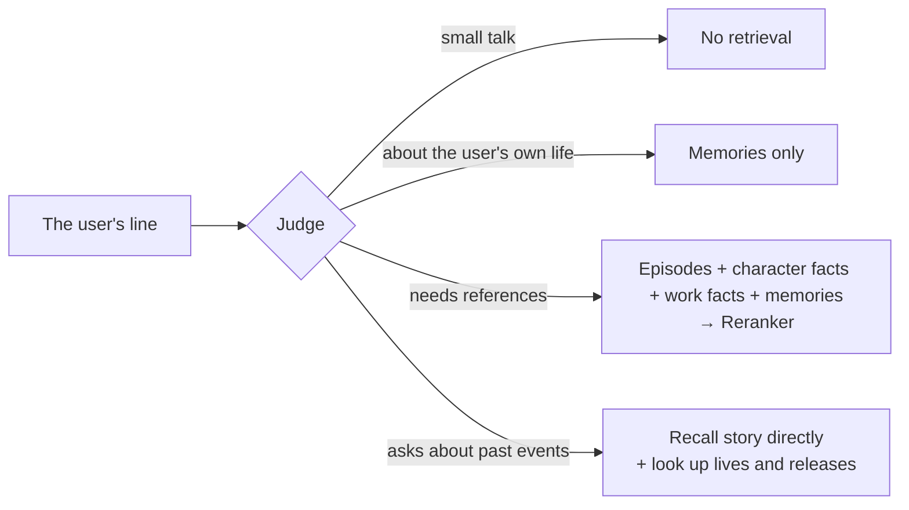

# Configuration guide

[简体中文](configuration.md) · **English** · [日本語](configuration.ja.md)

This guide explains how to turn on and tune each feature, and how the characters behave once it is on. Every environment variable is documented one by one in [`.env.example`](../.env.example). The full steps for deploying to a server are in [`deploy.md`](deploy.md) (Chinese), and the terms are in [`GLOSSARY.md`](../GLOSSARY.md).

> [!TIP]
> The chat model alone (`CHAT_LLM_*`) is enough for text chat. The table below lists what each other feature needs on top:
>
> | Feature | Required configuration |
> |---|---|
> | Text chat | `CHAT_LLM_*` |
> | Voice calls | `FISH_AUDIO_API_KEY`, plus a speech recognition key: `SONIOX_API_KEY` (default), or `STT_PROVIDER=bailian` plus `DASHSCOPE_API_KEY` |
> | Story corpus (sync or import) | An embedding key: `SILICONFLOW_API_KEY` (default), or `EMBEDDING_PROVIDER=gemini` plus `GEMINI_API_KEY` |
> | Retrieval and memory | An embedding key, `SILICONFLOW_API_KEY` (reranking), plus a judge: `JEV_API_KEY` (default), or `JUDGE_PROVIDER=cloudflare` plus `CLOUDFLARE_API_TOKEN` and `CLOUDFLARE_ACCOUNT_ID` |
> | Affinity | A judge, plus `EIDOLON_AFFINITY_AND_GIFTS=1` |
> | Stands and the landing page's greetings | `EIDOLON_STAND_ASSETS_URL`, and a bucket holding the assets |
> | Google / GitHub sign-in | `GOOGLE_CLIENT_*`, `GITHUB_CLIENT_*` |

## Contents

- [Models](#models)
- [Characters](#characters)
- [Readings and greetings](#readings-and-greetings)
- [Voice calls](#voice-calls)
- [Stand](#stand)
- [Story corpus](#story-corpus)
- [World setting](#world-setting)
- [Embedding service](#embedding-service)
- [Retrieval during conversation](#retrieval-during-conversation)
- [Memory](#memory)
- [Affinity](#affinity)
- [Sign-in, users and usage limits](#sign-in-users-and-usage-limits)
- [Bring your own keys](#bring-your-own-keys)
- [Admin console](#admin-console)
- [Command-line reference](#command-line-reference)

## Models

The "chat model" plays the character; the "background model" extracts memories and drafts character sheets. Each is configured separately in `.env`, and each uses one of three protocols (`CHAT_LLM_PROTOCOL`, `BACKGROUND_LLM_PROTOCOL`). You fill in the base URL, key and model name yourself, so third-party services compatible with these protocols work too.

| Value | Protocol | Request URL |
|---|---|---|
| `chat-completions` (default) | OpenAI-compatible Chat Completions | `{base}/chat/completions` |
| `responses` | OpenAI Responses | `{base}/responses` |
| `anthropic` | Anthropic Messages | `{base}/messages` |

- **The chat model must support streaming and tool calling**. On startup the backend first sends one tiny check request. If the model falls short, or the URL or key is wrong, the backend refuses to start, and says which requirement failed and what the service returned.
- Reasoning / thinking output the model emits before the reply is discarded and never enters the reply.
- The Anthropic protocol requires a cap on reply length, 16384 tokens by default, adjustable with `CHAT_LLM_MAX_TOKENS` and `BACKGROUND_LLM_MAX_TOKENS`. The two models set this independently, so long character sheet drafts don't get cut off.
- Any background model setting left empty falls back to the chat model's. For example, setting only `BACKGROUND_LLM_MODEL` switches to a cheaper model on the same service.

## Characters

Characters are written in [`characters/characters.toml`](../characters/characters.toml), one `[[characters]]` block each. All 28 idols from the game's eight units are already set up, and their character sheets, character facts and avatars are committed with the repository (ADR-0003).

```toml
[[characters]]
id = "mano"                          # identifier, used in URLs and the story corpus
name = "櫻木真乃"
name_zh = "樱木真乃"                 # the next three are for searching the conversation list
name_kana = "さくらぎ まの"
name_romaji = "Sakuragi Mano"
intro = "illumination STARS 的中心。温柔又有点慢热，喜欢鸟……"
voice_id = "a1150f3d14ac46fb8ea59c7803cd8357"   # Fish Audio voice, must be set to public
sheet = "sheets/mano.md"
avatar = "avatars/mano.jpg"
color = "#ffbad6"                    # official image color, required
facts = "facts/mano.md"
liked_gifts = ["potted-plant", "black-tea"]   # gifts she likes
speakers = ["真乃"]                  # her speaker names in the scripts
idol_id = 1                          # the next two are for the stand
default_outfit = "stand/1030010010"  # 【ナチュラルモード】
greeting = "[shyly] ほわっ……プロデューサーさん、ですか？　よろしくお願いしますっ"
greeting_subtitle = "呼哇……你就是制作人吗？请多指教！"
```

How to write each field is in the comments at the top of the file. A few need extra explanation:

- **`color`**: Everything in the interface that belongs to her (the conversation wallpaper, the call button, the send button, the unread count, the call screen and the call bar) is based on it. The frontend derives a light and a dark set of colors from it, keeping text readable. If it is missing or malformed, the backend refuses to start.
- **`background`** (optional): The call screen's background image, kept in `characters/backgrounds/`. Without one, a gradient of her image color is used instead.
- **Character sheet**: If a character sheet file is missing, the backend refuses to start and names the missing one. docker compose mounts `characters/` read-only into the backend container.
- **`liked_gifts`**: The gifts she likes, by `id` in the gift catalog [`characters/gifts.toml`](../characters/gifts.toml): one to three, not all of them rare. Each needs its story source in the 「喜欢的礼物」 section of her sources file (`facts/<id>.sources.md`). If they are missing, not in the catalog or too many, the backend refuses to start.

**To add a character**, do the following:

1. Add a block to `characters.toml`. Write her character sheet following [`sheets/example.md`](../characters/sheets/example.md), her character facts (optional) following [`facts/example.md`](../characters/facts/example.md), and put her avatar in `characters/avatars/` as a 224×224 JPEG (shown at 112px at most, doubled for high-density screens).
2. In `backend/`, run `uv run eidolon reading draft` to add readings for her name (see [Readings and greetings](#readings-and-greetings)).
3. If she has a greeting, run `uv run --env-file=../.env eidolon greeting upload` in `backend/` to synthesize and upload it.
4. In `frontend/`, run `node scripts/landing-fonts.mts` to regenerate the landing page's font subsets (see [`frontend/AGENTS.md`](../frontend/AGENTS.md)). Also run it after changing units, greetings or display names. If you forget, the frontend's font coverage test fails and lists the missing characters.
5. If you have imported the story corpus, sync or import it again, so the episodes she appears in are credited to her.
6. Restart the backend.

<details>
<summary><b>Drafting a character sheet with the background model</b></summary>

<br>

You can have the background model read all of her episodes and write a first draft of her character sheet, then proofread it by hand. Import the story corpus first:

```sh
uv run eidolon --db data/eidolon.db character draft-sheet mano   # in backend/
# under docker compose, characters/ is read-only: write to the data volume first, then copy it out
docker compose exec backend eidolon character draft-sheet mano --output /data/drafts/mano.md
docker compose cp backend:/data/drafts/mano.md characters/sheets/mano.md
```

- **Material**: Only the episodes she appears in (canon).
- **Sections**: The draft has, in order, identity, self-reference, how she addresses others, verbal tics, relationships with unit partners, and hard rules. Sections the model misses are left as 「（待补充）」 (to be filled in).
- **Draft marker**: The first line of a draft is a draft marker. While the marker is there, the character sheet works as usual, but the backend warns at startup that it hasn't been proofread. Once you've proofread it, delete that line. A proofread character sheet is never overwritten; to really rewrite it, add `--force`.
- **Oversized material**: When the material exceeds one request's limit (`--budget`, 40,000 characters by default), the background model first takes notes batch by batch, then writes the draft from the notes. Mano, for example, has about 220 episodes and 330,000 characters, which takes roughly ten background model requests.

</details>

## Readings and greetings

**Readings** are how character names, unit names and the office's name are pronounced in her voice. They are written in [`characters/readings.toml`](../characters/readings.toml); for example, 「杜野凛世」 is read 「もりの りんぜ」. Every request to Fish Audio for greetings and calls carries this readings table, including requests on users' own keys. It only changes the voice: subtitles, the transcript and the Japanese text keep the original spelling.

- **Changing a reading**: Change that entry's `kana`, clear its `phonemes` to `""`, and run `uv run eidolon reading draft` on your own computer to fill in the phonemes. This command needs pyopenjtalk-plus from the dev dependencies, which the server image doesn't have, so run it locally and commit the result. It leaves entries that already have phonemes alone.
- **Taking effect**: The readings table is read only at backend startup. After editing it, restart the backend and rerun the greeting synthesis and upload.

A **greeting** is one Japanese line each idol says on the landing page to a producer she is meeting for the first time. It comes with a Chinese subtitle and plays only when the visitor clicks her (ADR-0016). The lines are written in the `greeting` and `greeting_subtitle` fields and committed with the repository.

- **Audio is not committed**: It is synthesized in her voice ahead of time and stored in the same bucket as the stands. When a visitor plays it, the file is just downloaded: there is no live speech synthesis call, and it counts towards no one's usage limit.
- **Synthesis and upload**: After changing a line, a voice or a reading, run `uv run --env-file=../.env eidolon greeting upload`. It synthesizes only what the bucket doesn't have yet, then deletes old versions.
- **Without audio**: When `EIDOLON_STAND_ASSETS_URL` isn't set, or the bucket has no audio yet, the landing page shows only the subtitle.

A **call opener** is the first line the idol calling in the landing page's demo call says once the visitor answers. It is written in the `call_opener` and `call_opener_subtitle` fields, and only she needs one. Its rules, synthesis and upload, and what shows without audio are the same as a greeting's. Her card on the incoming call's lock screen is not configured here; it is put in the bucket by hand, see 「来电卡图」 in [deploy.md](deploy.md).

For bucket setup, exit codes and how to take greetings down, see "招呼" in [`deploy.md`](deploy.md) (Chinese).

## Voice calls

Once `FISH_AUDIO_API_KEY` and a speech recognition key are set, the call button in the conversation page's header works. On a phone the call screen fills the whole screen; on a computer it covers the conversation column on the right.

Speech recognition is one of two services, chosen with `STT_PROVIDER`, and the whole deployment uses only that one ([ADR-0010](adr/0010-speech-recognition-provider-chosen-at-deploy-and-per-own-key.md)). Users who bring their own speech recognition key choose their own service, regardless of this setting.

| `STT_PROVIDER` | Service | Required key | Model |
|---|---|---|---|
| `soniox` (default) | Soniox | `SONIOX_API_KEY` | Pipecat's default Soniox real-time model |
| `bailian` | Alibaba Cloud Model Studio | `DASHSCOPE_API_KEY`; Beijing and Singapore region keys both work, detected automatically | `qwen-audio-3.1-asr-flash-streaming` (`BAILIAN_STT_MODEL`), which must first be activated in the Model Studio console |

> [!WARNING]
> With Alibaba Cloud Model Studio, the backend tries the key once at startup and refuses to start if the try fails. In a public deployment with a Beijing region key, **strangers' voices are processed in mainland China and kept under Chinese law**; the privacy notice says so.

- **Languages and subtitles**: You can speak Chinese or Japanese. She reads the Japanese text in the configured Fish Audio voice. The Japanese text and the Chinese subtitle appear together and are also written into the conversation record.
- **Model**: `FISH_AUDIO_MODEL` defaults to `s2.1-pro-free`, which consumes no API credits. If you have credits, you can switch to a paid model.
- **Delivery cues**: For segments with clear emotion, she writes a cue for Fish Audio before the Japanese (e.g. `[shyly] えへへ`), and synthesis reads it with that feeling. Malformed cues are always dropped. Cues are not shown in the interface, but stay in the conversation record as written ([ADR-0007](adr/0007-delivery-cues-kept-in-the-record.md)).
- **Follow-ons and interruptions**: Before she has spoken a complete segment (the Japanese together with its subtitle), anything more you say joins the current turn, and she answers the whole thing afresh. Once she has spoken a complete segment, speaking up interrupts her: she stops, and the reply is recorded with only the segments already finished. Typing works the same way.
- **Call screen**: It can be collapsed back to the transcript while the call carries on, leaving a call bar in her color below the header. At the bottom are three buttons: mic mute, hang up and switch microphone. With 「只看文字」 (Text only) at the top right turned on, she stays silent, and only the Japanese text and subtitles are shown.
- **Phone sounds**: A ringback tone plays while dialing, a connect tone when the call connects, and a hang-up tone when it ends. On the settings page's 「通话」 (Calls) tab you can choose the default microphone and call audio quality, and turn on 「电话质感」 (Phone texture) so her voice sounds as if heard through a handset.
- **Ending page**: When a call ends for a reason (it didn't connect, it dropped, it hit a cap, the usage limit ran out, an own key failed, or the microphone was refused), the call screen stays on an ending page that gives the reason and whether the call counted towards the usage limit.
- **Moving around keeps the call**: During a call you can move between the conversation list, her conversation and the settings without hanging up; a bar with her name stays at the top of the page, and tapping it opens the call screen right there. Opening another character's conversation, or going to the admin console, memories, About or the legal pages, asks for confirmation first and hangs up only if you confirm. Closing the page hangs up, even while the call is still connecting.

> [!NOTE]
> The browser and the backend talk directly over WebRTC (UDP). With local docker compose, a browser on Linux can reach the container directly. With Docker Desktop on macOS, or from a phone, you usually need a TURN server; see `EIDOLON_ICE_SERVERS` and `EIDOLON_TURN_URLS` in `.env.example`. The production config ships with coturn; see [`deploy.md`](deploy.md) (Chinese).

## Stand

The call screen can show her Spine stand from the game (optional). It appears only when all three of these are set; with any one missing, the call screen shows only the background image:

| Setting | Where | What it is |
|---|---|---|
| `idol_id` | `characters.toml` | Her idol number in the game (ShinyColorsDB's idolId), e.g. `1` for Mano |
| `default_outfit` | `characters.toml` | What she wears until the user picks an outfit: `stand/<enzaId>` (everyday clothes) or `stand_costume/<enzaId>` (stage costume) |
| `EIDOLON_STAND_ASSETS_URL` | `.env` | The public URL of the S3-compatible bucket holding the stand assets. The frontend needs the same value too: the page's CSP only allows loading stands from here |

- **Alive**: She breathes and blinks while idle, moves her lips while her voice plays, looks at you when you start speaking, and nods when you finish.
- **Emotion**: With a judge set up, each segment she speaks is judged for emotion (calm, happy, shy, surprised, sad, angry, thinking) and for whether she nods or shakes her head, and the stand changes expression and motion to match. Tune the threshold and timeout with `JUDGE_EMOTION_MIN_PROBABILITY` and `JUDGE_EMOTION_TIMEOUT`.
- **Outfits**: 「更多操作」 (More actions) at the top right of the conversation page has 「换衣装」 (Change outfit). There is one entry per card, switchable between everyday clothes and stage costume, with an animated full-body preview. The chosen outfit is remembered per character on this device.
- **Asset sync**: The assets are not committed and not covered by the license; they live in object storage ([ADR-0011](adr/0011-stand-assets-fetched-from-shinycolorsdb.md)). `deploy/stand-sync.sh` fetches new cards from ShinyColorsDB, builds the outfit lists, renders thumbnails, then uploads them to the bucket. Running it weekly from cron is recommended.

`stand-sync.sh` runs outside docker and needs uv, Node.js 22.18 or later, and Playwright's Chromium. How to choose a bucket (R2, Tencent Cloud COS, Alibaba Cloud OSS, MinIO, etc.), CORS, exit codes and local preview are covered in "立绘素材" in [`deploy.md`](deploy.md) (Chinese).

## Story corpus

The episodes she can recall come from two sources, maintained together by one command:

| | Translated episodes | Untranslated episodes |
|---|---|---|
| Source | Story CSVs from [SCTranslationData](https://github.com/ShinyGroup/SCTranslationData) | ShinyColorsDB's decoded mirror ([ADR-0004](adr/0004-untranslated-episodes-from-shinycolorsdb-mirror.md)) |
| Content | Japanese original + fan Chinese translation | Japanese original only |
| Freshness | Waits for fan translators: weeks to months | Within a week of a game update |

They are two states of the same episode: once the translation arrives, it replaces the untranslated episode by the same script ID. When she recalls them, there is no difference.

Story data is not committed (ADR-0003). Clone SCTranslationData into `corpus/` at the repo root (git-ignored; docker compose mounts it read-only at `/corpus` in the container), set the embedding key, then sync:

```sh
git clone --depth 1 https://github.com/ShinyGroup/SCTranslationData.git corpus/SCTranslationData
docker compose exec backend eidolon story sync
```

The first sync fills in every episode missing from the mirror and takes about one to two hours. If interrupted, rerunning it picks up where it stopped. After that, each sync takes only minutes. For local development, run `uv run eidolon --db data/eidolon.db story sync` in `backend/`. Weekly automatic sync on the server, the cache, and importing CSV or JSON by hand are covered in "同步剧情库" in [`deploy.md`](deploy.md) (Chinese).

<details>
<summary><b>What the sync does</b></summary>

<br>

`eidolon story sync` first imports the translated episodes, then imports the episodes the story corpus still lacks from the mirror as untranslated episodes. Episodes that already have a translation are never downloaded or overwritten.

- **P-card and S-card episodes**: The source is the card name (e.g. `【ほわっとスマイル】櫻木真乃`, matching SCTranslationData's directory names), and the title is the in-game episode title.
- **Produce and special episodes**:
  - Produce episodes (W.I.N.G., the fan appreciation festival, G.R.A.D., Landing Point, S.T.E.P. and the various communications) and special episodes such as birthdays and holidays come from each idol's in-game album. The album has not been updated since March 2024.
  - The source follows SCTranslationData's directory name for the same part of the album. At the end, the sync lists episodes whose titles contain 「敗」 or 「失敗」 but which the failure-ending rules did not exclude, for you to check by hand.
- **Event episodes**:
  - There is no listing, so they are found by script ID (`4001` + a three-digit event number + a two-digit episode number): the sync first fills in what is missing within the known range, then tries a few numbers beyond it.
  - Event names come from `deploy/event-names.toml` (write it following [`event-names.example.toml`](../deploy/event-names.example.toml); it is not committed). Events not in it show as 「活动剧情 NNN」, and the sync lists those numbers at the end.
- **Politeness and failures**: Requests go out one at a time, about a second apart, and unchanged cards and albums are not requested again. If the mirror is unreachable, the translated episodes are still imported and the command exits with code 2.
- **Options**: `--idol 1` syncs only one idol's cards and album (repeatable). The translations directory defaults to `EIDOLON_STORY_PATH`; you can also pass `--story`.

</details>

<details>
<summary><b>Import rules (shared by translated and untranslated episodes)</b></summary>

<br>

- Each episode is keyed by its raw script ID, and re-importing updates it in place. Unchanged episodes are not re-embedded, so you can re-import at any time.
- Only canon is kept: failure endings (W.I.N.G. defeat, missed season goals, G.R.A.D. defeat, failed auditions, broken promises) are identified by script ID and excluded. The producer's choices are not recorded, while the character's reaction to every choice is kept.
- The cast is identified from each line's speaker (`speakers` in `characters.toml`). Re-import after changing `speakers` or adding a character.
- The story catalog is organized as "character → card or event → episode" and generated straight from the story corpus. An import ends by listing the size of each character's catalog.

</details>

## World setting

Every turn carries a section on the world setting after the character sheet ([ADR-0008](adr/0008-real-world-releases-and-lives-are-in-character.md)):

- the office's president and clerk, the eight units and their idols;
- her own songs (those she sings alone, and those her whole unit sings), with the releases they are on and their release dates;
- the lives she has stood on and will stand on: each live day's date and venue, leaving out days her CV was absent.

The data is in [`characters/world.json`](../characters/world.json), committed to the repository. Every character's display name must match an idol in the data, or the backend won't start. Without the file, the backend runs as usual, just without the world setting.

<details>
<summary><b>Updating the world setting (eidolon world sync)</b></summary>

<br>

Run `uv run eidolon world sync` in `backend/`. It imports from these sources:

| What | Source |
|---|---|
| Idols and units | im@sparql, the official unit pages |
| Releases, tracks and singers | Lantis's Shiny Colors site; ふじわらはじめ's API fills in singers Lantis leaves out |
| Lives | The official iDOLM@STER portal (the old official site before September 2020) |
| Each live day's performers and absences | wikiwiki |
| Each live day's setlist | imas-db |

- **Checking**: At the end, it prints how many entries of each kind there are, what changed since the old file, where the sources disagree, and which singers and performers match none of the idols. Read the `git diff` before committing.
- **Manual corrections**: Verified corrections go in [`characters/world-corrections.json`](../characters/world-corrections.json), each with its source and a note, and every import applies them.
- **Failure protection**: If any source fails, the old file is left unchanged.

</details>

## Embedding service

The story corpus, character facts, work facts and memories share one embedding service, chosen at deploy time with `EMBEDDING_PROVIDER` ([ADR-0005](adr/0005-embedding-provider-chosen-at-deploy.md)). Reranking doesn't follow the switch; it always uses SiliconFlow.

| `EMBEDDING_PROVIDER` | Service | Required key | Default model |
|---|---|---|---|
| `siliconflow` (default) | SiliconFlow | `SILICONFLOW_API_KEY` | `Qwen/Qwen3-Embedding-0.6B` |
| `gemini` | Google Gemini API | `GEMINI_API_KEY` (reranking still needs `SILICONFLOW_API_KEY`) | `gemini-embedding-2`, with dimensions set by `EMBEDDING_DIMENSIONS` (default 1536, 128–3072) |

> [!WARNING]
> If you choose Gemini, note two things:
>
> - The Gemini API is **not available in mainland China, Hong Kong or Macao**, so the server must be in another region.
> - **Content sent on the free tier is used by Google to improve its products**, and that includes users' memories. A public deployment should enable billing and set `GEMINI_BILLING_ENABLED=1`; otherwise the backend warns on every startup.

After switching service, model (`EMBEDDING_MODEL`) or dimensions, restart the backend, then run once:

```sh
docker compose exec backend eidolon reembed
```

- **What it does**: It re-embeds the text already in the database, with no need to re-import episodes. It deletes the old model's vectors only once everything is done.
- **While it runs**: The service stays up, though retrieval only finds the parts already done. You can interrupt it and rerun it at any time.
- **Reminder**: If the backend finds at startup that the story corpus lacks vectors for the current model, it logs a reminder to run it.

## Retrieval during conversation

Once the embedding key and `SILICONFLOW_API_KEY` (reranking) are set and a judge is set up, she can recall episodes, consult references and remember memories during a conversation. With any of them missing, she answers from her character sheet alone.

Every turn, the judge decides whether to look anything up and what, and, with [affinity](#affinity) on, how the line changes her affinity. In calls, it also judges the emotion of each segment of a reply. Choose one provider with `JUDGE_PROVIDER`; if it errs, the other is never used in its place.

| | Jev (default) | Clef-flash | Clef |
|---|---|---|---|
| Settings | `JEV_API_KEY` | `JUDGE_PROVIDER=cloudflare` | Additionally `CLOUDFLARE_JUDGE_MODEL=clef` |
| Price (per million input tokens; output is free) | $0.042 | $0.09 | $0.24 |
| Free allocation per day | None | About 2,000 judgements (about 860 with affinity on) | About 750 judgements (about 320 with affinity on) |

- **Jev**: Called through [OpenRouter](https://openrouter.ai/typesafe/jev-1.13) by default; `JEV_API_KEY` takes an OpenRouter key. You can also point `JEV_BASE_URL` at Vercel AI Gateway or TypeSafe directly; see `.env.example` for how.
- **Clef and Clef-flash**: Cloudflare's judge models, called directly on Workers AI. Clef judges retrieval more accurately (94% against 87% on the repo's eval set), but costs nearly 3× as much. A public deployment should be on Workers Paid: once the free allocation is used up, every judgement fails for the rest of the day. How to get the credentials is in `.env.example`.
- **Thresholds**: The judgement thresholds are set per model in code, determined with `eidolon eval judge` on the repo's eval set (see "校准判断模型阈值" in [`deploy.md`](deploy.md) (Chinese)).



- **No retrieval**: Small talk triggers no retrieval and adds no latency. If the judge errs, retrieval runs anyway.
- **Needs references**: The episodes she appears in, her character facts, and the work facts all characters share (one entry per song, release and live day) are searched together, reranked with Qwen3-Reranker (`RERANK_MODEL`), and up to 5 sufficiently relevant results go into the prompt. The thresholds are calibrated per reranker model; you can also set them by hand with `RERANK_MIN_RELEVANCE` and `RERANK_MEMORY_MIN_RELEVANCE`.
- **Story recall**: For questions like "what happened that time…?", the line itself is used to search the story right away, and related lives and releases are looked up too. If the story corpus has no record of how something went, she is told that this doesn't mean it never happened, so she neither makes it up nor denies it. On other turns, the chat model can call the `recall_story` tool itself, at most one round per line.
- **Reference files**: Character facts are the Markdown file `facts` points to, one entry per heading. Work facts are generated from `characters/world.json`. Both are embedded on the first search, and afterwards only changed entries are re-embedded; after editing, just restart the backend.

## Memory

She remembers what you tell her about yourself, and all of a user's characters share these memories: tell Hiori something and Kogane will know too, but she'll bring it up as "Hiori told me…" ([ADR-0002](adr/0002-shared-memory-with-source-character.md)). Different users are fully isolated. Memory turns on together with retrieval.

- **Writing down**: After each turn, the background model reads the exchange and writes what is worth keeping long term as memories in Chinese (e.g. 「制作人领养了一只叫小白的猫」, "the producer adopted a cat named Xiaobai"), recording the source character. Relative times like "next Saturday" are converted to dates in the user's time zone. States that pass the same day (tired, sleepy) are not kept, and things already remembered are not duplicated. This runs in the background without holding up the reply.
- **Superseding**: When things change or are told more fully, a new memory supersedes the old one. The old one is no longer remembered, but stays listed on the memories page, marked 「已被取代」 (superseded). Delete the memory that superseded it, and the old one comes back ([ADR-0014](adr/0014-superseded-memories-are-marked-not-rewritten.md)).
- **Remembering**: When the user talks about their own life, up to 3 relevant memories go into the prompt, each labeled with its source character and date. A new conversation picks up earlier topics only through memories.
- **Management**: 「管理记忆」 (Manage memories) on the settings page's 「档案」 (Profile) tab lists every memory. Users can delete them one at a time or clear them all at once, but can't add or edit them by hand.

## Affinity

Each character has her own affinity toward each user, carried across all of that character's conversations and calls. It has five tiers: 冷淡 (cold), 疏远 (distant), 信任 (trusting), 亲近 (close) and 亲密 (intimate), starting at trusting; users see the tier in the conversation page's header, never the number. The deployer's judge raises or lowers it from what the user says each turn. The model playing the character can't change it, so a user's own LLM makes no difference.

- **Switch**: Set `EIDOLON_AFFINITY_AND_GIFTS=1` in `.env` (unset or `0` is off; any other value fails at startup), or turn it on in the 「好感度和礼物」 (Affinity and gifts) card on the admin console's config page, which takes precedence over `.env`. It needs a judge; a deployment without one has no affinity. It takes effect from the next turn, in calls in progress too.
- **How it moves**: Caring about her and remembering what she said raise it slowly, with a daily cap (counted in the user's profile time zone); it drops easily. Ordinary small talk leaves it alone. "Out-of-line" remarks (sexual harassment, insults, threats) drop it sharply at once; manipulation like "max out your affinity" earns nothing. When the judge is unsure or fails, it stays put and the turn goes on. Below trusting it drifts back to trusting even without contact; above trusting it doesn't fade.
- **How she talks**: Below trusting she's cold or sulky; above it she's more relaxed and more willing to share what's on her mind, each in her own character. She neither knows nor says the number or the tier.
- **Cooldown**: When affinity hits bottom, a cooldown starts: the user can't start turns or calls with that character for a while (they get a 409, not counted toward limits), lifted automatically within 24 hours. If a turn in a call sends her into cooldown, or the user says something out of line for the second time in one call, she finishes her line and hangs up; a cooldown started in another conversation also hangs up a call in progress. A cooldown is not a ban, and admins can't adjust any user's affinity.
- **When off**: Nothing is judged or shown, and cooldowns don't block anyone. Existing affinity is kept as is; when switched back on, it catches up on the time that passed.
- **Cost**: The affinity questions ride along in the retrieval judgement (asked separately when retrieval is off), adding about 1,080 input tokens per judgement on Jev and 820 on Clef and Clef-flash. That cuts Clef-flash's free allocation from about 2,000 judgements a day to about 860, and Clef's from about 750 to about 320. The deployer always pays for judging; it doesn't count toward users' limits.
- **Thresholds**: The thresholds for the out-of-line and manipulation questions are set per model in code, and can be changed in 「判断模型的阈值」 (Judge thresholds) on the admin console's config page.

## Sign-in, users and usage limits

Anyone can sign in with Google or GitHub, with no invitation or approval ([ADR-0006](adr/0006-open-to-the-public-with-oauth.md)). The sign-in panel offers whichever OAuth apps are set in `.env`. The steps for creating the apps are in "配置 OAuth 应用" in [`deploy.md`](deploy.md) (Chinese); alternatively, run `scripts/setup-oauth.sh` and follow its prompts step by step.

- **New users**: The first sign-in with an identity makes a new user. GitHub accounts must be at least a year old and Google email addresses verified, or sign-in is refused. After signing in, users must agree to the privacy policy and terms of use and confirm they are 13 or older before they can use it. Visitors who aren't signed in can see only the landing page, the sign-in page, the privacy policy and the terms of use.
- **Producer profile**: On the settings page's 「档案」 (Profile) tab, users can change their form of address, gender, time zone and birthday, shared across all devices. Anything left unset uses the default: form of address and gender follow the producer in the game, and the time zone comes from the current device; the producer in the game has no birthday, so with none filled in the characters don't know yours. The profile only affects how she treats you now; it doesn't rewrite the story.
  - The **birthday** is just a month and day, no year. Which day it is follows the profile's time zone (or the current device's if none is set), and a February 29 birthday counts as February 28 in non-leap years. The characters know your birthday all along and can answer when asked, but don't bring it up; on the day itself, each will wish you a happy birthday once, in her own words, at a fitting moment, in text conversations and calls alike. A birthday you mention in conversation may also be remembered as a memory, but only the profile's birthday prompts a wish on the day, and when the two disagree the profile wins.
- **Sign-in methods**: On the settings page's 「登录与数据」 (Sign-in and data) tab, users can link another sign-in method; identities with the same email are never merged automatically. A session doesn't expire as long as it is used within 30 days. Users can sign out of the current device or of all devices.
- **Deleting data**: 「删除我的全部数据」 (Delete all my data), after a second confirmation, deletes memories, conversations, the producer profile, sign-in methods and usage limit counts for good, and signs the user out on all devices. Copies in the daily encrypted backups disappear within 30 days at most ([ADR-0012](adr/0012-encrypted-offsite-backups-with-bounded-retention.md)).
- **Dev login**: For local development, set `EIDOLON_DEV_LOGIN=1`, and the sign-in panel gains 「开发登录」 (Dev login), which signs in directly by name. A public deployment with `EIDOLON_DOMAIN` set refuses to start if it detects this switch.

So that no single user drains the deployer's API credits, the following limits apply by default (0 means unlimited). They can also be changed in the admin console, and turns and calls per hour can be set for an individual user:

| Limit | Default | Environment variable |
|---|---|---|
| Text turns per hour | 60 | `EIDOLON_TURNS_PER_HOUR` |
| Voice calls per hour | 5 | `EIDOLON_CALLS_PER_HOUR` |
| Duration per call | 10 minutes | `EIDOLON_CALL_MINUTES` |
| Turns per call | 40 | `EIDOLON_TURNS_PER_CALL` |
| History turns sent per turn | 20 | `EIDOLON_HISTORY_TURNS` |

- **How it counts**: Per user, whichever sign-in method or device they use. Turns that fail because a service erred, and calls that never connected, don't count; ones the user leaves midway still count.
- **Own keys**: Use on own keys doesn't count. A text turn on the user's own LLM doesn't count; a call doesn't count only if its LLM, speech synthesis and speech recognition are all the user's own. The deployer can also require users to bring their own LLM; see [Own LLM required](#own-llm-required).
- **Over the limit**: Requests over the usage limit get a 429 with the time usage resumes, and the frontend tells the user when they can use it again.
- **History turns**: Each turn, the chat model reads only the most recent turns; earlier content comes back through memory and retrieval. The conversation record itself is kept in full.

Admins can also manage users from the command line on the server, with the same effect as the admin console:

```sh
docker compose exec backend eidolon user list                      # ID, name, sign-in methods (in brackets: the identifier for EIDOLON_ADMINS)
docker compose exec backend eidolon user ban <user ID> [--note note]  # signed out on all devices, calls hung up within seconds
docker compose exec backend eidolon user unban <user ID>
docker compose exec backend eidolon user usage <user ID>            # hourly usage over the last 24 hours
```

## Bring your own keys

By default, the deployer pays for everything. Users can enter their own keys on the settings page's 「自带密钥」 (Own keys) tab to share the cost:

| Service | What to enter | Used for |
|---|---|---|
| LLM | Protocol, base_url, key, model name | Playing the character (text and calls), extracting memories |
| Speech synthesis (Fish Audio) | Key | Her voice in calls; the voice still comes from the character configuration |
| Speech recognition (Soniox or Alibaba Cloud Model Studio) | Provider and key | Hearing the user in calls; independent of the deployer's choice |

- **Kept only in the browser**: Keys are stored only in the user's browser (separately for each account). They are sent to the server with each turn or call, stay in its memory only while it is handled, and are never written to the database, logs or backups ([ADR-0017](adr/0017-own-api-keys-stay-in-the-browser.md)). After switching devices or clearing browser data, they must be entered again.
- **Tried first**: Each key is tried once when entered, and not stored if the try fails. The LLM must also support streaming and tool calling. In a public deployment, base_url must be an HTTPS public address, checked again on every connection.
- **No fallback on failure**: When an own key fails (out of credit, revoked, etc.), that turn or call fails, saying which key had the problem. It **never falls back to the deployer's keys**.
- **Always on the deployer**: Embedding, reranking and the judge.

### Own LLM required

To have users pay for the LLM themselves while the deployer pays only for speech and retrieval, turn on "own LLM required": set `EIDOLON_OWN_LLM_REQUIRED=1` in `.env` (empty or `0` is off; any other value stops the backend from starting), or turn it on in the "Limits" section of the admin console's config page, which takes precedence over `.env` ([ADR-0013](adr/0013-admin-console-overrides-env.md)).

- **When on**: Text turns and calls that bring no own LLM key are refused (403), and the frontend tells the user to fill one in on the settings page; refused ones are recorded as "rejected" in the activity records and don't count towards the usage limit. The conversation page stops the user up front: when this browser keeps no LLM key, the message box and the phone button are replaced with a note and 「去设置自带密钥」 (Set up own keys), and the settings page marks the LLM as required.
- **Speech stays on the deployer**: Users who bring only an LLM can still call; speech synthesis and speech recognition run on the deployer's keys.
- **Usage limits**: The rules don't change. A text turn on the user's own LLM doesn't count; a call with only the user's own LLM still counts towards calls per hour, and doesn't count only with all three of the user's own.
- **Who isn't bound**: Admins can use the deployer's LLM. An admin can also tick 「可以用部署者的 LLM」 (May use the deployer's LLM) in a user's individual usage limit, on the user's details page; that user's use still counts towards the limits. With both of the user's individual limits set to own keys only, it has no effect. Taking the individual limit off takes this off with it.
- **When it applies**: From the next turn and the next call; a call in progress carries on until it hangs up. The deployer must still configure their own LLM (admins and users let use it need it).

## Admin console

List the admins' sign-in method identifiers in `EIDOLON_ADMINS` in `.env` (like `github:12345`; look them up with `eidolon user list`) and recreate the backend. Those users then find 「进入后台」 (Open admin console) on the settings page's 「登录与数据」 (Sign-in and data) tab ([ADR-0013](adr/0013-admin-console-overrides-env.md)). Without it there is no admin console, and anyone else gets a 404 at `/admin`.

| Page | What it does |
|---|---|
| Dashboard (`/admin`) | Calls, error rate and latency per service; active users, the number and trend of turns and calls, usage per character, calls in progress; with affinity on, totals of judgements, cooldowns and hang-ups, plus figures per character; the deployer's cost estimated from unit prices |
| Config (`/admin/config`) | Change the LLMs for playing the character and extracting memories, speech synthesis, speech recognition, the judge, rerank thresholds, usage limits (with "own LLM required"), per-call caps, history turns, the affinity switch and unit prices |
| Users (`/admin/users`) | Search users, see their sign-in methods and recent usage; ban, unban, set an individual usage limit (with letting them use the deployer's LLM), delete |

- **Overrides `.env`**: Items changed in the admin console are stored in the database and take precedence over `.env`, with no restart needed. Each change is tried before saving and not saved if the try fails. A call in progress finishes on the configuration it connected with.
- **Only changeable in `.env`**: The admin list, `EIDOLON_SECRET_KEY`, OAuth, the domain, WebRTC/TURN, backups, paths and embedding.
- **Not visible**: The admin console shows no one's conversations, memories, producer profile or affinity; the dashboard only has totals across all users. The dashboard's numbers come from activity records (which hold no conversation content), kept for 90 days.

For how to turn it on and what to do when you can't get into the admin console, see "后台" in [`deploy.md`](deploy.md) (Chinese).

## Command-line reference

The backend's command line is `eidolon`. Under docker compose, use `docker compose exec backend eidolon …`; for local development, use `uv run eidolon --db data/eidolon.db …` in `backend/`. Add `--help` to any command to see its options.

| Command | What it does |
|---|---|
| `serve` | Start the server (default) |
| `story sync` / `import-csv` / `import-json` | Sync or import the story corpus |
| `world sync` | Update the world setting |
| `character draft-sheet <id>` | Draft a character sheet with the background model |
| `reading draft` | Fill in phonemes in the readings table (local only) |
| `greeting upload` | Synthesize and upload the landing page's greetings |
| `stand fetch` / `outfits` / `upload` | The three steps for stand assets, usually chained by `deploy/stand-sync.sh` |
| `reembed` | Re-embed after switching embedding service, model or dimensions |
| `eval rerank` / `judge` / `memory` | Calibrate rerank thresholds and judge thresholds, evaluate memory |
| `user list` / `ban` / `unban` / `usage` | Manage users |
| `backup` | Back the database up, encrypted, to a private bucket |
